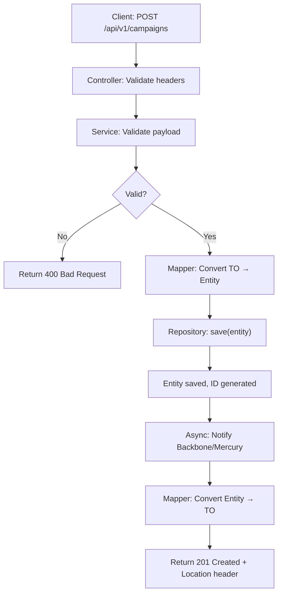
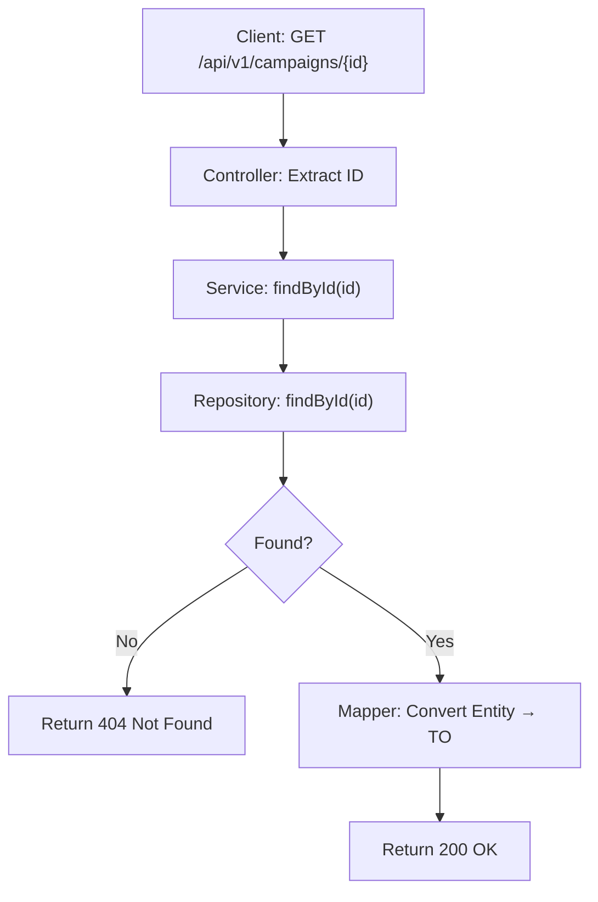
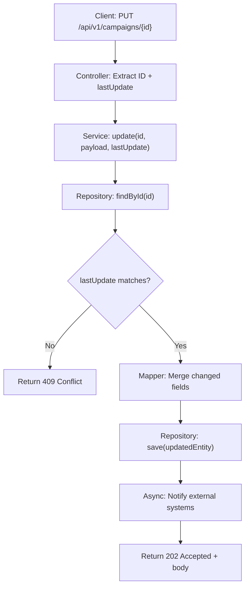
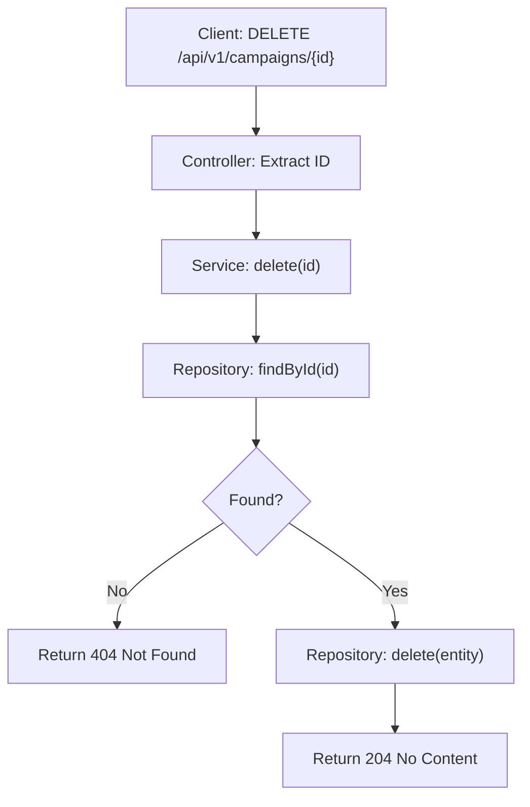
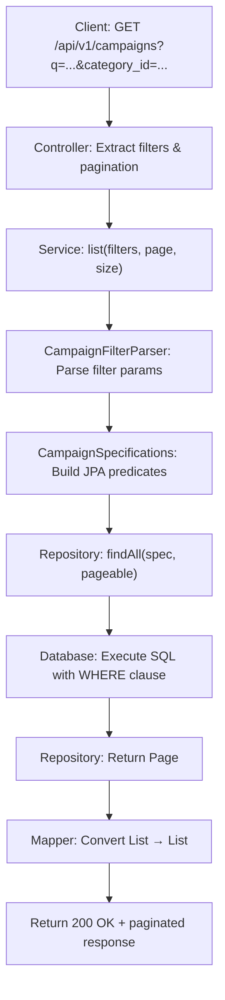

# Directory Backend - Comprehensive Project Documentation

**Version:** 0.0.1
**Last Updated:** March 2026
**Purpose:** REST API backend microservice for managing directory of businesses, campaigns, products, and users

---

## Table of Contents

1. [Executive Summary](#executive-summary)
2. [System Architecture](#system-architecture)
3. [Technical Stack](#technical-stack)
4. [Functional Overview](#functional-overview)
5. [Data Model](#data-model)
6. [API Structure](#api-structure)
7. [Process Flows](#process-flows)
8. [Integration Points](#integration-points)
9. [Database & Persistence](#database--persistence)
10. [Testing & Quality](#testing--quality)
11. [Configuration & Deployment](#configuration--deployment)
12. [Key Conventions](#key-conventions)

---

## Executive Summary

**Directory Backend** is a Spring Boot microservice that provides REST APIs for managing a directory platform. It handles:

- **Campaigns** - Marketing/promotional campaigns
- **Businesses** - Business entities and their profiles
- **Products** - Catalog of products
- **Users** - User accounts and authentication
- **Favorites** - User favorite products

The service follows a **layered architecture** (Controller → Service → Repository) and integrates with internal services (Backbone, Mercury) and messaging systems (Kafka).

### Key Features

✓ Full CRUD operations for all entities
✓ Advanced search and filtering with specifications
✓ Optimistic locking for concurrent updates
✓ Async notifications via Kafka
✓ OpenAPI/Swagger documentation
✓ 80%+ test coverage with JaCoCo
✓ Quality gates: SonarCloud + Qodana

---

## System Architecture

### High-Level Architecture Diagram

```
┌─────────────────────────────────────────────────────────────────┐
│                         CLIENT LAYER                             │
│                  (Web, Mobile, Third-party)                     │
└────────────────────────────┬────────────────────────────────────┘
                              │
                              ↓
┌─────────────────────────────────────────────────────────────────┐
│                   API GATEWAY / LOAD BALANCER                    │
│              (Spring Boot REST Controller Layer)                 │
└────────────────────────────┬────────────────────────────────────┘
                              │
                              ↓
┌─────────────────────────────────────────────────────────────────┐
│                    SERVICE LAYER (Business Logic)                │
│  - CampaignService, BusinessService, ProductService, UserService│
│  - Validation, Authorization, Status Management                 │
└────────────────────────────┬────────────────────────────────────┘
                              │
                ┌─────────────┼─────────────┐
                ↓             ↓             ↓
         ┌──────────┐ ┌──────────┐ ┌──────────────┐
         │ Repository│ │ Mappers  │ │ External     │
         │ (JPA)    │ │ (MapStruct)│ │ Clients      │
         └──────────┘ └──────────┘ └──────────────┘
                │               │          │
                ↓               ↓          ↓
         ┌──────────┐ ┌──────────┐ ┌──────────────────┐
         │PostgreSQL│ │Transform │ │ - Backbone       │
         │Database  │ │ DTOs     │ │ - Mercury        │
         │          │ │ <-> Ent. │ │ - Kafka Producer │
         └──────────┘ └──────────┘ └──────────────────┘
```

### Layered Request Flow

```
HTTP Request
    ↓
[*Controller] - Receives request, validates headers
    ↓
[*Api Interface] - Swagger/OpenAPI annotations
    ↓
[*Service] - Business logic, validation, authorization
    ↓
[*Repository] - JPA queries, database access
    ↓
[Database] - PostgreSQL persistence
    ↓
[Response Entity] - HTTP response with proper headers
    ↓
HTTP Response (201/200/202/204/4xx/5xx)
```

---

## Technical Stack

### Core Framework
| Component | Version | Purpose |
|-----------|---------|---------|
| **Java** | 25 | Programming language |
| **Spring Boot** | 4.1.2 | Application framework |
| **Spring Cloud** | 2025.1.4 | Cloud-native patterns, config server |
| **Maven** | 3.8.0+ | Build & dependency management |

### Data & Persistence
| Component | Version | Purpose |
|-----------|---------|---------|
| **PostgreSQL** | 42.7.7 | Primary relational database |
| **JPA/Hibernate** | (Spring Boot default) | ORM framework |
| **Spring Data JPA** | (Spring Boot default) | Repository abstraction |
| **Flyway** | (detected in migrations) | Database version control |

### APIs & Contracts
| Component | Version | Purpose |
|-----------|---------|---------|
| **SpringDoc OpenAPI** | 2.6.0 | Swagger/OpenAPI documentation |
| **Jackson** | (Spring default) | JSON serialization |

### Testing & Quality
| Component | Version | Purpose |
|-----------|---------|---------|
| **JUnit Jupiter** | 5.14.1 | Test framework |
| **Mockito** | 5.21.0 | Mocking framework |
| **JaCoCo** | 0.8.14 | Code coverage (80% target) |
| **SonarCloud** | Latest | Static code analysis |
| **Qodana** | Latest | JetBrains code inspection |

### Mapping & Utilities
| Component | Version | Purpose |
|-----------|---------|---------|
| **MapStruct** | 1.6.3 | DTO ↔ Entity mapping |
| **JWT (jjwt)** | 0.13.0 | JSON Web Token handling |
| **Google Gson** | 2.13.2 | JSON parsing |
| **Apache Commons Lang3** | 3.18.0 | Utility functions |

### Infrastructure
| Component | Version | Purpose |
|-----------|---------|---------|
| **Kafka** | (Spring Kafka) | Event streaming, outbound email |
| **Vault** | Detected | Secrets management |
| **Docker** | amazoncorretto:21-alpine3.23 | Container runtime |

---

## Functional Overview

### Core Entities

#### 1. **Campaign** 📢
- Marketing or promotional campaigns
- Linked to businesses
- Can include date ranges and category filters
- Search/filter support with legacy aliases (`q`, `category_id`, `business_id`, `start_date_*`, `end_date_*`)

#### 2. **Business** 🏢
- Organization/company profiles
- Parent entity for campaigns and products
- Contact and communication details

#### 3. **Product** 📦
- Catalog items
- Linked to businesses
- Searchable and filterable

#### 4. **User** 👤
- User accounts
- Authentication (JWT-based)
- Profile information
- Related to favorites and confirmed codes

#### 5. **User Favorite** ⭐
- Bookmarks/saved products for users
- Soft-delete support (has `deleted` field)
- Links user to product

#### 6. **Digital Contact** 📱
- Communication channels (email, phone, etc.)
- Associated with businesses or users

#### 7. **Timezone** 🕐
- Supported timezones
- Used for date/time handling

---

## Data Model

### Entity-Relationship Diagram (Conceptual)

```
┌──────────────────┐         ┌──────────────────┐
│    Business      │◄────────┤    Campaign      │
├──────────────────┤  1:N    ├──────────────────┤
│ id (PK)          │         │ id (PK)          │
│ name             │         │ name             │
│ description      │         │ business_id (FK) │
│ created_at       │         │ start_date       │
│ updated_at       │         │ end_date         │
│ deleted          │         │ category_id (FK) │
│ last_update      │         │ last_update      │
└──────────────────┘         └──────────────────┘
        │                             │
        │ 1:N                         │
        ↓                             │
┌──────────────────┐                 │
│    Product       │◄────────────────┘
├──────────────────┤
│ id (PK)          │
│ name             │
│ description      │
│ business_id (FK) │
│ created_at       │
│ updated_at       │
│ deleted          │
│ last_update      │
└──────────────────┘
        │
        │ 1:N
        ↓
┌──────────────────┐      ┌──────────────────┐
│ UserFavorite     │      │      User        │
├──────────────────┤      ├──────────────────┤
│ id (PK)          │◄─────│ id (PK)          │
│ user_id (FK)     │      │ username         │
│ product_id (FK)  │  1:N │ email            │
│ created_at       │      │ created_at       │
│ updated_at       │      │ updated_at       │
│ deleted          │      │ deleted          │
│ last_update      │      │ last_update      │
└──────────────────┘      └──────────────────┘
                                 │
                                 │ 1:N
                                 ↓
                          ┌──────────────────┐
                          │ DigitalContact   │
                          ├──────────────────┤
                          │ id (PK)          │
                          │ user_id (FK)     │
                          │ contact_type (FK)│
                          │ value            │
                          └──────────────────┘
```

### Key Database Fields

All entities include:
- `id` - Primary key (UUID or auto-increment)
- `created_at` - Timestamp of creation
- `updated_at` - Timestamp of last update
- `deleted` - Soft-delete flag (boolean)
- `last_update` - Version for optimistic locking

---

## API Structure

### API Endpoints by Domain

#### Campaign APIs (`/api/v1/campaigns`)
```
GET    /api/v1/campaigns              List campaigns (paginated, filtered)
POST   /api/v1/campaigns              Create new campaign
GET    /api/v1/campaigns/{id}         Get campaign by ID
PUT    /api/v1/campaigns/{id}         Update campaign (202 Accepted)
DELETE /api/v1/campaigns/{id}         Delete campaign
```

**Query Parameters:**
- `q` - Free-text search
- `category_id` - Filter by category
- `business_id` - Filter by business
- `start_date_from`, `start_date_to` - Date range filters
- `end_date_from`, `end_date_to` - Date range filters
- `page`, `size`, `sort` - Pagination

#### Business APIs (`/api/v1/businesses`)
```
GET    /api/v1/businesses             List businesses
POST   /api/v1/businesses             Create business
GET    /api/v1/businesses/{id}        Get business
PUT    /api/v1/businesses/{id}        Update business
DELETE /api/v1/businesses/{id}        Delete business
```

#### Product APIs (`/api/v1/products`)
```
GET    /api/v1/products               List products
POST   /api/v1/products               Create product
GET    /api/v1/products/{id}          Get product
PUT    /api/v1/products/{id}          Update product
DELETE /api/v1/products/{id}          Delete product
```

#### User APIs (`/api/v1/users`)
```
GET    /api/v1/users/{id}             Get user details
POST   /api/v1/users                  Create/register user
PUT    /api/v1/users/{id}             Update user profile
```

#### Favorites APIs (`/api/v1/favorites`)
```
GET    /api/v1/favorites              Get user's favorites
POST   /api/v1/favorites              Add product to favorites
DELETE /api/v1/favorites/{id}         Remove from favorites
```

### Request/Response Format

**Standard Success Response (200/201):**
```json
{
  "id": "uuid-or-id",
  "name": "Example",
  "createdAt": "2026-03-26T10:30:00Z",
  "updatedAt": "2026-03-26T10:30:00Z",
  "deleted": false,
  "lastUpdate": "2026-03-26T10:30:00Z"
}
```

**Paginated Response (List):**
```json
{
  "content": [
    { /* entity */ },
    { /* entity */ }
  ],
  "pageable": {
    "pageNumber": 0,
    "pageSize": 20,
    "sort": ["name,asc"]
  },
  "totalElements": 150,
  "totalPages": 8,
  "last": false
}
```

**Update Response (202 Accepted):**
```
HTTP/1.1 202 Accepted
Location: /api/v1/campaigns/123
X-Message-Header: Campaign updated successfully

{
  /* Updated entity payload */
}
```

**Error Response (4xx/5xx):**
```json
{
  "timestamp": "2026-03-26T10:30:00Z",
  "status": 409,
  "error": "Conflict",
  "message": "Resource lastUpdate does not match"
}
```

### Response Headers

- `X-Message-Header` - Custom message (per `DirectoryAppConstants.MESSAGE_HEADER`)
- `Location` - For 201 Created (resource URL)
- Standard HTTP headers

---

## Process Flows

### 1. Create Flow



### 2. Read Flow



### 3. Update Flow (Optimistic Locking)



### 4. Delete Flow



### 5. List/Search Flow with Filters



---

## Integration Points

### 1. **Backbone Integration** 🔗
- **Purpose:** External service integration
- **Client:** `BackboneClient.java`
- **Configuration:** `BackboneFeignConfigurer`
- **Usage:** Notify business/campaign changes
- **Type:** Feign HTTP client

### 2. **Mercury Integration** 📨
- **Purpose:** Communication/notification service
- **Client:** `MercuryClient.java`
- **Configuration:** `MercuryFeignConfigurer`
- **Usage:** Send notifications, alerts
- **Type:** Feign HTTP client

### 3. **Authentication/Security** 🔐
- **Service:** `AuthServiceImpl.java`
- **JWT Handling:** `SessionJwtServiceImpl.java`
- **Token Utility:** `JwtUtil.java`
- **Type:** OAuth/JWT-based authentication

### 4. **Kafka Messaging** 📤
- **Producer:** `EmailMessageProducerServiceImpl.java`
- **Purpose:** Async email notifications
- **Topics:** TBD (check Kafka configuration)
- **Format:** Kafka TO classes in `com.umdc.directory.kafka.to`

### 5. **Configuration Server** ⚙️
- **Bootstrap Config:** `bootstrap.yml`
- **Spring Cloud Config Server:** Central config management
- **Vault Integration:** Secrets management
- **Environment Variables:** Configured via `.env` files

---

## Database & Persistence

### Database Technology

- **Type:** PostgreSQL relational database
- **Driver:** PostgreSQL JDBC (42.7.7)
- **Access:** Spring Data JPA with Hibernate ORM

### Flyway Migrations

Database version control via Flyway migrations:

```
src/main/resources/db/migration/
├── V1__initial_schema.sql
├── V2__add_deleted_fields_user_favorite.sql
└── V3__future_migration.sql
```

**Recent Migrations:**
- `V2__add_deleted_fields_user_favorite.sql` - Added soft-delete support to user_favorite table

### Connection Management

- **Bootstrap Config:** `src/main/resources/bootstrap.yml`
- **Data Source:** Configured via Spring Cloud Config Server + Vault
- **SSL/TLS:** `DataSourceSslConfig.java` for secure connections
- **Certificates:** Stored in `src/main/resources/*.crt`

### Query Patterns

**1. Basic Find:**
```java
Optional<CampaignEntity> campaign = campaignRepository.findById(id);
```

**2. Paginated Search with Filters:**
```java
Page<CampaignEntity> page = campaignRepository.findAll(specification, pageable);
```

**3. Soft Delete:**
```java
entity.setDeleted(true);
repository.save(entity);
```

**4. Optimistic Locking:**
```java
if (!currentEntity.getLastUpdate().equals(requestLastUpdate)) {
    throw new OptimisticLockException("Version mismatch");
}
```

---

## Testing & Quality

### Test Structure

```
src/test/java/
├── com/prx/directory/
│   ├── api/v1/controller/         // Controller/API tests
│   ├── service/                   // Service layer tests
│   ├── jpa/repository/            // Repository tests
│   ├── mapper/                    // Mapper tests
│   └── kafka/                     // Kafka producer tests
```

### Test Configuration

**Profile:** `test` (configured in `src/test/resources/application-test.yml`)

**Key Characteristics:**
- ✅ H2 in-memory database (no PostgreSQL required)
- ✅ Vault disabled
- ✅ Config Server disabled
- ✅ Kafka mocked
- ✅ Security mocked

### Coverage Requirements

- **Minimum Line Coverage:** 80% at bundle level
- **Enforced by:** JaCoCo Maven plugin
- **Report Generation:** `mvn clean test jacoco:report` → `target/site/jacoco/index.html`

### Quality Gates

| Tool | Integration | Purpose |
|------|-------------|---------|
| **JaCoCo** | Maven plugin | Code coverage (80% target) |
| **SonarCloud** | GitHub Actions | Cloud-based static analysis |
| **Qodana** | GitHub Actions | JetBrains IntelliJ inspection engine |
| **PMD** | Maven plugin | Code smell detection |

### Key Test Commands

```bash
# Run all tests
mvn test

# Run single test class
mvn -Dtest=CampaignControllerTest test

# Run single test method
mvn -Dtest=CampaignControllerTest#listCampaignsReturnsOk test

# Generate coverage report
mvn clean test jacoco:report

# Run full CI verification
mvn -B -V -e clean verify
```

---

## Configuration & Deployment

### Local Development Setup

**Prerequisites:**
1. Java 25 (JDK)
2. Maven 3.8+
3. Docker (optional, for PostgreSQL/Kafka/Vault)
4. PostgreSQL 15+ or Docker container

**Steps:**

```bash
# 1. Clone repository
git clone <repo-url>
cd directory-backend

# 2. Copy environment file
cp default.env .env

# 3. Customize .env with local settings
# (Database, Vault, Kafka URLs, etc.)

# 4. Build without tests
mvn -DskipTests package

# 5. Run application
java -jar target/directory-backend.jar
```

### Configuration Files

| File | Purpose |
|------|---------|
| `bootstrap.yml` | Spring Cloud bootstrap (Vault, Config Server) |
| `application.yml` | Application-specific configuration |
| `default.env` | Local environment defaults (copy to `.env`) |
| `application-test.yml` | Test profile overrides |

### Environment Variables

Key variables from `default.env`:

```bash
# Database
SPRING_DATASOURCE_URL=jdbc:postgresql://localhost:5432/directory
SPRING_DATASOURCE_USERNAME=postgres
SPRING_DATASOURCE_PASSWORD=postgres

# Vault (Secrets)
VAULT_ENABLED=true
VAULT_HOST=vault.local
VAULT_TOKEN=s.xxxxx

# Config Server
SPRING_CLOUD_CONFIG_URI=http://config-server:8888

# Kafka
SPRING_KAFKA_BROKERS=localhost:9092

# Application
SERVER_PORT=8080
SPRING_PROFILES_ACTIVE=dev
```

### Docker Deployment

**Base Image:** `amazoncorretto:21-alpine3.23`

**Build:**
```bash
docker build -t directory-backend:latest .
```

**Run:**
```bash
docker run -p 8080:8080 \
  -e SPRING_DATASOURCE_URL=jdbc:postgresql://db:5432/directory \
  -e SPRING_DATASOURCE_USERNAME=postgres \
  -e SPRING_DATASOURCE_PASSWORD=postgres \
  directory-backend:latest
```

### CI/CD Pipelines

Located in `.github/workflows/`:

- **Code Quality:** `qodana_code_quality.yml` (JetBrains Qodana)
- **SonarCloud:** Integrated via GitHub Actions
- **Build & Test:** Standard Maven CI build

---

## Key Conventions

### API Contracts
✓ Keep `/api/v1/*` backward compatible unless explicitly breaking
✓ Update both `*Api.java` annotations AND `src/main/resources/api/index.yaml`
✓ Use standard HTTP methods: GET, POST, PUT, DELETE

### Update Operations
✓ Return `202 Accepted` (not 200 OK)
✓ Use `lastUpdate` field for optimistic locking
✓ Return `409 Conflict` on version mismatch

### Response Headers
✓ Include `X-Message-Header` per `DirectoryAppConstants.MESSAGE_HEADER`
✓ Include `Location` header for 201 Created

### Code Organization
✓ Controllers: thin, delegate to service
✓ Services: business logic, return `ResponseEntity`
✓ Repositories: JPA queries only
✓ Mappers: MapStruct-based, in `com.umdc.directory.mapper`
✓ Constants: in `com.umdc.directory.constant`

### Asset Security
⚠️ Do NOT modify certificates: `src/main/resources/*.crt`, `keystore.jks`
⚠️ Do NOT commit secrets: `default.env` is sensitive
⚠️ Always keep secrets in Vault/Config Server

### Testing
✓ JUnit 5 + Mockito
✓ Maintain 80% code coverage
✓ Test profile uses H2 (no external dependencies)
✓ Mock external clients in tests

---

## Project Structure

```
directory-backend/
├── .github/
│   ├── agents/              # AI agent definitions
│   ├── skills/              # Development skills
│   ├── tools/               # Development tools
│   ├── diagrams/            # Mermaid diagrams
│   └── workflows/           # CI/CD pipelines
├── src/
│   ├── main/
│   │   ├── java/com/prx/directory/
│   │   │   ├── api/v1/                 # Controllers & API interfaces
│   │   │   │   ├── controller/
│   │   │   │   └── to/                 # DTOs (Transfer Objects)
│   │   │   ├── jpa/
│   │   │   │   ├── entity/             # JPA entities
│   │   │   │   └── repository/         # Spring Data repositories
│   │   │   ├── service/                # Business logic
│   │   │   ├── mapper/                 # MapStruct mappers
│   │   │   ├── client/
│   │   │   │   ├── backbone/           # Backbone client
│   │   │   │   └── mercury/            # Mercury client
│   │   │   ├── kafka/
│   │   │   │   ├── producer/           # Kafka producer
│   │   │   │   └── to/                 # Kafka DTOs
│   │   │   ├── security/               # Auth & security
│   │   │   ├── config/                 # Configuration classes
│   │   │   ├── constant/               # Application constants
│   │   │   ├── util/                   # Utilities (JWT, etc.)
│   │   │   └── DirectoryBackendApplication.java  # Entry point
│   │   └── resources/
│   │       ├── bootstrap.yml           # Spring Cloud bootstrap
│   │       ├── api/
│   │       │   └── index.yaml          # OpenAPI spec
│   │       ├── db/migration/           # Flyway migrations
│   │       └── *.crt, keystore.jks     # SSL certificates
│   └── test/
│       ├── java/                       # Test classes
│       └── resources/
│           └── application-test.yml    # Test profile
├── pom.xml                             # Maven configuration
├── CLAUDE.md                           # Development guide
├── README.md                           # Project overview
├── default.env                         # Environment template
└── Dockerfile                          # Container definition
```

---

## Contact & Support

**Team:** um-dev-creative
**Knowledge Base:** https://prx.myjetbrains.com/youtrack/articles/DS-A-8/Directory-Backend
**Issue Tracking:** GitHub Issues (um-dev-creative/directory-backend)
**Primary Language:** English
**License:** See LICENSE file

---

## Appendix: Useful Commands

```bash
# Build
mvn -DskipTests package              # Build without tests
mvn -B -V -e clean verify            # Full CI build

# Testing
mvn test                             # Run all tests
mvn -Dtest=CampaignControllerTest test  # Single test class
mvn clean test jacoco:report         # Generate coverage report

# Run
java -jar target/directory-backend.jar  # Run application

# Quality
mvn clean verify                     # Full verification with quality gates
```

---

**End of Documentation**
For updates or clarifications, refer to the CLAUDE.md file or contact the development team.
