# directory-backend — Technical Documentation

> **Version:** 0.0.1 &nbsp;|&nbsp; **Java:** 25 &nbsp;|&nbsp; **Spring Boot:** 4.1.2 &nbsp;|&nbsp; **Spring Cloud:** 2025.1.4  
> **Last Updated:** April 19, 2026

---

## Table of Contents

1. [Project Overview](#1-project-overview)
2. [Technology Stack](#2-technology-stack)
3. [System Architecture](#3-system-architecture)
4. [Project Structure](#4-project-structure)
5. [Domain Model](#5-domain-model)
6. [API Reference](#6-api-reference)
7. [Request Flow](#7-request-flow)
8. [External Integrations](#8-external-integrations)
9. [Security Model](#9-security-model)
10. [Configuration & Bootstrap](#10-configuration--bootstrap)
11. [Messaging — Kafka](#11-messaging--kafka)
12. [Caching](#12-caching)
13. [Campaign Filter Engine](#13-campaign-filter-engine)
14. [Data Persistence Layer](#14-data-persistence-layer)
15. [Mapper Layer](#15-mapper-layer)
16. [Quality Gates & CI/CD](#16-quality-gates--cicd)
17. [Build & Run Guide](#17-build--run-guide)
18. [Environment Variables Reference](#18-environment-variables-reference)

---

## 1. Project Overview

**directory-backend** is a production-grade, cloud-native REST microservice that powers the **Directory Site** platform. It provides a centralized API for managing businesses, campaigns, products, categories, users, favorites, digital contacts, and timezones.

The service is designed as a **Spring Boot microservice** integrated into the PRX ecosystem via **Spring Cloud** service discovery, centralized configuration (Spring Cloud Config + HashiCorp Vault), and OAuth2 / JWT-based security.

### Key Capabilities

| Capability | Description |
|------------|-------------|
| 🏢 Business Registry | CRUD operations for business entities with profile image management |
| 📣 Campaign Management | Full lifecycle management with advanced filtered search and pagination |
| 🛍️ Product Catalog | Product creation, listing, and business-product linking |
| 📂 Category Management | Hierarchical category CRUD |
| 👤 User Management | User registration, profile updates, email confirmation flows |
| ⭐ Favorites | User favorites for stores, products, and offers |
| 📱 Digital Contacts | Business digital contact management |
| 🌍 Timezone Registry | Timezone collection with Redis-backed caching |
| 🔐 Auth Integration | OAuth2 resource server + cross-service JWT token relay |
| 📧 Email Notifications | Kafka-based outbound email messaging |

---

## 2. Technology Stack

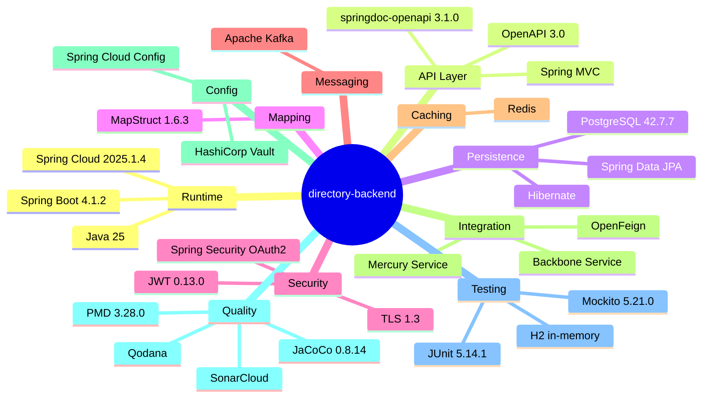

### Dependency Versions

| Library | Version | Purpose |
|---------|---------|---------|
| Spring Boot | 4.1.2 | Application framework |
| Spring Cloud | 2025.1.4 | Service discovery, config |
| Java | 25 | Runtime (LTS) |
| PostgreSQL Driver | 42.7.7 | Database connectivity |
| MapStruct | 1.6.3 | DTO ↔ Entity mapping |
| JWT (jjwt) | 0.13.0 | Token parsing and validation |
| springdoc-openapi | 3.1.0 | OpenAPI 3.0 documentation |
| JaCoCo | 0.8.14 | Code coverage enforcement |
| PMD | 3.28.0 | Static analysis |
| JUnit Jupiter | 5.14.1 | Unit/integration testing |
| Mockito | 5.21.0 | Mocking framework |
| JMH | 1.37 | Microbenchmarks |
| Commons Lang3 | 3.18.0 | Utility helpers |
| Gson | 2.13.2 | JSON serialization |

---

## 3. System Architecture

### High-Level Context

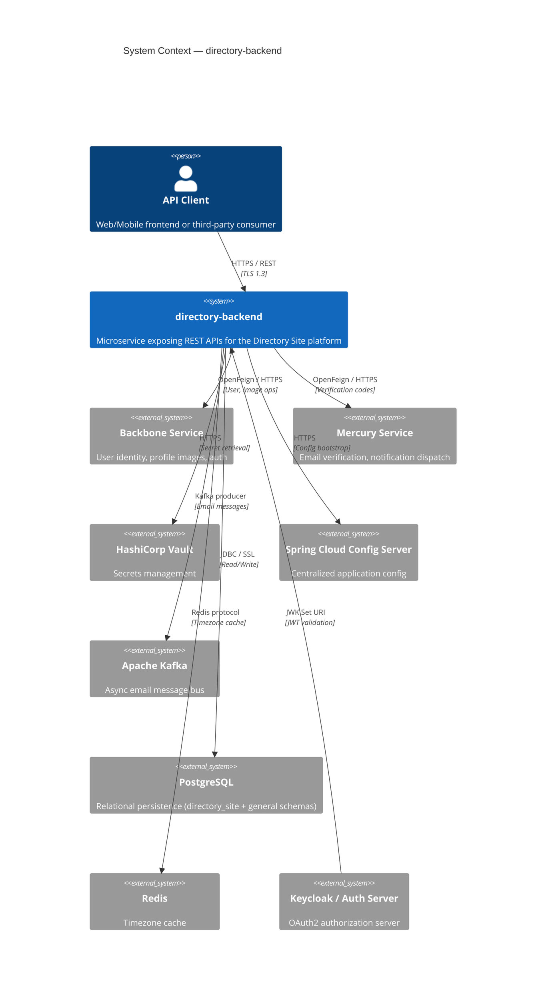

### Internal Layered Architecture

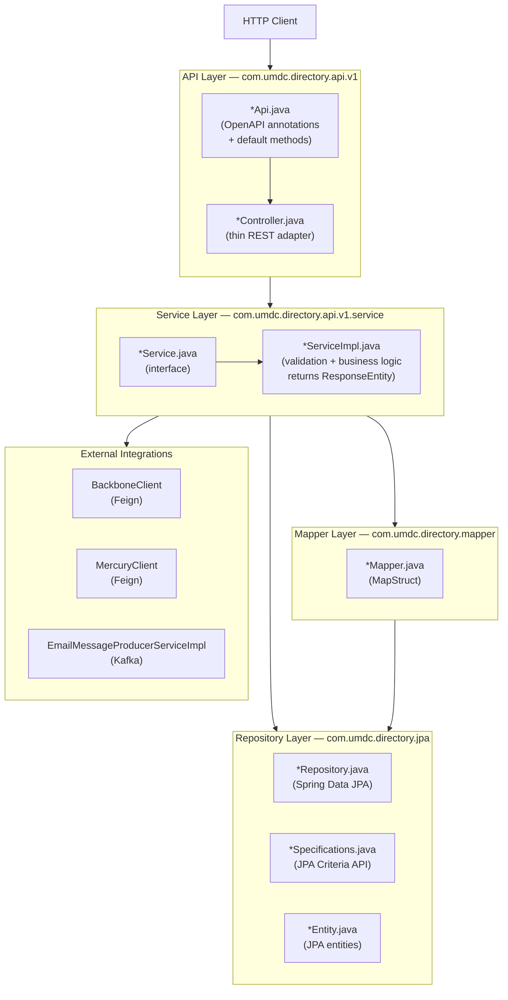

---

## 4. Project Structure

```
directory-backend/
├── src/
│   ├── main/
│   │   ├── java/com/prx/directory/
│   │   │   ├── DirectoryBackendApplication.java        ← Entry point
│   │   │   ├── api/v1/
│   │   │   │   ├── controller/                         ← *Api.java + *Controller.java
│   │   │   │   ├── service/                            ← *Service.java + *ServiceImpl.java
│   │   │   │   └── to/                                 ← DTOs (Java records / classes)
│   │   │   ├── jpa/
│   │   │   │   ├── entity/                             ← JPA entities (@Table → directory_site schema)
│   │   │   │   ├── repository/                         ← Spring Data repositories
│   │   │   │   └── spec/                               ← JPA Specifications (dynamic filters)
│   │   │   ├── mapper/                                 ← MapStruct mappers
│   │   │   ├── client/
│   │   │   │   ├── backbone/                           ← BackboneClient (Feign)
│   │   │   │   ├── mercury/                            ← MercuryClient (Feign)
│   │   │   │   └── interceptor/                        ← Feign configurers (token injection)
│   │   │   ├── kafka/
│   │   │   │   ├── config/                             ← KafkaProducerConfig
│   │   │   │   ├── producer/                           ← EmailMessageProducerServiceImpl
│   │   │   │   └── to/                                 ← EmailMessageTO, Recipient
│   │   │   ├── security/                               ← SessionJwtServiceImpl
│   │   │   ├── services/                               ← AuthServiceImpl (cross-cutting)
│   │   │   ├── config/                                 ← DataSourceSslConfig
│   │   │   ├── constant/                               ← DirectoryAppConstants, enums
│   │   │   └── util/                                   ← JwtUtil
│   │   └── resources/
│   │       ├── bootstrap.yml                           ← Primary config (Vault + Config Server)
│   │       ├── api/index.yaml                          ← OpenAPI 3.0 spec
│   │       ├── keystore.jks                            ← TLS keystore
│   │       └── *.crt                                   ← CA certificates
│   └── test/
│       ├── java/com/prx/directory/                     ← JUnit 5 + Mockito tests
│       └── resources/application-test.yml              ← H2 profile (Vault/Kafka/Security off)
├── pom.xml                                             ← Maven build descriptor
├── Dockerfile                                          ← Container image definition
├── ruleset.xml                                         ← PMD custom ruleset
├── qodana.yaml                                         ← Qodana static analysis config
├── default.env                                         ← Environment variable template (not committed)
└── .github/
    ├── workflows/                                      ← CI/CD pipelines
    ├── agents/                                         ← AI agent definitions
    ├── prompts/                                        ← Executable prompt templates
    ├── hooks/                                          ← Event-driven agent triggers
    └── skills/                                         ← Agent skill definitions
```

---

## 5. Domain Model

### Entity Relationship Diagram

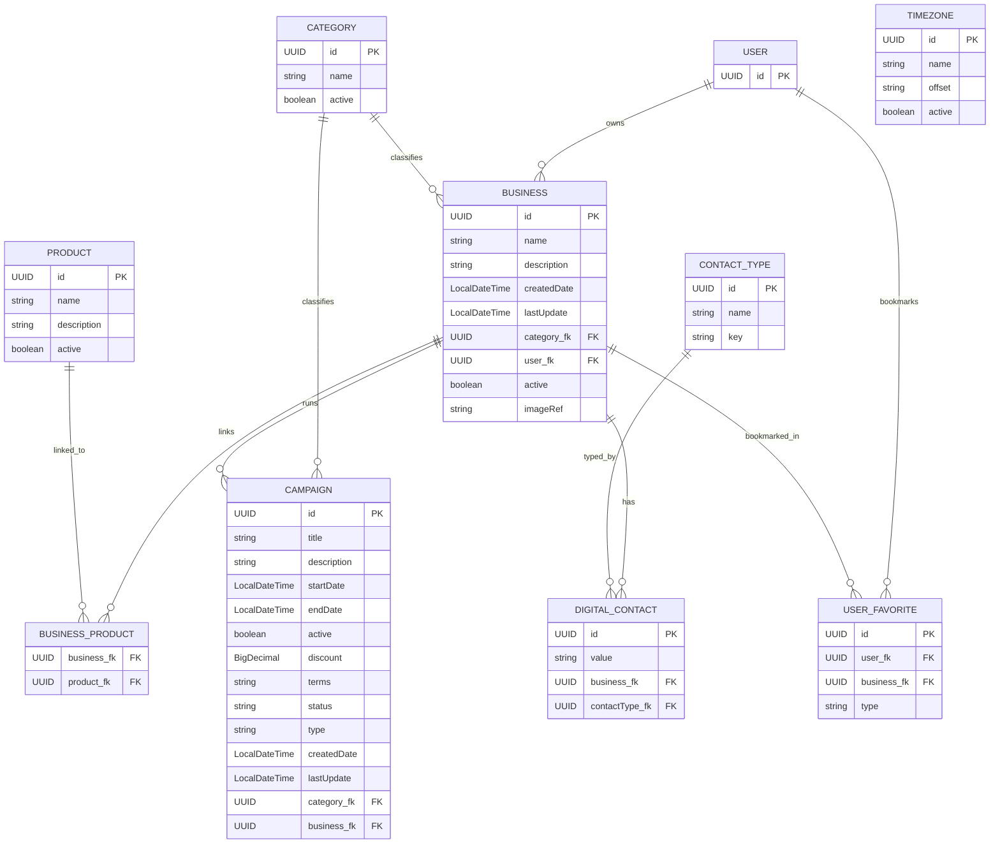

### Schema Mapping

| Entity | DB Schema | Table |
|--------|-----------|-------|
| `UserEntity` | `general` | `user` |
| `BusinessEntity` | `directory_site` | `business` |
| `CampaignEntity` | `directory_site` | `campaign` |
| `CategoryEntity` | `directory_site` | `category` |
| `ProductEntity` | `directory_site` | `product` |
| `BusinessProductEntity` | `directory_site` | `business_product` |
| `DigitalContactEntity` | `directory_site` | `digital_contact` |
| `ContactTypeEntity` | `directory_site` | `contact_type` |
| `UserFavoriteEntity` | `directory_site` | `user_favorite` |
| `TimezoneEntity` | `directory_site` | `timezone` |

> **Primary keys:** All entities use UUID (`@GeneratedValue(strategy = GenerationType.UUID)`) via the `uuid_generate_v4()` PostgreSQL function.

---

## 6. API Reference

All endpoints are served under the base path `/api/v1` over **HTTPS (TLS 1.3)**.

### Endpoint Summary

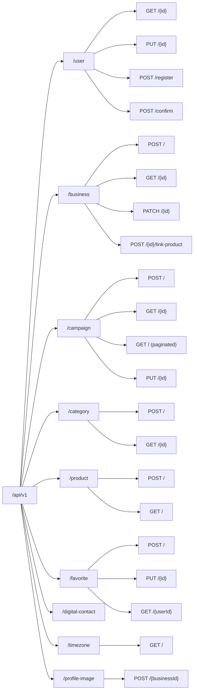

### Endpoint Details

#### Campaign API — `/api/v1/campaign`

| Method | Path | Description | Response |
|--------|------|-------------|----------|
| `POST` | `/` | Create a new campaign | `201 Created` + `CampaignTO` |
| `GET` | `/{id}` | Get campaign by UUID | `200 OK` + `CampaignTO` |
| `GET` | `/` | Search campaigns (paginated, filtered, sorted) | `200 OK` + `CampaignListResponse` |
| `PUT` | `/{id}` | Update campaign (optimistic lock via `lastUpdate`) | `202 Accepted` + `CampaignUpdateResponse` |

**Campaign List Query Parameters:**

| Parameter | Type | Description |
|-----------|------|-------------|
| `page` | integer | Page number, 1-based (default: 1) |
| `per_page` | integer | Items per page, max 100 (default: 10) |
| `sort` | string | Comma-separated fields; prefix `-` for desc (e.g., `-created_date,title`) |
| `title` | string | Partial, case-insensitive title filter |
| `category_fk` | UUID | Filter by category |
| `business_fk` | UUID | Filter by business |
| `active` | boolean | Filter by active status |
| `start_from` / `start_to` | ISO datetime | Start date range filter |
| `end_from` / `end_to` | ISO datetime | End date range filter |

> **Legacy aliases** (supported for backward compatibility): `q` → `title`, `category_id` → `category_fk`, `business_id` → `business_fk`, `start_date_from/to` → `start_from/to`, `end_date_from/to` → `end_from/to`.

#### Business API — `/api/v1/business`

| Method | Path | Description | Response |
|--------|------|-------------|----------|
| `POST` | `/` | Create business | `201 Created` + `BusinessCreateResponse` |
| `GET` | `/{id}` | Get business by UUID | `200 OK` + `BusinessTO` |
| `PATCH` | `/{id}` | Partial update of business | `200 OK` + `BusinessUpdateResponse` |
| `POST` | `/{id}/link-product` | Link a product to a business | `200 OK` + `LinkBusinessProductResponse` |

#### User API — `/api/v1/user`

| Method | Path | Description | Response |
|--------|------|-------------|----------|
| `GET` | `/{id}` | Get user by UUID | `200 OK` + `GetUserResponse` |
| `PUT` | `/{id}` | Update user profile | `200 OK` |
| `POST` | `/register` | Register a new user | `201 Created` |
| `POST` | `/confirm` | Confirm email with verification code | `200 OK` + `CheckVerificationCodeResponse` |

#### Standard HTTP Status Codes

| Code | Meaning | When Used |
|------|---------|-----------|
| `200` | OK | Successful GET / update |
| `201` | Created | Resource created (POST) |
| `202` | Accepted | Update accepted (optimistic concurrency) |
| `204` | No Content | Successful delete |
| `400` | Bad Request | Validation failure |
| `404` | Not Found | Resource does not exist |
| `409` | Conflict | Optimistic lock conflict (`lastUpdate` mismatch) |
| `500` | Internal Server Error | Unexpected server error |

### Response Headers Convention

Every response includes custom headers set by the service layer:

| Header | Constant | Purpose |
|--------|----------|---------|
| `message` | `DirectoryAppConstants.MESSAGE_HEADER` | Human-readable operation result |
| `message-error` | `DirectoryAppConstants.MESSAGE_ERROR_HEADER` | Error description on failure |

---

## 7. Request Flow

### Standard Request Lifecycle

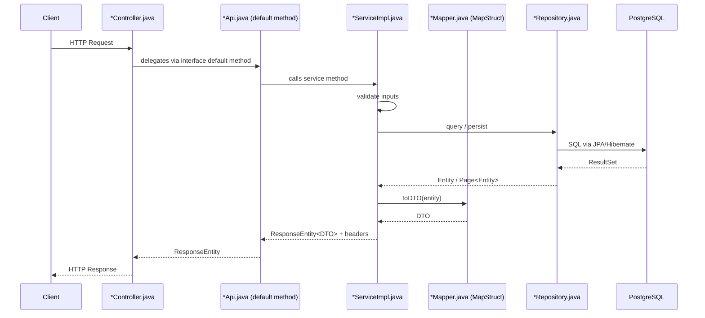

### Campaign Update — Optimistic Concurrency Flow

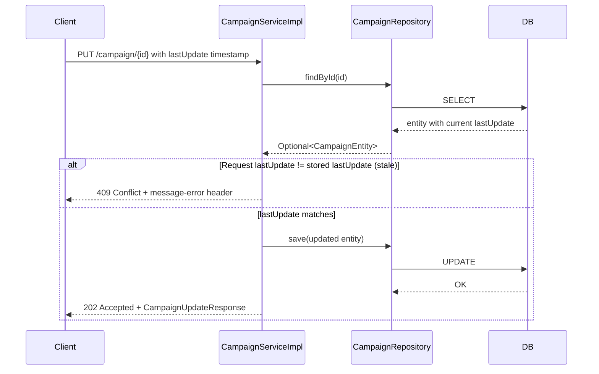

### User Registration Flow

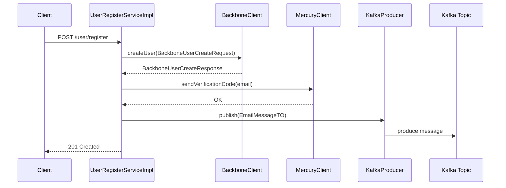

---

## 8. External Integrations

### Integration Map

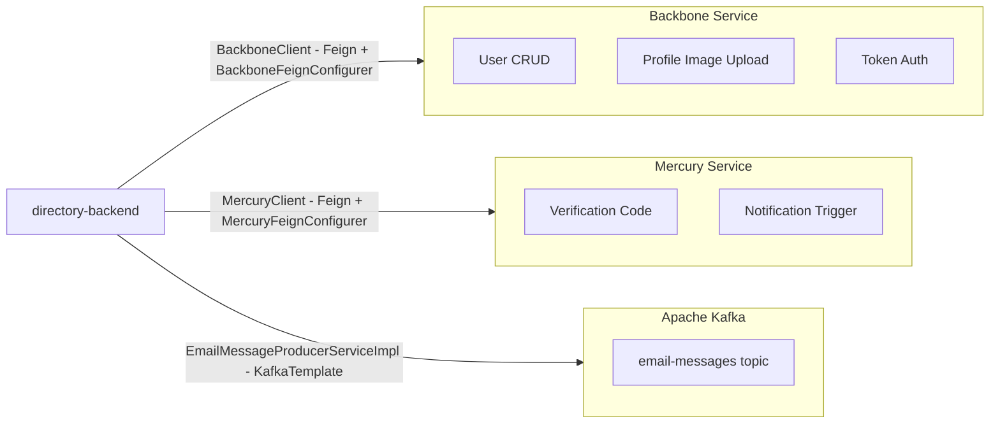

### Backbone Integration

| Component | Class | Purpose |
|-----------|-------|---------|
| Feign Client | `BackboneClient` | Calls Backbone REST API |
| Configurer | `BackboneFeignConfigurer` | Injects `Authorization: Bearer <token>` header |
| Auth client config | `bootstrap.yml` (`prx.auth.clients[id=backbone]`) | OAuth2 client credentials for token acquisition |
| DTOs | `com.umdc.directory.client.backbone.to.*` | `BackboneUserCreateRequest/Response`, `BackboneProfileImageRefResponse`, etc. |

### Mercury Integration

| Component | Class | Purpose |
|-----------|-------|---------|
| Feign Client | `MercuryClient` | Sends verification code requests |
| Configurer | `MercuryFeignConfigurer` | Token injection for Mercury calls |
| DTO | `VerificationCodeRequest` | Verification payload |

### Feign Authentication Flow

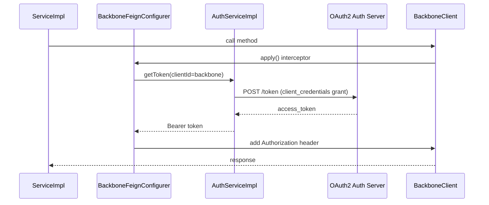

---

## 9. Security Model

### Authentication & Authorization

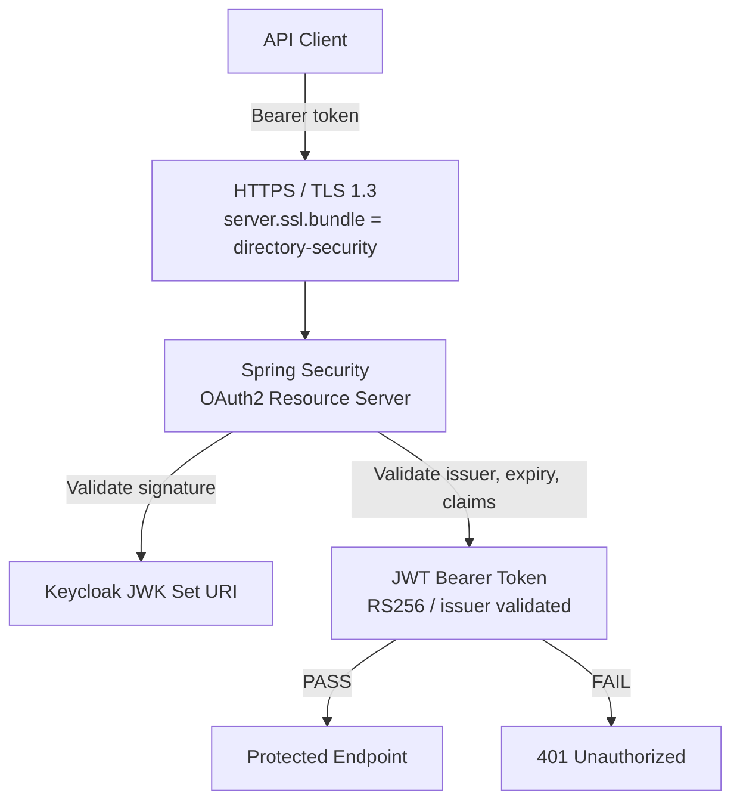

### Security Components

| Component | Class / Config | Role |
|-----------|---------------|------|
| JWT Parsing | `JwtUtil` | Parses and validates JWT claims |
| Session JWT Service | `SessionJwtServiceImpl` | Session-level token management |
| Auth Service | `AuthServiceImpl` | Acquires OAuth2 tokens for Feign clients |
| SSL Bundle | `bootstrap.yml` → `spring.ssl.bundle.jks` | TLS keystore configuration |
| OAuth2 Resource Server | `bootstrap.yml` → `spring.security.oauth2.resourceserver` | JWT issuer + JWK set URI |
| Role Filtering | `app.clientRoles` env var | Controls role-based access |

### TLS Configuration

```yaml
server:
  ssl:
    enabled: true
    bundle: directory-security
    enabled-protocols: TLSv1.3
spring:
  ssl:
    bundle:
      jks:
        directory-security:
          keystore:
            location: classpath:${SSL_KEYSTORE_LOCATION}
            type: ${SSL_KEYSTORE_TYPE}
          truststore:
            location: classpath:${SSL_TRUSTSTORE_LOCATION}
```

> **Keystore asset:** `src/main/resources/keystore.jks` — **never modify without explicit authorization.**

---

## 10. Configuration & Bootstrap

### Bootstrap Sequence

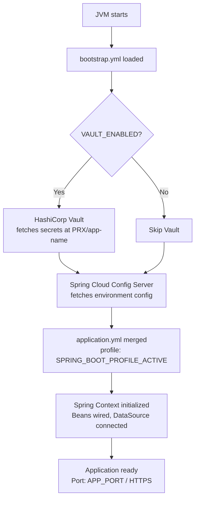

### Key Configuration Namespaces

| Namespace | Purpose |
|-----------|---------|
| `prx.jwt.*` | JWT secret and expiration |
| `prx.auth.clients[]` | OAuth2 client credentials for Feign integrations |
| `spring.security.oauth2.*` | Resource server JWT validation |
| `spring.cloud.vault.*` | Vault URI, token, KV backend |
| `spring.cloud.config.*` | Config server URI, label, profile |
| `spring.jpa.*` | Hibernate / datasource settings |
| `swagger.*` | OpenAPI documentation metadata |
| `server.ssl.*` | TLS configuration |

---

## 11. Messaging — Kafka

### Email Producer Architecture

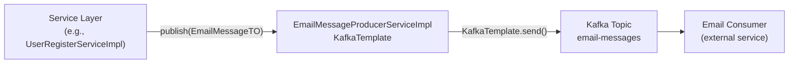

### Email Message Structure

| Field | Type | Description |
|-------|------|-------------|
| `recipients` | `List<Recipient>` | Target email addresses |
| `subject` | `String` | Email subject line |
| `body` | `String` | Email body content |
| `templateId` | `String` | Optional template identifier |

### Kafka Configuration

- **Producer Config Class:** `KafkaProducerConfig`
- **Serialization:** JSON via `JsonSerializer`
- **Topic:** Configured via environment variable
- **Security:** Configured in Spring Cloud Config profile

---

## 12. Caching

### Timezone Cache

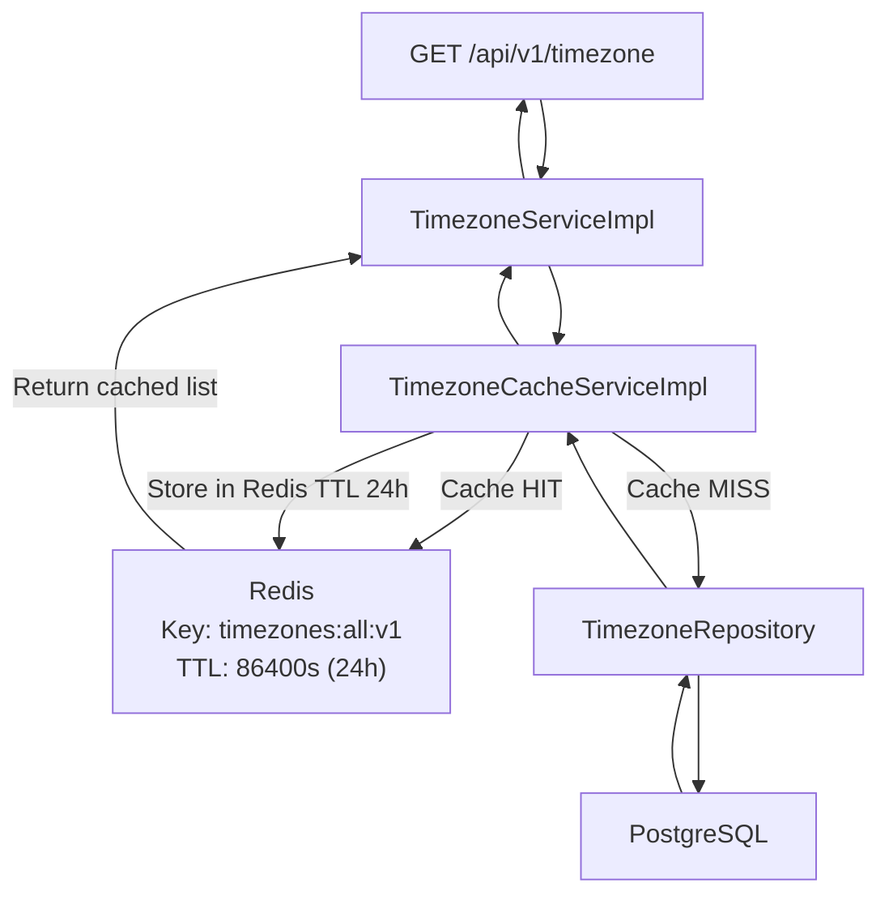

### Cache Constants

| Constant | Value | Purpose |
|----------|-------|---------|
| `TIMEZONE_CACHE_KEY` | `timezones:all:v1` | Redis key for timezone list |
| `TIMEZONE_CACHE_LOCK_KEY` | `timezones:lock` | Distributed lock key |
| `TIMEZONE_CACHE_DEFAULT_TTL_SECONDS` | `86400` (24h) | Cache TTL |
| `TIMEZONE_CACHE_LOCK_TTL_MS` | `5000` (5s) | Lock TTL to prevent stampede |

---

## 13. Campaign Filter Engine

The Campaign list endpoint features a composable, extensible filter + sort engine built on JPA Specifications.

### Filter Processing Pipeline

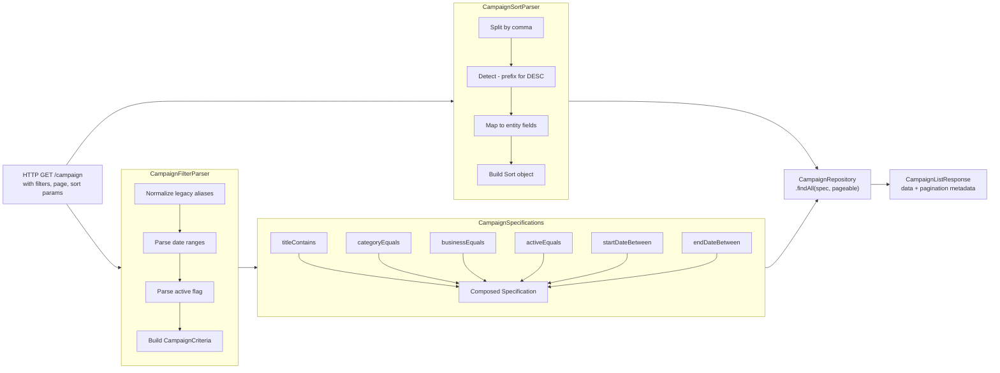

### Supported Sort Fields

| API Parameter | Entity Property | Default Order |
|---------------|----------------|---------------|
| `title` | `title` | ASC |
| `start_date` | `startDate` | ASC |
| `end_date` | `endDate` | ASC |
| `created_date` | `createdDate` | DESC (default) |

> Prefix with `-` for descending order. Multiple fields: `sort=-created_date,title`.

### CampaignListResponse Structure

```json
{
  "data": [],
  "page": 1,
  "perPage": 20,
  "total": 150,
  "totalPages": 8,
  "statusCounts": {
    "active": 120,
    "inactive": 30
  }
}
```

---

## 14. Data Persistence Layer

### Repository Hierarchy

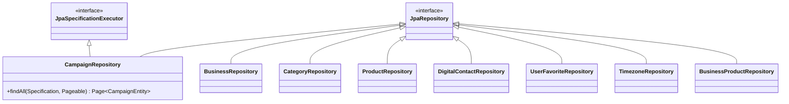

### Composite Key — BusinessProduct

`BusinessProductEntity` uses an embedded composite key:

```java
@Entity
@Table(name = "business_product", schema = "directory_site")
public class BusinessProductEntity {
    @EmbeddedId
    private BusinessProductEntityId id;
    // id.businessId + id.productId form the composite PK
}
```

### JPA Configuration

| Property | Value |
|----------|-------|
| Hibernate DDL auto | Managed by existing schema |
| JDBC metadata access | `allow_jdbc_metadata_access: true` |
| Deferred datasource init | `defer-datasource-initialization: true` |
| LOB creation | `non_contextual_creation: true` |
| SSL connection | `DataSourceSslConfig` loads DB certificate |

---

## 15. Mapper Layer

All DTO ↔ Entity conversions use **MapStruct 1.6.3** with the shared configuration `MapperAppConfig` from `com.umdc.commons.services.config.mapper`.

### Mapper Inventory

| Mapper | Source → Target | Key Notes |
|--------|----------------|-----------|
| `CampaignMapper` | `CampaignEntity` ↔ `CampaignTO` | Maps category/business FKs |
| `BusinessMapper` | `BusinessEntity` ↔ `BusinessTO/Request/Response` | Handles contact sets |
| `BusinessProductMapper` | `BusinessProductEntity` ↔ `LinkBusinessProductResponse` | Composite ID flattening |
| `CategoryMapper` | `CategoryEntity` ↔ `CategoryCreateRequest/Response` | Simple field mapping |
| `ProductMapper` | `ProductEntity` ↔ `ProductCreateRequest/Response` | |
| `FavoriteMapper` | `UserFavoriteEntity` ↔ `FavoriteCreateRequest/Response` | Type enum mapping |
| `DigitalContactMapper` | `DigitalContactEntity` ↔ `DigitalContactTO` | |
| `TimezoneMapper` | `TimezoneEntity` ↔ DTO | |
| `GetUserMapper` | Backbone response ↔ `GetUserResponse` | |
| `UserCreateMapper` | `UserRegisterRequest` ↔ `BackboneUserCreateRequest` | |
| `PutUserMapper` | Update request ↔ `BackboneUserUpdateRequest` | |
| `ConfirmCodeMapper` | `ConfirmCodeRequest` ↔ Mercury DTO | |

### MapStruct Pattern

```java
@Mapper(config = MapperAppConfig.class)
public interface CampaignMapper {
    CampaignTO toTo(CampaignEntity entity);
    CampaignEntity toEntity(CampaignTO to);
    List<CampaignTO> toToList(List<CampaignEntity> entities);
}
```

> MapStruct generates implementations at compile time — **zero reflection overhead** at runtime.

---

## 16. Quality Gates & CI/CD

### Quality Gate Summary

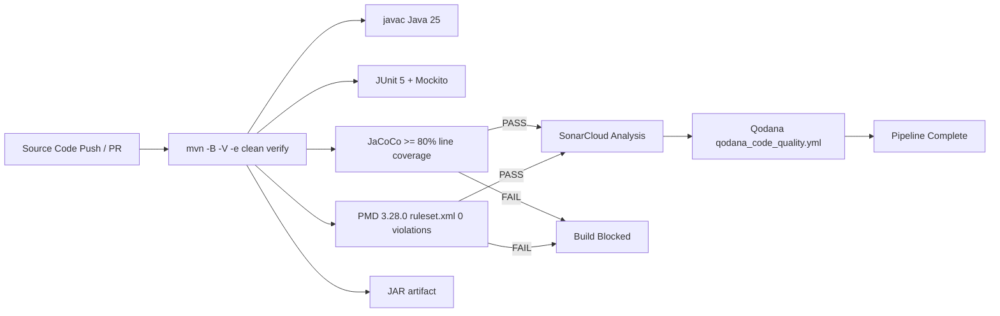

### CI/CD Pipelines

| Workflow File | Trigger | Actions |
|---------------|---------|---------|
| `.github/workflows/ci.yml` | Push / PR | Full `mvn verify` including PMD + JaCoCo |
| `.github/workflows/build.yml` | Merge to main | SonarCloud analysis |
| `.github/workflows/qodana_code_quality.yml` | Scheduled | Qodana inspection → `qodana.sarif.json` |

### JaCoCo Exclusions

JaCoCo excludes the following packages from coverage measurement:

- `*Application.*` — entry point
- `**/exceptions/*` — exception classes
- `**/util/*` — utility classes
- `**/config/**/*` — configuration classes
- `**/mapper/*` — generated code
- `**/cache/*` — cache infrastructure
- `**/security/*` — security infrastructure
- `**/producer/*` — Kafka producers
- `**/interceptor/*` — Feign interceptors

### Test Profile

Tests run under the `test` Spring profile configured in `src/test/resources/application-test.yml`:

| Setting | Value |
|---------|-------|
| Database | H2 in-memory |
| Vault | Disabled |
| Config Server | Disabled |
| Kafka | Disabled |
| Security | Disabled |

---

## 17. Build & Run Guide

### Prerequisites

| Tool | Version | Notes |
|------|---------|-------|
| Java (JDK) | 21 | Set `JAVA_HOME` |
| Maven | 3.x | Use `./mvnw` wrapper |
| Docker | 24+ | Optional — for containerized run |
| PostgreSQL | 14+ | With `directory_site` and `general` schemas |
| Redis | 7+ | For timezone caching |
| Kafka | 3+ | For email messaging |

### Build Commands

```bash
# Fast build (skip tests)
./mvnw -DskipTests package

# Full CI-aligned build (tests + PMD + JaCoCo)
./mvnw -B -V -e clean verify

# Run all tests
./mvnw test

# Run a single test class
./mvnw -Dtest=com.umdc.controller.v1.api.directory.CampaignControllerTest test

# Run a single test method
./mvnw -Dtest=CampaignControllerTest#listCampaignsReturnsOk test

# Generate coverage report
./mvnw clean test jacoco:report
# Open: target/site/jacoco/index.html

# PMD check
./mvnw pmd:check

# Run the packaged JAR
java -jar target/directory-backend.jar
```

### Docker Build & Run

```bash
# Build image
docker build -t prx/directory-backend:0.0.1 .

# Run container (requires .env file from default.env template)
docker run --env-file .env \
  -p 8443:8443 \
  prx/directory-backend:0.0.1
```

### Local Environment Setup

1. Copy `default.env` to `.env` — **never commit `.env`**.
2. Populate all required variables (see [Environment Variables Reference](#18-environment-variables-reference)).
3. Import TLS certificates if needed (see `docs/SETUP_JAVA_HOME_AND_IMPORT_CERTS.md`).
4. Ensure PostgreSQL has `directory_site` and `general` schemas with required tables.
5. Start Redis and Kafka locally or via Docker Compose.

---

## 18. Environment Variables Reference

| Variable | Required | Description |
|----------|----------|-------------|
| `APP_PORT` | Yes | Server listening port (e.g., `8443`) |
| `APP_TOKEN_SECRET` | Yes | JWT signing secret |
| `APP_TOKEN_EXPIRATION` | Yes | JWT expiration in milliseconds |
| `SPRING_BOOT_PROFILE_ACTIVE` | Yes | Active Spring profile (`dev`, `qa`, `prod`) |
| `SPRING_BOOT_CLOUD_BOOTSTRAP_ENABLED` | Yes | Enable Spring Cloud bootstrap context |
| `VAULT_ENABLED` | Yes | Enable Vault secret retrieval (`true`/`false`) |
| `VAULT_TOKEN` | Yes | Vault access token |
| `VAULT_SERVER_URI` | Yes | Vault server URI |
| `CNFS_URI` | Yes | Spring Cloud Config Server URI |
| `CNFS_PORT` | Yes | Config Server port |
| `SPRING_CLOUD_CONFIG_LABEL` | Yes | Git branch label for config |
| `AUTH_SERVER_URI` | Yes | Keycloak / OAuth2 issuer URI |
| `AUTH_TOKEN_URI` | Yes | Token endpoint path |
| `AUTH_CERT_URI` | Yes | JWK Set URI path |
| `AUTH_CLIENT_ID` | Yes | OAuth2 client ID for resource server |
| `AUTH_CLIENT_SECRET` | Yes | OAuth2 client secret |
| `AUTH_ROLE_ID` | Yes | Comma-separated role IDs for access control |
| `BACKBONE_CLIENT_ID` | Yes | Backbone OAuth2 client ID |
| `BACKBONE_CLIENT_SECRET` | Yes | Backbone OAuth2 client secret |
| `BACKBONE_GRANT_TYPE` | Yes | OAuth2 grant type for Backbone |
| `BACKBONE_SCOPE` | Yes | OAuth2 scope for Backbone |
| `BACKBONE_USERNAME` | Yes | Backbone service account username |
| `BACKBONE_PASSWORD` | Yes | Backbone service account password |
| `MERCURY_CLIENT_ID` | Yes | Mercury OAuth2 client ID |
| `MERCURY_CLIENT_SECRET` | Yes | Mercury OAuth2 client secret |
| `MERCURY_GRANT_TYPE` | Yes | OAuth2 grant type for Mercury |
| `MERCURY_SCOPE` | Yes | OAuth2 scope for Mercury |
| `MERCURY_USERNAME` | Yes | Mercury service account username |
| `MERCURY_PASSWORD` | Yes | Mercury service account password |
| `SSL_KEYSTORE_LOCATION` | Yes | Keystore file location (classpath-relative) |
| `SSL_KEYSTORE_PASSWORD` | Yes | Keystore password |
| `SSL_KEYSTORE_TYPE` | Yes | Keystore type (e.g., `JKS`, `PKCS12`) |
| `SSL_TRUSTSTORE_LOCATION` | Yes | Truststore file location |
| `SSL_TRUSTSTORE_PASSWORD` | Yes | Truststore password |
| `SSL_TRUSTSTORE_TYPE` | Yes | Truststore type |
| `LOGGING_TRACE_ENABLED` | Yes | Enable trace-level logging (`true`/`false`) |

> **Security:** Never commit any `.env` file or the `default.env` with real values to version control.

---

## Appendix — Constants Reference

Key constants defined in `DirectoryAppConstants`:

| Constant | Value | Usage |
|----------|-------|-------|
| `MESSAGE_HEADER` | `message` | Success response header |
| `MESSAGE_ERROR_HEADER` | `message-error` | Error response header |
| `DEFAULT_PAGE` | `1` | Campaign list default page |
| `DEFAULT_PER_PAGE` | `10` | Campaign list default page size |
| `MAX_PER_PAGE` | `100` | Campaign list maximum page size |
| `TIMEZONE_CACHE_KEY` | `timezones:all:v1` | Redis cache key |
| `TIMEZONE_CACHE_DEFAULT_TTL_SECONDS` | `86400` | 24-hour cache TTL |
| `INTERNAL_SERVER_ERROR_CODE` | `500` | Standard error code constant |

---

*Documentation generated for `directory-backend` v0.0.1 · April 19, 2026*

