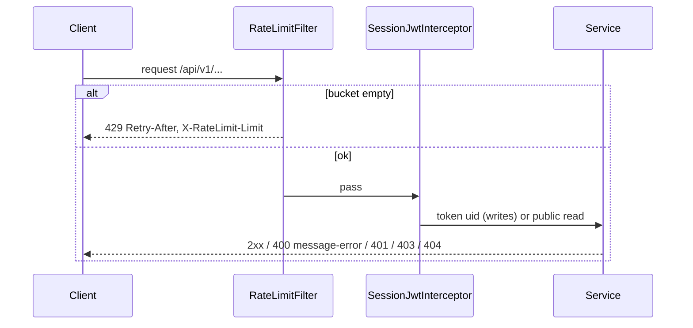

# API contract for Phase 0 and Phase 1: technical guide

Contract: `src/main/resources/api/index.yaml` (OpenAPI 3.0.0). It is hand-maintained; the `*Api.java` annotations are the source of truth and the YAML follows them. No test reads the file.

## Structure

- `components.responses`: `BadRequest` (declares the `message-error` header), `Unauthorized`, `Forbidden`, `NotFound`, `InternalError`, `TooManyRequests`.
- `TooManyRequests` (`429`) is attached to every operation: `RateLimitFilter` covers all of `/api/v1/**`. Body `{"error":"too_many_requests","retryAfterSeconds":N}`, headers `Retry-After` and `X-RateLimit-Limit`.
- `components.schemas`: request/response objects of the changed endpoints (snake_case for geo, hours and pagination envelopes, as in the Java records). Read models that were not touched (`Business`, `Campaign`) stay open objects.
- Public reads (`nearby`, `map`, hours `GET`, `hours/status`) use `security: []`.

## Mapping of the phases

| Source | Documented |
|---|---|
| F0 owner checks (`BusinessApi`, `ProductApi`, `CampaignApi`, `BusinessProfileImageController`) | `session-token` required, `401/403/404`, images ignore `objectKey` |
| F0 favourites (`FavoriteApi`) | `type`, `page`, `size`, `sort` query parameters, `400`, `409`, reactivation `201`; `PATCH` and `DELETE /favorites/{favoriteId}` |
| F0 platform | `429`, docs only with `umdc.docs.enabled` |
| F1-A `feat/f1-a-geo-search` (PR #128) | `GET /businesses/nearby`, `GET /businesses/map` |
| F1-B `feat/f1-b-opening-hours` (PR #127) | `GET/PUT .../hours`, `GET .../hours/status` |
| F1-C `feat/f1-c-geocoding` (PR #126) | `POST /geocode` |

## Corrections to the old contract

- `/businesses/1a24da99-...`, `/campaigns/64d0648d-...`, `/campaigns/75980cb0-...`, `/favorites/016870b0-...` became `{businessId}`, `{campaignId}`, `{favoriteId}`.
- `DELETE /favorites` (no id) does not exist in the code; the contract has `DELETE /favorites/{favoriteId}`.
- `GET /favorites` had a `requestBody`; it now lists real query parameters.
- Empty `responses: {}` filled from the `@ApiResponses` of each interface; `GET /products/business/{businessId}` added.
- `format: style` on dates replaced by `date-time`.

## Known differences with the code

- Business create/update, products, campaigns and favourites declare the header `required=false` in Java (the answer is `401` when absent); the contract marks it required.
- `PUT /favorites/{id}` is `PATCH` in the code.
- Phase 1 paths are not in `development` until PRs #126, #127 and #128 are merged.
- `/api/v1/auth/*` is served by the security library and was not re-verified here.

## Validation

`yaml.safe_load` parse, every `$ref` resolves, every `{param}` of a path is declared, no empty `responses`, no fixed UUID in a path.
