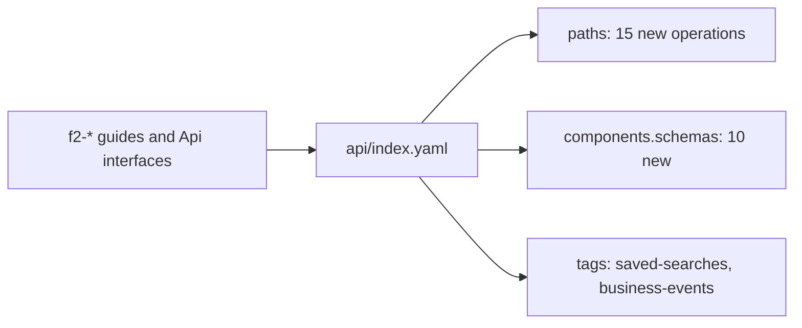

# API contract, Phase 2 (technical guide)

Documentation only: `src/main/resources/api/index.yaml` was edited textually (no YAML re-dump, so the diff stays small) from the Phase 2 technical guides (`f2-products`, `f2-campaigns`, `f2-saved-searches`, `f2-click-events`) and the `*Api` interfaces of the feature branches. No code, migration or configuration change. As with Phase 1, these endpoints appear in the contract before all of them are in `development`.

## Operations added
| Operation | Security | Answers |
| --- | --- | --- |
| `PATCH`, `PUT /products/{productId}` | `session-token` required | 200, 400, 401, 403, 404, 429 |
| `DELETE /products/{productId}` | required | 204, 401, 403, 404, 429 |
| `POST /campaigns/{campaignId}/deactivate`, `/reactivate`, `/publish` | required | 200 `Campaign`, 401, 403, 404, 409, 429 |
| `POST`, `GET /users/me/saved-searches` | required | 201/200, 400, 401, 409, 429 |
| `PATCH`, `DELETE /users/me/saved-searches/{id}` | required | 200/204, 400, 401, 404, 409, 429 |
| `GET /users/me/saved-searches/{id}/replay` | required | 200 `SearchReplay`, 401, 404 |
| `GET`, `PUT /users/me/last-search` | required | 200, 400, 401, 404 |
| `POST /businesses/{businessId}/events` | required | 204, 400, 401, 404, 429 |
| `GET /businesses/{businessId}/events/summary` | required, owner | 200, 400, 401, 403, 404 |

`400` and `409` carry the `message-error` header (reusable `#/components/headers/MessageError`).

## Operations changed
- `POST /products`: new `price`, `currency`, `imageRef`, `businessId`; `404` when `businessId` does not exist; `403` also for a business of another user.
- `GET /products/business/{businessId}`: `include_inactive` (owner only), `active` only honoured for the owner, `401` and `403`.
- `POST`, `PATCH /campaigns`: `type`; `GET /campaigns`: filters `status`, `type`; the `session-token` is optional and only widens visibility; `GET /campaigns/{id}` is `404` when hidden; `PATCH` `409` also for an illegal transition. The create example no longer sends `status: ACTIVE` (ignored by the server, except `DRAFT`).
- `/auth/session-token` and `/auth/token`: the example password is the placeholder `<password>`.

## New schemas
`ProductUpdateRequest`, `SearchParams`, `SavedSearchCreateRequest`, `SavedSearch`, `SavedSearchList`, `SearchReplay`, `LastSearch`, `BusinessEventRequest`, `EventCounts`, `BusinessEventSummary`; `ProductCreateRequest` and `ProductCreateResponse` gained the price, currency, image (and `active`) fields.

## Validation
The file parses with `yaml.safe_load` and every `$ref` to `#/components/schemas/*` resolves. `mvn -o -B clean verify` is unchanged by this task.
