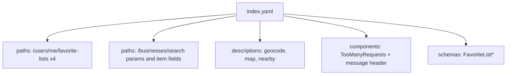

# API contract, Phase 3 (technical guide)

Documentation only change in `src/main/resources/api/index.yaml`, edited textually. Source of truth: the Phase 3 guides `f3-favorite-lists.md`, `f3-search-open-now.md` and `f3-geo-quotas.md`.

## Favorite lists
Base `/api/v1/users/me`, tag `favorite-lists`, header `session-token` required (`401`).

| Operation | Answers |
| --- | --- |
| `POST /favorite-lists` (`FavoriteListNameRequest`) | 201 `FavoriteList`; 400; 401; 409 duplicate name or 20-list limit |
| `GET /favorite-lists` | 200 `FavoriteListsResponse {items, max}`; 401 |
| `GET /favorite-lists/{id}?page=0&size=20` | 200 `FavoriteListDetail`; 400; 401; 404 |
| `PATCH /favorite-lists/{id}` | 200 `FavoriteList`; 400; 401; 404; 409 |
| `DELETE /favorite-lists/{id}` | 204; 401; 404 |
| `POST /favorite-lists/{id}/items` (`FavoriteListItemRequest {favorite_id}`) | 201 `FavoriteListItem`; 400; 401; 404; 409 |
| `DELETE /favorite-lists/{id}/items/{favoriteId}` | 204; 401; 404 |

Schemas: `FavoriteList {id, name, item_count, created_at, updated_at}`, `FavoriteListItem {favorite_id, type STORE|PRODUCT, item_id, name, added_at}`, `FavoriteListDetail` (list fields plus `items`: page with `total_count`, `page` 0-based, `per_page` max 100, `total_pages`, `items`). Every operation also lists `429`.

## Search
`GET /businesses/search` gains query params `open_now` (boolean), `lat`, `lng` (number, both or none) and `sort` (`name` default | `distance`). `session-token` becomes optional (the endpoint is public). The 200 description adds the nullable item fields `open_now` (boolean) and `distance_m` (integer metres); the 400 covers invalid `lat`, `lng` and `sort`. Additive: no existing field changes.

## Geo quotas
`POST /geocode` (10/min), `GET /businesses/map` (60/min), `GET /businesses/nearby` (60/min) keep `$ref: TooManyRequests`; their descriptions state the default and the property (`umdc.ratelimit.geocode-per-minute`, `map-per-minute`, `nearby-per-minute`). The shared `TooManyRequests` response now declares the `message` header next to `Retry-After` and `X-RateLimit-Limit`.

## Validation
The file parses with `yaml.safe_load` and every `$ref` to `#/components/...` resolves. No secrets were added.
