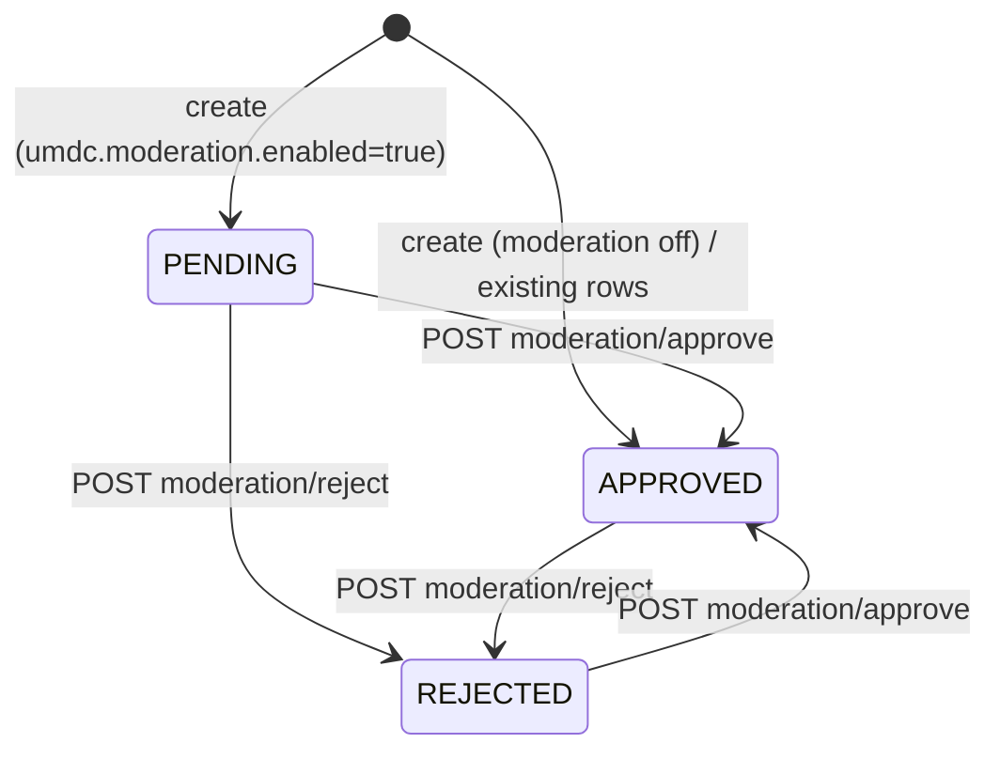
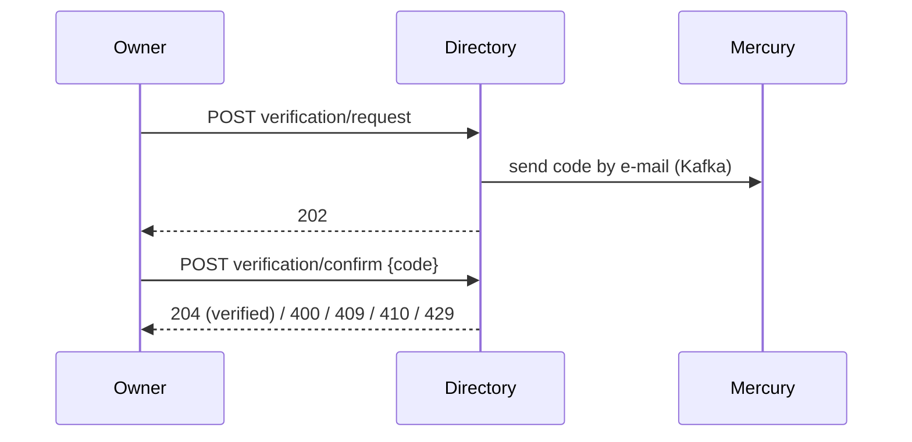

# API contract, Phase 4 (technical guide)

Documentation only. Sources: `p4-mercury-moderation.md`, `p4-i18n.md`, `p4-token-security.md`, `p4-search-sql.md` and `f4-redis.md` of the Phase 4 branches (read before they were merged).

## Changes in `index.yaml`

| Area | Contract change |
| --- | --- |
| Moderation | 5 paths under `/businesses/{businessId}`, tag `business-moderation`; schemas `BusinessModeration`, `VerificationConfirmRequest` (the example code is the placeholder `<code>`) |
| Visibility | optional `session-token` on `GET /businesses/{businessId}` and `GET /businesses/user/{userId}` (404 / filtered list unless approved or owner) |
| S1 | `PATCH /businesses/{businessId}`: 403 when body `id` is another user; the 404 for an unknown user is removed |
| i18n | `components/parameters/AcceptLanguage`, `components/headers/ContentLanguage`, schema `CategoryGetResponse` (`locale`); referenced from the three category GETs; the API description says it applies to `message`/`message-error` everywhere |
| Auth (S4) | `POST /auth/session-token` 401 (Backbone token validated); `POST /auth/token` 403 when `umdc.auth.alias-token.enabled=false` (default `true`) |
| Mercury | 503 (and 429 + `Retry-After`) on `/auth/*`, `POST /users`, `POST /user-register` |
| CORS | note in the API description: 403 without an allowed origin (`UMDC_CORS_ALLOWED_ORIGINS`) |
| Search | open_now and sort=distance have no cap (V17 and SQL evaluation); Phase 3 text updated |

Redis (`umdc.ratelimit.store`, `umdc.geo.cache-enabled`) changes no contract and is not in the file.

## Moderation flow

## Checks done

`index.yaml` loads with `yaml.safe_load` and every local `$ref` resolves. Only the CHANGELOG, this guide and its user counterpart are added besides the contract.

## Pending

The real behaviour depends on the Phase 4 branches being merged; if a branch changes a status code before merging, adjust this file.
