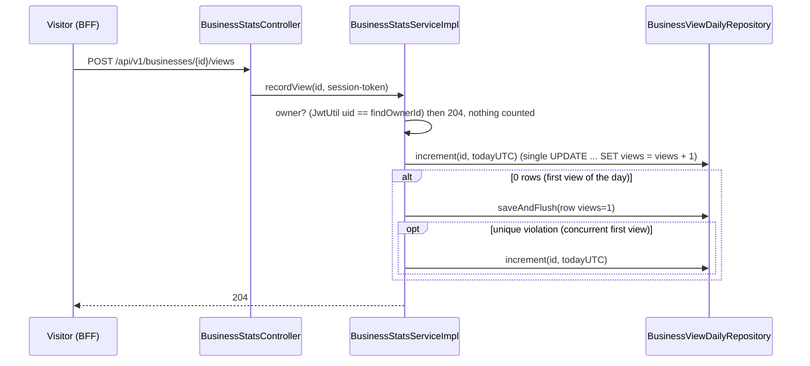

# Business statistics: views (technical guide)

## Schema (`V5__create_business_view_daily.sql`)
`business_view_daily(business_fk -> business ON DELETE CASCADE, view_date DATE, views BIGINT)`, primary key `(business_fk, view_date)` (it serves the range reads, so there is no extra index). It is applied by hand: Flyway is not configured. No personal data is in the table or in any log line of the feature.

## Code
| Piece | Role |
| --- | --- |
| `BusinessViewDailyEntity` / `BusinessViewDailyId` | Counter row and its composite key |
| `BusinessViewDailyRepository` | `increment` (`@Modifying @Transactional` JPQL `UPDATE`, atomic) and `findSeries` (range, ordered) |
| `BusinessStatsServiceImpl` | Not `@Transactional` as a whole: each step is its own transaction so a unique violation on the insert cannot abort the others. The day is `LocalDate.now(clock)` in UTC (a `Clock` is injectable for tests). `summary` is `@Transactional(readOnly = true)`, zero-fills the days and computes `viewsLast7Days` from a read window of at least 7 days |
| `BusinessRepository.findOwnerId` | Owner id without loading the business; used for the owner checks (401/403/404) |
| `BusinessStatsController` | `/api/v1/businesses/{businessId}` with `POST /views` and `GET /stats?days=` |

Limits: page views, not unique visitors (by design); the only abuse control is the BFF rate limit.
Tests: `BusinessStatsServiceImplTest`, `BusinessViewDailyRepositoryTest` (`@DataJpaTest`, H2 in PostgreSQL mode), `BusinessStatsRoutesTest`.
