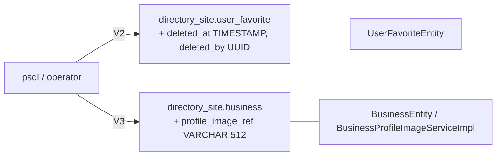

# Database migration scripts V2 and V3 (technical guide)

- Location: `src/main/resources/db/migration/`. Naming follows Flyway (`V<n>__<description>.sql`) but **Flyway is not a dependency or configured**; the scripts are applied by hand and are not run by the application or by tests (H2 builds its schema from the entities).
- Both use `ADD COLUMN IF NOT EXISTS` with nullable columns: idempotent, non-blocking, no backfill.
- There is no `V1`; the baseline schema predates the scripts. Introducing Flyway would need a baseline (`baselineOnMigrate`) so `V2`/`V3` are not replayed blindly.
- Rollback: `ALTER TABLE ... DROP COLUMN` for the same columns (data in them is lost).
