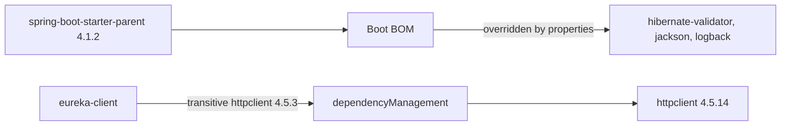

# Dependency update (Spring Boot 4.1.2) — technical guide

Versions follow `backbone-rest` (the newest of the three reference services); where backbone does not define the property, the highest value among `mercury` and `zerobound-rest` is used.

## Versions

| Property | Before | Now |
|----------|--------|-----|
| `spring-boot-starter-parent` / `spring-boot.version` | 4.0.6 | 4.1.2 |
| `spring-cloud.version` | 2025.1.1 | 2025.1.4 |
| `com.umdc.commons.version` | 0.0.1 | 0.0.4 |
| `com.umdc.commons-services.version` | 0.0.1 | 0.0.3 |
| `com.umdc.security-oauth.version` | 0.0.1 | 0.0.3 |
| `springdoc.version` / `springdoc-openapi-maven-plugin` | 2.6.0 / 1.4 | 3.1.0 / 1.5 |
| `jwt.version` (jjwt) | 0.12.3 | 0.13.0 |
| `postgresql.version` | 42.7.7 | 42.7.14 |
| `google.gson.version` | 2.13.2 | 2.14.0 |
| `snakeyaml.version` | 2.5 | 2.6 |
| `org.json.version` | 20250517 | 20260814 |
| `commons-lang3.version` | 3.18.0 | 3.21.0 |
| `plexus.utils.version` | 4.0.2 | 4.1.0 |
| `asm.version` | 9.7 | 9.10.1 |
| `rewrite.plugin.version` / `rewrite.recipe.version` | 5.42.0 / 5.21.0 | 6.46.1 / 6.37.1 |
| `junit.jupiter.version` / `mockito.version` | 6.0.3 / 5.21.0 | 6.1.3 / 5.24.0 |
| `maven.compiler.plugin` / `javadoc` / `jacoco` / `surefire` | 3.14.1 / 3.6.3 / 0.8.14 / 3.5.2 | 3.15.0 / 3.12.0 / 0.8.15 / 3.5.6 |

Unchanged: `mapstruct` 1.6.3, `jmh` 1.37, Java 25. `com.umdc:persistence` is not used by this service and was not added.

## Security overrides of the Boot BOM

Aligned with backbone, using the property names of the Boot 4.1.2 BOM:

| Property | BOM value | Override | Reason |
|----------|-----------|----------|--------|
| `hibernate-validator.version` | 9.1.5.Final | 9.1.6.Final | Expression Language injection advisory |
| `jackson-2-bom.version` | 2.21.7 | 2.21.8 | jackson-databind / jackson-core CVEs |
| `jackson-bom.version` (Jackson 3, `tools.jackson`) | 3.1.7 | 3.1.8 | same, via spring-cloud-config |
| `logback.version` | 1.5.38 | 1.6.6 | logback-classic CVE (fixed in 1.6.3) |
| `httpclient.version` (`dependencyManagement`) | 4.5.3 (via `eureka-client`) | 4.5.14 | GHSA-7r82-7xv7-xcpj |

Tomcat needs no override: the 4.1.2 BOM already resolves `tomcat-embed-core` 11.0.27. Netty comes at 4.2.19.Final from the BOM.

## Verification

`mvn -B clean verify`: 661 tests, 0 failures, JaCoCo gate met; `mvn dependency:tree` confirms the resolved versions above. Method coverage (JaCoCo): 93.25 % (760 of 815).

## Not covered

Not started against Vault, Config Server, Kafka or a real PostgreSQL (the test profile uses H2 with those disabled). Smoke-test the service in a real environment before releasing.
