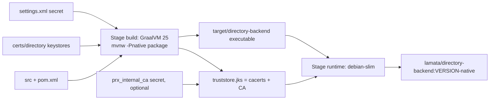

# Container images (technical guide)

## Files
| File | Role |
|---|---|
| `Dockerfile` | JVM image. Needs `target/directory-backend.jar` (built first). Stage 1 splits the jar into layers, stage 2 is `amazoncorretto:25-alpine`. |
| `Dockerfile.native` | Native image. Compiles inside the container with `./mvnw -Pnative package` (the `native` profile is inherited from `spring-boot-starter-parent`: Spring AOT + `native-maven-plugin`). |
| `docker-entrypoint.sh` / `docker-entrypoint.native.sh` | `exec java ... -jar` / `exec ./directory-backend ...`; both make the process PID 1 for a graceful SIGTERM. |
| `docker-build.sh` | `jvm`, `native` or `all`. |
| `.dockerignore` | Keeps secrets (`secrets/`, `*.env`, `config/`, `.git`) out of the context. Only `target/directory-backend.jar` of `target/` is sent. |

## Native build flow

## Status
The native image **builds** (554 MB) and the executable starts, but it has **not been verified against real Config Server, Vault, PostgreSQL and Redis**. With placeholder configuration it stops at `No spring.config.import property`; with Config Server disabled it reports `no ServletWebServerFactory bean`, which may be an AOT-time condition mismatch and must be investigated with the real environment. Use the JVM image for deployments until then.

## Decisions
- **Builder image `25-ol9`:** the plain `:25` tag fails on CPUs without x86-64-v3 (`Fatal glibc error: CPU does not support x86-64-v3`); OL9 needs only x86-64-v2. Override with `--build-arg GRAALVM_IMAGE=...`.
- **Maven inside the container** for native: Spring AOT must run on the compiled classes, so a prebuilt jar is not enough. The private `com.umdc.*` repositories need credentials, passed as the BuildKit secret `maven_settings` (mounted at `/root/.m2/settings.xml`, not kept in a layer). The Maven repository is a cache mount.
- **AOT placeholders:** Spring AOT loads `bootstrap.yml`, whose `${VARS}` have no default. `config/native-aot.env` (versioned, no credentials) gives them placeholder values for the build only; they are not compiled into the executable, real values come from the environment/Vault/Config Server at runtime.
- **PMD/CPD skipped** in the image build (`-Dpmd.skip -Dcpd.skip`); they remain gates of `mvn verify`.
- **Truststore:** a JVM image imports the internal CA into `cacerts`; the native executable has no JVM `cacerts`, so the build stage copies the GraalVM JDK `cacerts`, adds the CA (optional secret `prx_internal_ca`) and the entrypoint points `javax.net.ssl.trustStore` to it.
- **Entrypoint options:** no `-XX:+UseCompactObjectHeaders`, `-XX:MaxRAMPercentage` (rejected by this executable; use `NATIVE_OPTS=-Xmx...`) nor `-jar` in native; `-D` properties are accepted. `NATIVE_OPTS` is appended last.
- **Runtime base:** `debian:bookworm-slim` (glibc, needed by the executable; `wget` for the `HEALTHCHECK`). Runs as the non-root `jvapps:appmng`.
- Port `8197`, `HEALTHCHECK` on `/actuator/health/liveness`, as in the JVM image.
