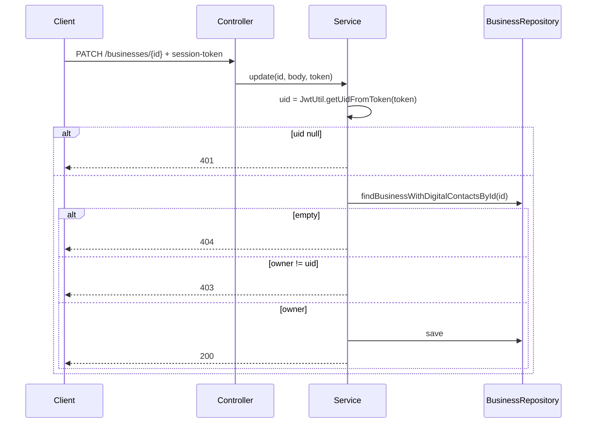

# Business and image owner checks (technical guide)

Phase 0, flow A1, requirement RF-01 part 1: owner authorisation on business and image.

## Design

The caller identity is `JwtUtil.getUidFromToken(token)` (uid claim of the `session-token` header), the same pattern `BusinessServiceImpl.deleteBusiness` already used. The owner of a business is `BusinessEntity.getUserFk().getId()`.

| Component | Change |
| --- | --- |
| `BusinessApi` / `BusinessController` | `post` and `update` receive `@RequestHeader(session-token, required=false)`; a missing header is answered `401` by the service (not Spring's `400`) |
| `BusinessService(Impl).update(id, request, token)` | 401 invalid token, 400 invalid input, 404 unknown business, 403 non-owner, then the existing PATCH logic |
| `BusinessService(Impl).create(request, token)` | 401 invalid token; 400 for invalid input (the all-zero userId is still invalid); body `userId` different from token user gives 403; a null body `userId` is replaced by the token uid (an effective `BusinessCreateRequest` is rebuilt before mapping) |
| `BusinessProfileImageService(Impl).uploadForBusiness(id, image, type, token)` | 401, 404, 403, then upload under `businesses/{businessId}/{uuid}.{ext}` |
| `BusinessProfileImageController.upload` | 401 without a valid uid; the client `objectKey` is discarded |
| `BusinessProfileImageServiceImpl.upload` | always `generateKey(null, contentType)`, even if the request carries a key |

## Contract changes (for `api/index.yaml`)

| Endpoint | New responses |
| --- | --- |
| `POST /api/v1/businesses` | 401, 403; header `session-token` (optional in the schema, enforced); `userId` in the body becomes optional |
| `PATCH /api/v1/businesses/{id}` | 401, 403; header `session-token` |
| `POST /api/v1/businesses/images/{businessId}` | 401, 403 (404 already existed) |
| `POST /api/v1/businesses/images` | 401; the `objectKey` parameter is ignored |

Known limitation: the token is decoded, not signature-verified, by `JwtUtil`; signature verification is a platform concern (security flow).
`PATCH` still lets the owner reassign the business to another user through `request.id()`; it is now owner-only.

## Tests

`BusinessOwnerChecksTest` (owner matrix), updated `BusinessServiceImpl*Test`, `BusinessProfileImage*Test`; `TestTokens` builds unsigned JWT-shaped tokens with a `uid` claim.
