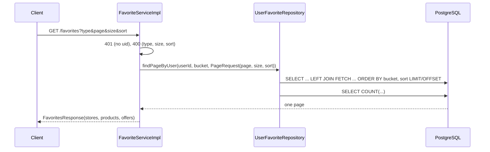
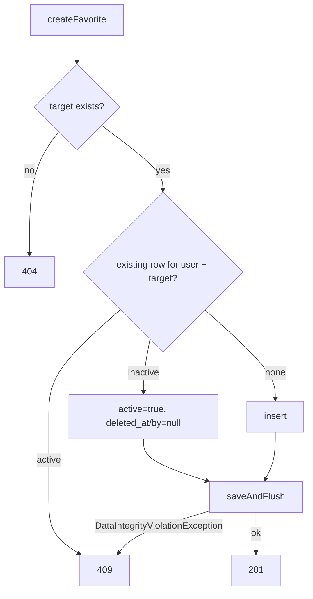

# Favorites (F0-B): technical guide

Code: `FavoriteApi`, `FavoriteController`, `FavoriteServiceImpl`, `UserFavoriteRepository`, `UserFavoriteEntity` (table `directory_site.user_favorite`).

## Request flow



## Listing, sort and paging

- `findPageByUser` returns `Page<UserFavoriteEntity>`: active favorites of the user, with business, product and campaign fetched in the same query (no N+1; they are to-one joins, so paging stays in SQL).
- `bucket` is `0` stores, `1` products, `2` offers, `-1` all. The query orders by `CASE WHEN business IS NOT NULL THEN 0 WHEN product IS NOT NULL THEN 1 ELSE 2 END` first, which keeps the historical order stores, products, offers across pages. The `Pageable` sort is appended after it.
- `sort` is a whitelist parsed by `FavoriteServiceImpl.parseSort`: `created_at`/`createdAt` maps to `uf.createdAt`, `name` maps to `COALESCE(b.name, p.name, c.title)` (`JpaSort.unsafe`, never built from user text: only the two literals are accepted). `uf.id` is always the last key so pages are stable. Default `created_at desc`.
- **Page base: 0.** It is unchanged from before and is not to be changed (clients depend on it). `page < 0` is clamped to 0, `size` is capped at 100 and `size < 1` is `400`.
- Real SQL is exercised by `UserFavoriteRepositoryTest` (H2, PostgreSQL mode).

## Update by type

`updateFavorite` loads the favorite, checks ownership (`403`) and only then resolves `request.id()` with the repository that matches the favorite: business, campaign, or product (also the fallback when no target is set). A missing target is `404`. If the same user already has another **active** favorite for that target the answer is `409`.

## Create, reactivation and duplicates



`createFavorite` and `updateFavorite` are intentionally **not** `@Transactional`: after a constraint violation inside the surrounding transaction the session would be rollback-only and the response could not be built. Each repository call runs in its own transaction and `saveAndFlush` makes the violation surface inside `persist(...)`, where it becomes `409`. `deleteFavorite` and `getFavorites` keep their transactions.

## Concurrency: database constraints to add (not applied here)

Without a unique index two simultaneous requests can both pass the application check. No DDL is applied by this change; the script below is for the migrations flow (Flyway). Run the clean-up first if duplicates exist already.

```sql
-- 0) Find existing duplicates (keep the newest, deactivate the rest) before creating the indexes
UPDATE directory_site.user_favorite f
   SET active = false, deleted_at = now()
 WHERE f.active
   AND EXISTS (SELECT 1 FROM directory_site.user_favorite n
                WHERE n.user_fk = f.user_fk AND n.active
                  AND n.business_fk IS NOT DISTINCT FROM f.business_fk
                  AND n.product_fk  IS NOT DISTINCT FROM f.product_fk
                  AND n.campaign_fk IS NOT DISTINCT FROM f.campaign_fk
                  AND (n.created_at > f.created_at OR (n.created_at = f.created_at AND n.id > f.id)));

-- 1) One active favorite per user and target
CREATE UNIQUE INDEX uq_fav_user_business ON directory_site.user_favorite (user_fk, business_fk)
  WHERE business_fk IS NOT NULL AND active;
CREATE UNIQUE INDEX uq_fav_user_product  ON directory_site.user_favorite (user_fk, product_fk)
  WHERE product_fk IS NOT NULL AND active;
CREATE UNIQUE INDEX uq_fav_user_campaign ON directory_site.user_favorite (user_fk, campaign_fk)
  WHERE campaign_fk IS NOT NULL AND active;

-- 2) Exactly one target per row (add NOT VALID first, then VALIDATE once the data is clean)
ALTER TABLE directory_site.user_favorite ADD CONSTRAINT ck_fav_one_target
  CHECK (num_nonnulls(business_fk, product_fk, campaign_fk) = 1) NOT VALID;
ALTER TABLE directory_site.user_favorite VALIDATE CONSTRAINT ck_fav_one_target;
```

The indexes are partial on `active`, so reactivating a soft-deleted row and the re-creation path stay compatible; the application also reuses the inactive row instead of inserting a new one. If the fix in step 0 is not wanted, the product decision is to keep one row per user and target and reactivate it.

## Contract summary (for `api/index.yaml`)

| Endpoint | Change |
| --- | --- |
| `GET /favorites` | `sort` accepted: `created_at` or `name`, optional `,asc`/`,desc`. New `400` for invalid `type`, `sort`, or `size < 1`. `size` max 100. |
| `POST /favorites` | A soft-deleted favorite is reactivated and answers `201` (it was `409`). Race duplicates answer `409`. |
| `PUT /favorites/{id}` | Target resolved by favorite type; `409` for an active duplicate target. |

## Tests

`FavoriteServiceImplF0Test` (sort, paging arguments, update by type, reactivation, race), `UserFavoriteRepositoryTest` (real queries), plus the adapted `FavoriteServiceImpl*Test`.
