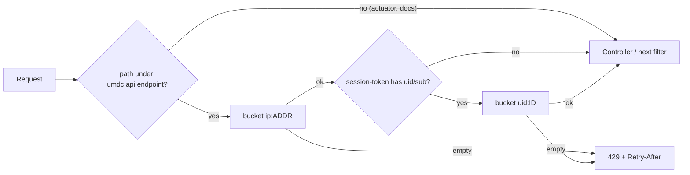
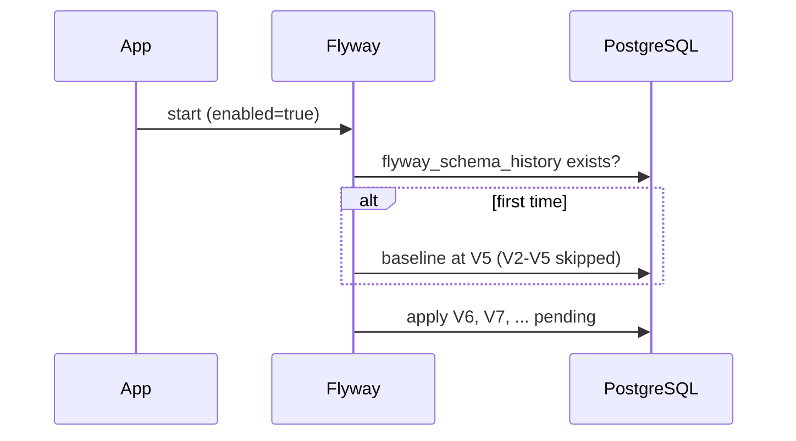

# Phase 0 platform: closed docs, rate limiting, Flyway, coverage

Technical guide for the platform changes of Phase 0 (flow C).

## 1. Swagger / api-docs closed outside dev and test

`SessionTokenSecurityConfig` only adds `permitAll` for `/v3/api-docs/**`, `/swagger-ui/**`, `/swagger-ui.html` and `/swagger-resources/**` when `umdc.docs.enabled=true`. Otherwise those paths fall to `anyRequest().denyAll()` (403). The same property switches springdoc off (`springdoc.api-docs.enabled`, `springdoc.swagger-ui.enabled`), so in production the endpoints are not even registered.

| Property | Default (`bootstrap.yml`) | Notes |
|---|---|---|
| `umdc.docs.enabled` (`UMDC_DOCS_ENABLED`) | `false`; `true` under profile `dev`; `true` in `application-test.yml` | closed in every other profile |

The one-argument constructor `new SessionTokenSecurityConfig(apiPath)` keeps the docs closed; Spring uses the two-argument one.

## 2. Rate limiting



Classes in `com.umdc.directory.config.ratelimit`:

- `RateLimitFilter` (`OncePerRequestFilter`): only the API path is limited, so `/actuator/health` and the probes are never touched. The user id is read from the unverified token payload (`uid`, else `sub`) just to choose a bucket; forging it can only create more buckets, the IP bucket always applies. `X-Forwarded-For` (first address) is used only if `trust-forwarded-header` is true (set it behind a trusted proxy only).
- `RateLimitStore` (interface) / `InMemoryRateLimitStore`: token bucket per key, continuous refill (`permits/60` tokens per second), idle buckets evicted every 1000 calls. A Redis implementation can be added later by declaring another `RateLimitStore` bean; `RateLimitConfig` picks it up through `ObjectProvider`.
- `RateLimitConfig`: registers the filter (order `HIGHEST_PRECEDENCE + 10`, before Spring Security) only when `umdc.ratelimit.enabled=true`.
- Rejection: HTTP 429, `Retry-After` (seconds until one token is back, at least 1), `X-RateLimit-Limit`, body `{"error":"too_many_requests","retryAfterSeconds":N}`.

| Property | Env var | Default |
|---|---|---|
| `umdc.ratelimit.enabled` | `UMDC_RATELIMIT_ENABLED` | `true` (`false` in the test profile) |
| `umdc.ratelimit.ip-per-minute` | `UMDC_RATELIMIT_IP_PER_MINUTE` | `120` |
| `umdc.ratelimit.user-per-minute` | `UMDC_RATELIMIT_USER_PER_MINUTE` | `300` |
| `umdc.ratelimit.trust-forwarded-header` | `UMDC_RATELIMIT_TRUST_FORWARDED` | `false` |

Limitation: in-memory buckets are per instance, so with N replicas the effective quota is N times higher until the Redis store exists.

## 3. Flyway

Dependencies: `spring-boot-starter-flyway` and `flyway-database-postgresql` (versions managed by the Spring Boot BOM). Configuration in `bootstrap.yml`:

```yaml
spring.flyway:
  enabled: ${SPRING_FLYWAY_ENABLED:false}   # OFF by default
  baseline-on-migrate: true
  baseline-version: "5"
  locations: classpath:db/migration
```

It is off because `V2` to `V5` were applied by hand in every environment. To enable it in an environment: set `SPRING_FLYWAY_ENABLED=true`. On the first start Flyway creates `flyway_schema_history`, baselines at version 5 (V2-V5 are marked as already applied and are NOT executed) and runs only `V6` and later.



Numbering rule:

- Never rename or edit an existing `V*.sql`; a new change is a new file with the next number.
- `V6` is reserved for Phase 1 business hours of locations and `V7` for `saved_search` / `favorite_list`. Do not use those numbers for anything else.
- Scripts must be idempotent-safe for the baseline path (the target database already has V2-V5).
- Tests use H2 with `ddl-auto=create-drop` and `spring.flyway.enabled=false` (`application-test.yml`); the PostgreSQL-specific scripts are not run against H2.

## 4. Coverage measurement

Before: `jacoco.argLine` was an empty pom property, so `${jacoco.argLine}` in Surefire was interpolated empty, no `jacoco.exec` was written and `jacoco-check` was skipped. Now:

- `prepare-agent` runs in the default build and writes `jacoco.argLine`.
- Surefire uses `<argLine>@{jacoco.argLine}</argLine>` (late replacement, resolved after `prepare-agent`). Passing `-Djacoco.argLine=...` on the command line still works.
- `mvn clean verify` (the CI command) now writes `target/jacoco.exec` and `target/site/jacoco/jacoco.xml` and enforces `jacoco-check`: LINE >= 0.80 (bundle), BRANCH >= 0.50 (package) and, new, METHOD >= 0.85 (bundle). Measured: METHOD 93.4 %.
- The old `coverage` profile was removed (its work is now default).
- `.github/workflows/ci.yml` is unchanged: it already runs `mvn -B -V -e clean verify` and uploads `target/site/jacoco`.

## 5. Tests

`SessionTokenSecurityConfigTest` (docs open), `SessionTokenSecurityConfigDocsClosedTest` (docs 403), `InMemoryRateLimitStoreTest`, `RateLimitFilterTest`, `RateLimitConfigTest`, `PlatformDefaultsTest` (bootstrap defaults).
