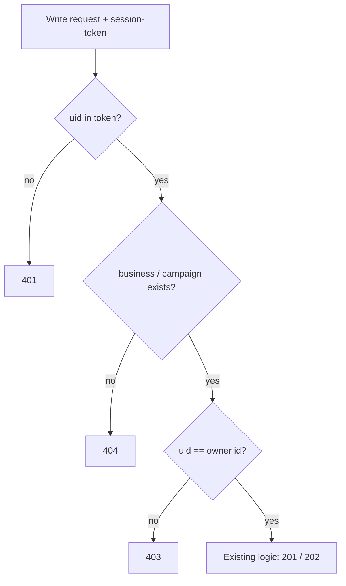

# Owner checks on product and campaign writes (technical guide)

Implements RF-01 part 2 of the MVP requirements (the analysis is kept outside the repository).

## Design

Each write endpoint takes the `session-token` header (`ConstantApp.SESSION_TOKEN_KEY`, as in `BusinessApi`). The service reads the user with `JwtUtil.getUidFromToken` (signature is verified earlier by the security interceptor) and compares it with `BusinessRepository.findOwnerId(businessId)`. The logic is inline, following `BusinessServiceImpl.deleteBusiness`; no shared helper.

## Per operation

| Method | Check |
| --- | --- |
| `ProductServiceImpl.create(req, token)` | token, then `countByUserId(uid) > 0` (the payload has no business); `403` otherwise |
| `ProductServiceImpl.linkProductToBusiness(req, token)` | `businessId` required (`400`), token, `findOwnerId` |
| `CampaignServiceImpl.create(to, token)` | token first, then existing field validation, then `findOwnerId(businessId)` (`404`/`403`) |
| `CampaignServiceImpl.update(id, req, token)` | token, campaign lookup, `findOwnerId` of the campaign's business, plus `findOwnerId` of the target when `businessId` changes; then the optimistic `lastUpdate` check (`409`) and `202` |

`create` returns the `401`/`403`/`404` as `ResponseEntity`; `update` keeps throwing `ResponseStatusException` as before.

## Signature changes

`ProductService.create/linkProductToBusiness`, `CampaignService.create/update` and the matching `*Api`/`*Controller` methods gained a trailing `String token` parameter.

## Tests

`ProductCampaignOwnerChecksTest` covers owner, other user, missing token and missing business or campaign for each operation. `support/OwnerTokens` builds unsigned tokens with a `uid` claim.
