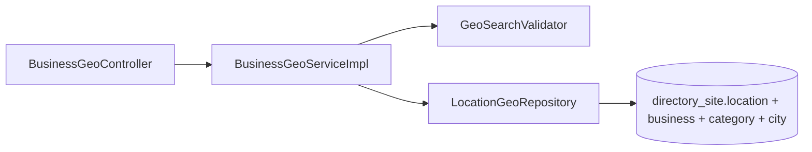

# Geographic search: nearby and map (technical guide)

Requirement RF-05 of the MVP analysis. Public endpoints (`/api/v1/**` is `permitAll`), no PostGIS.

## Components

- `BusinessGeoApi` / `BusinessGeoController`: `/api/v1/businesses/nearby` and `/map`. They are literal paths, so they win over `/businesses/{id}` (same precedent as `search`; tested in `BusinessGeoRoutesTest`). All parameters are received as text so that `GeoSearchValidator` can answer `400` with the reason in `message-error` (also for non numeric values).
- `LocationGeoRepository`: native SQL built with an `EntityManager`. Filters are bound as named parameters; numbers inlined in the SQL are validated doubles formatted with `Locale.ROOT`, never user text.
- Distance: Haversine, `2R * asin(sqrt(least(1, sin2(dLat/2) + cos(lat0) cos(lat) sin2(dLng/2))))`, R = 6371000 m, using only `sin`, `cos`, `asin`, `sqrt`, `power`, `radians`, `least`, which exist in PostgreSQL and H2.
- Pre-filter: a bbox derived from the radius (handles the antimeridian and the poles) uses the partial index `idx_location_geo` created by `V8__location_geo_index.sql` (not applied by this change).
- Order: `distance_m, location id`; with `sort=name`: `name, distance_m, location id`. Category filter: `c.id = x or c.category_parent_fk = x`. Text: `lower(...) like ... escape '\'` with `%`, `_` and `\` escaped.
- Clusters (zoom < 14): grid cells of `90 / 2^zoom` degrees, `group by floor(lng/cell), floor(lat/cell)`, centroid = average, most populated first.
- Logs never contain exact coordinates (rounded to 2 decimals).

## Contract

### `GET /api/v1/businesses/nearby`

| Param | Type | Rules |
|---|---|---|
| `lat` | number | required, -90..90 |
| `lng` | number | required, -180..180 |
| `radius_m` | int | default 5000, 1..50000 |
| `category_id`, `city_id` | UUID | optional |
| `q` | string | optional, max 100 |
| `sort` | `distance`\|`name` | default `distance` |
| `page`, `per_page` | int | default 1 and 10; page >= 1, per_page 1..100 |

`200`: `{total_count, page, per_page, total_pages, data:[{location_id, business_id, name, description, category_id, category_name, verified, profile_image_ref, city_id, city_name, location_name, address_line, latitude, longitude, main, distance_m}]}`. `400` with `message-error`. `500` on unexpected errors.

### `GET /api/v1/businesses/map`

| Param | Type | Rules |
|---|---|---|
| `bbox` | `minLng,minLat,maxLng,maxLat` | required; min < max; at most 90 degrees per axis |
| `zoom` | int | default 14, 0..22 |
| `category_id`, `city_id`, `q` | | as above |
| `limit` | int | default 200, 1..500 |

`200`: `{type:"FeatureCollection", features:[...], truncated, clustered, zoom}`. Point feature: `{type:"Feature", geometry:{type:"Point", coordinates:[lng,lat]}, properties:{business_id, location_id, name, category_id, verified, main}}`. Cluster feature (zoom < 14): same geometry, `properties:{cluster:true, count}`. Coordinates have 5 decimals. `truncated` is `true` when the limit was reached. `400` with `message-error`.

## Tests

`LocationGeoRepositoryTest` runs the SQL on H2 in PostgreSQL mode (inside and outside the radius, distance order and tie-break, name order, pagination, category with sub-categories, city, text escaping, bbox, clusters, extreme coordinates). The SQL has not been run on PostgreSQL by this change; check it against a real database before relying on the performance.
