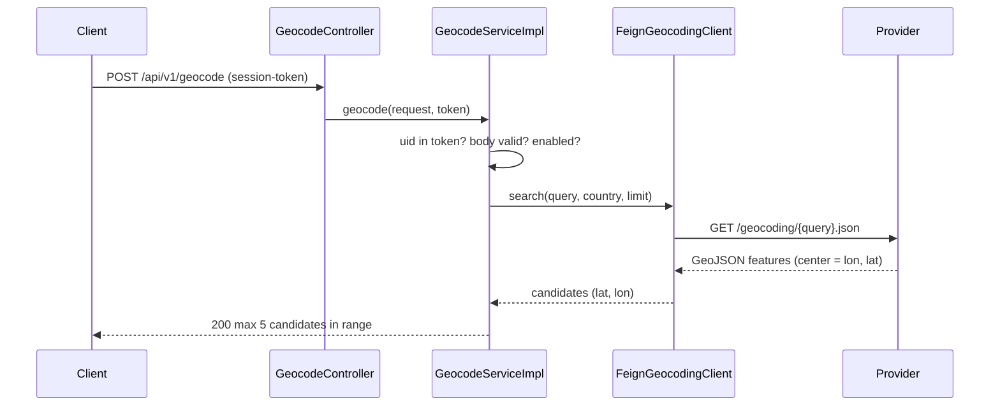

# Server-side geocoding and pin validation (F1-C, RF-04 backend)

## Design

A `GeocodingClient` port hides the provider. The only implementation, `FeignGeocodingClient`, calls a Maptiler-style API through the Feign interface `MaptilerGeocodingFeign` (`GET {base-url}/geocoding/{query}.json?key=&limit=&country=`). `GeocodeServiceImpl` validates the request, applies the switch and maps failures. Results are **not cached or persisted** (provider terms) and the address is never logged.

## Contract of `POST /api/v1/geocode`

Request `GeocodeRequest`: `address` (required, trimmed non-empty, max 200), `city` (optional, max 200), `country` (optional, `[A-Za-z]{2}`, default `ca`). Header `session-token` (uid claim required).

Response `GeocodeResponse`: `candidates[]` of `{label, latitude, longitude, confidence?}` (`confidence` omitted when null), at most 5, with `|lat| <= 90` and `|lon| <= 180`.

| Status | Cause | `message-error` |
| --- | --- | --- |
| 200 | ok or empty | |
| 400 | blank address, field over 200, bad country | `address is required`, `address, city and country must have at most 200 characters`, `country must be an ISO 3166-1 alpha-2 code` |
| 401 | no uid in token | `Unauthorized` |
| 502 | provider error (4xx/5xx, connection) | `Geocoding provider failed` |
| 503 | `umdc.geocoding.enabled=false` | `Geocoding is not enabled` |
| 504 | provider timeout | `Geocoding provider timed out` |

The `FeignException` text contains the request URL and therefore the API key: `FeignGeocodingClient` logs only the failure kind and the exception class, and throws `GeocodingException` with a fixed message. The rate limiter of Phase 0 applies to the path like to any other `/api/v1` route.

## Configuration

| Property | Default | Environment variable |
| --- | --- | --- |
| `umdc.geocoding.enabled` | `false` | `UMDC_GEOCODING_ENABLED` |
| `umdc.geocoding.base-url` | `https://api.maptiler.com` | `UMDC_GEOCODING_BASE_URL` |
| `umdc.geocoding.api-key` | empty | `UMDC_GEOCODING_API_KEY` (or Vault; never in the repository) |
| `umdc.geocoding.connect-timeout-ms` | `2000` | `UMDC_GEOCODING_CONNECT_TIMEOUT_MS` |
| `umdc.geocoding.read-timeout-ms` | `3000` | `UMDC_GEOCODING_READ_TIMEOUT_MS` |
| `umdc.geocoding.max-candidates` | `5` (clamped to 1..5) | `UMDC_GEOCODING_MAX_CANDIDATES` |
| `umdc.location.bounds.enforced` | `true` | `UMDC_LOCATION_BOUNDS_ENFORCED` |

Defaults live in `GeocodingProperties` and `LocationBoundsProperties` (no YAML change). `GeocodingFeignConfiguration` is intentionally not a `@Configuration` so its `Request.Options` (timeouts) applies only to this client. `@EnableFeignClients(basePackages = "com.umdc.directory.client")` already covers `client.geocoding`.

## Pin validation (`LocationValidator`)

After the existing pair and range checks: (0, 0) is rejected always; a point outside the Canada box (lat 41.6..83.2, lng -141.1..-52.5, constants in `LocationValidator`) is rejected while `umdc.location.bounds.enforced` is true. `LocationBoundsProperties` copies the property to a static flag of the validator at binding time, because the validator is a static utility called by `LocationServiceImpl`. Messages travel in `message-error` with `400`. Existing tests that saved example points outside Canada (1, 2) now use (45, -75).

## Tests

`GeocodeServiceImplTest` (success, empty, cap 5, out-of-range filter, 400s, 401, 503, 502, 504), `FeignGeocodingClientTest` (mapping, malformed features, timeout, 5xx without key leak, path sanitising, timeouts), `GeocodeControllerTest`, `LocationValidatorBoundsTest` ((0,0), outside Canada, edges, toggle, incomplete pair). The provider is always mocked: no network in tests.
