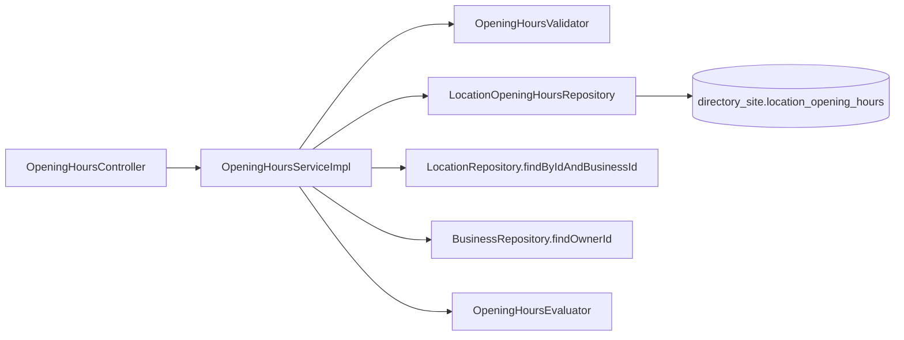
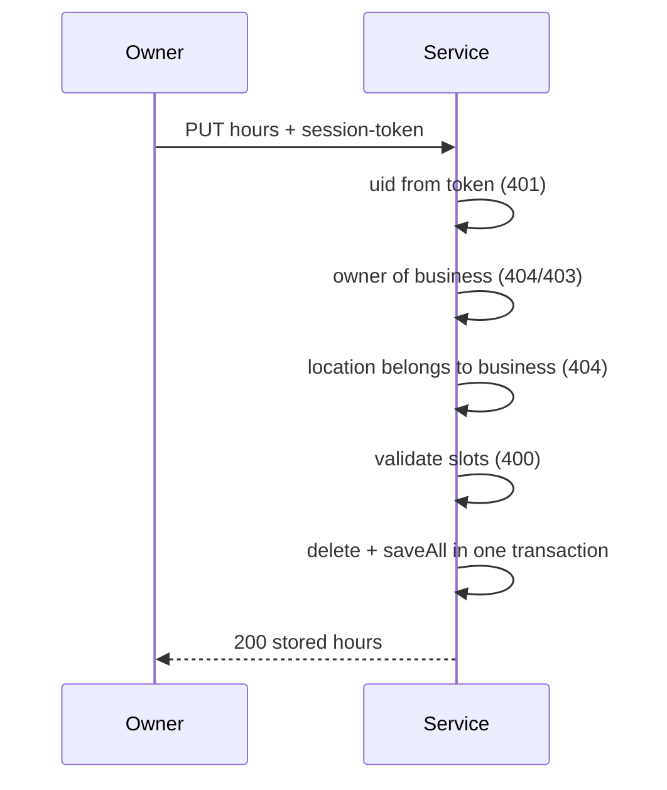

# Opening hours per location (technical guide)

RF-09. New, self-contained feature: it does not change `LocationTO`, `LocationEntity`, `LocationServiceImpl` or the search DTOs.

## Components
| Class | Role |
|---|---|
| `OpeningHoursApi` / `OpeningHoursController` | Routes under `/api/v1/businesses/{businessId}/locations/{locationId}` |
| `OpeningHoursService` / `OpeningHoursServiceImpl` | Access rules, zone resolution, status |
| `OpeningHoursValidator` | Body validation (package-private) |
| `OpeningHoursEvaluator` | Pure functions `isOpenNow` and `nextChange` (no clock, no I/O) |
| `LocationOpeningHoursEntity` / `LocationOpeningHoursRepository` | Persistence; also `findTimezoneOfBusiness` |
| `OpeningHoursMessages` | `message-error` reasons and limits |
| `V6__create_location_opening_hours.sql` | Table, CHECKs, index. Flyway is off by default: the script is not applied by this change |

## Endpoints
| Method and path | Access | Answers |
|---|---|---|
| `GET .../hours` | public | 200 `{slots[], timezone}`; 404 |
| `PUT .../hours` | owner (`session-token`, `uid` equals `BusinessRepository.findOwnerId`) | 200; 400 + `message-error`; 401; 403; 404 |
| `GET .../hours/status?at=` | public | 200 `{open_now, closes_at or opens_at, timezone}`; 400 invalid `at`; 404 |

Order of checks in `PUT`: 401 (no uid), 404 (business), 403 (not owner), 404 (location of that business), 400 (body).

## Validation (400)
`day_of_week` 1..7; `HH:mm` (`00:00`..`23:59`); `opens_at < closes_at`; closed day has no times and no other slot; at most 4 slots per day (so at most 28 in total); slots of a day do not overlap (touching is fine).

## Time zone
`BusinessEntity.timezoneFk` points to `TimezoneEntity`. Resolution: `ZoneId.of(name)` when the name is an IANA id; otherwise the fixed `utcOffset`; otherwise `America/Toronto`. A fixed offset has no daylight saving, so a business should be stored with an IANA name.

## Evaluator
Each slot becomes an instant interval for the days from yesterday to 14 days ahead (`LocalDateTime.atZone(zone)`, so daylight saving changes keep the local hours; a time inside the spring gap moves forward). `23:59` closing means the end of the day. Touching or overlapping intervals are merged, which joins "until 23:59" with "from 00:00 next day". `isOpenNow` checks containment (opening included, closing excluded). `nextChange` returns the end of the containing interval, or the start of the next one; it returns empty when there are no hours or the interval reaches the scan horizon (always open).

## Integrating `open_now` in the search (follow-up)
1. Load slots for the page of results in one query (add `findByLocationIdIn`), group by location.
2. Resolve each business zone once (batch the timezone query).
3. Call `OpeningHoursEvaluator.isOpenNow(slots, zone, Instant.now())` and `nextChange` per result, and add the fields to the search item DTO. An `open_now=true` filter needs the same evaluation after the query (or a materialised column) because the time zone and the day change the answer.

## Tests
`OpeningHoursEvaluatorTest` (fixed instants, zones, daylight saving, midnight), `OpeningHoursServiceImplTest` (owner/other/no token/unknown matrix, validation, zone fallback, status with a fixed clock), `LocationOpeningHoursRepositoryTest` (`@DataJpaTest`, H2), `OpeningHoursRoutesTest`.
