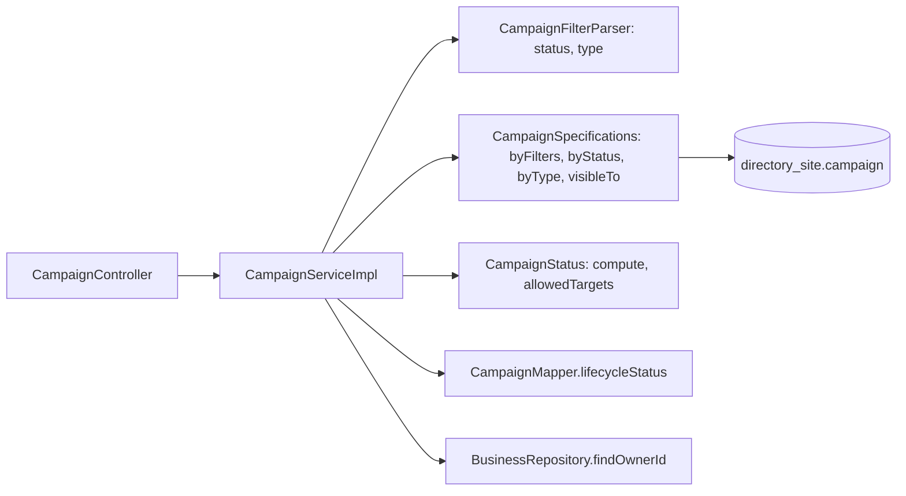
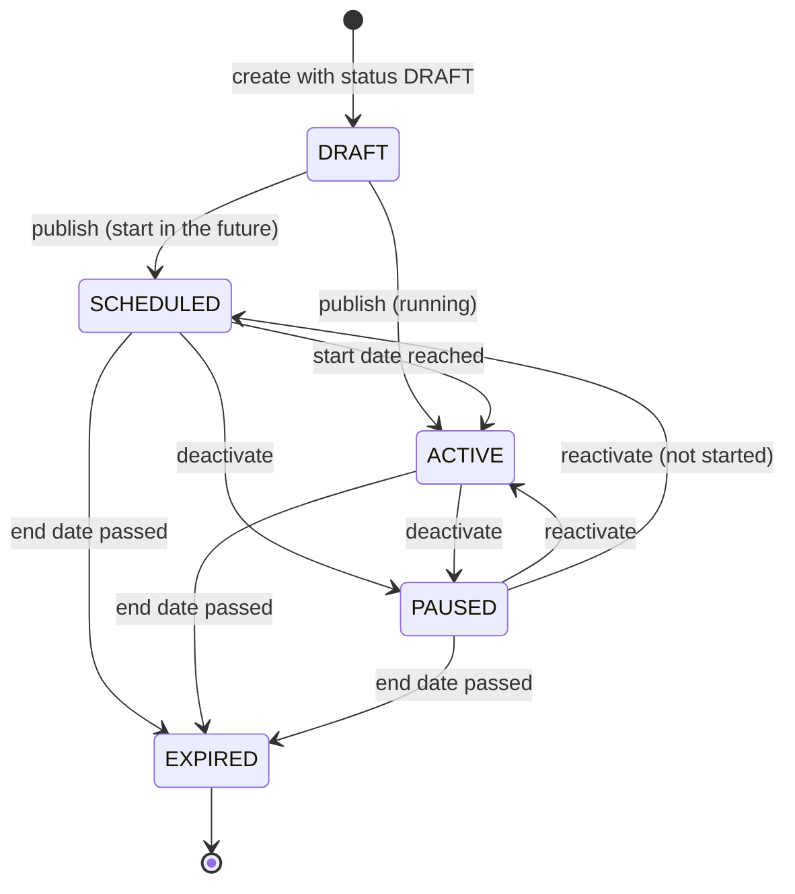
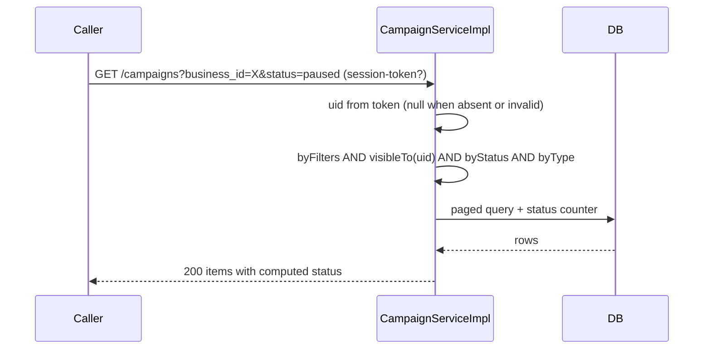

# Campaigns: type, lifecycle status and visibility (technical guide)

RF-03. Reuses `CampaignFilterParser`, `CampaignSpecifications` and `CampaignServiceImpl`; `PATCH` keeps the `lastUpdate` check and the `202 Accepted` answer.

## Model
- `campaign.type`: `PROMOTION | EVENT | ANNOUNCEMENT` (`CampaignType`, case-insensitive on input, stored upper case). Default `PROMOTION` on create.
- `campaign.status`: only `DRAFT` is stored (or null). Every other status is computed at read time by `CampaignStatus.compute(stored, active, start, end, now)` with this precedence: `DRAFT`, `EXPIRED` (end before now), `PAUSED` (`active = false`), `SCHEDULED` (start after now), `ACTIVE`.
- The mapper exposes the computed value in `CampaignTO.status` and `CampaignResumeTO.status`. A `status` sent by the client on create is ignored, except `DRAFT`.
- `V10__campaign_type_status.sql` (applied by hand): adds the columns if missing, maps legacy `type` values to `PROMOTION`, clears legacy `status` text, adds `ck_campaign_type`, `ck_campaign_status`, default `PROMOTION` and `idx_campaign_business_active_end`.

## Status transitions

`CampaignStatus.allowedTargets()` is the table; `EXPIRED` is final. Illegal requests answer `409` with `message` `Campaign status transition not allowed: A -> B` and change nothing. Time moves ACTIVE/SCHEDULED to EXPIRED by itself, so no job is needed.

## Endpoints
| Method and path | Access | Answers |
|---|---|---|
| `POST /api/v1/campaigns` | owner of `businessId` | `201` `CampaignTO` (now with `type`, computed `status`); `400` invalid `type`; `401`; `403`; `404` |
| `GET /api/v1/campaigns/{id}` | public; optional `session-token` | `200` `CampaignTO`; `404` when missing or hidden from the caller |
| `GET /api/v1/campaigns` | public; optional `session-token` | `200` `CampaignListResponse`; `400` invalid `status`/`type`/pagination |
| `PATCH /api/v1/campaigns/{id}` | owner | `202` `{id, lastUpdate}` (unchanged); body accepts optional `type`; `400`, `401`, `403`, `404`, `409` (stale `lastUpdate` or illegal transition) |
| `POST /api/v1/campaigns/{id}/deactivate` | owner | `200` `CampaignTO` with `status: PAUSED`; `401`; `403`; `404`; `409` |
| `POST /api/v1/campaigns/{id}/reactivate` | owner | `200` `CampaignTO` (`ACTIVE` or `SCHEDULED`); `401`; `403`; `404`; `409` unless currently `PAUSED` |
| `POST /api/v1/campaigns/{id}/publish` | owner | `200` `CampaignTO`; `401`; `403`; `404`; `409` unless `DRAFT` and not past its end date |

List query: existing `page`, `per_page`, `sort`, `title`/`q`, `category_fk`/`category_id`, `business_fk`/`business_id`, `active`, `start_*`/`end_*` (and legacy `start_date_*`/`end_date_*`), plus new `status` (`DRAFT|SCHEDULED|ACTIVE|PAUSED|EXPIRED`) and `type`. Header `session-token` is optional and is only used to widen visibility.

Request body of `POST` lifecycle calls: none. Response shape `CampaignTO`: `id, title, description, startDate, endDate, categoryId, businessId, createdDate, lastUpdate, discount, active, categoryName, status, terms, type`. List item `CampaignResumeTO`: `id, title, description, endDate, categoryName, discount, status`. The list totals `active` and `inactive` count by the `active` flag (active means flag true and end date not passed), `expired` by end date.

## Visibility
`CampaignSpecifications.visibleTo(userId, now)` is AND-ed to the list specification: `(owner of the business) OR (not draft AND end_date >= now AND active)`. Without a valid token only the second branch applies. The total counts, pagination and the status counter use the same specification, so they never leak hidden rows. `GET /{id}` applies the same rule through `isVisible`.

## Decisions
- Status is computed rather than stored so it cannot go stale and needs no scheduler.
- `EXPIRED` beats `PAUSED`: an expired campaign stays `EXPIRED` whatever its flag, and cannot be reactivated.
- A consumer without a session token still gets the public list (no `401`), to keep the existing public contract.
- `PATCH` with `active` keeps working (same effect as deactivate/reactivate) but is also checked against the transition table.
- Lifecycle responses are documented with the `CampaignApi.LifecycleResponses` meta-annotation; `api/index.yaml` is updated separately.

## Tests
`CampaignStatusTest` (compute, parse, table), `CampaignLifecycleTest` (service branches, 401/403/404/409, create/PATCH, 202 kept), `CampaignLifecycleRepositoryTest` (H2: status, type, visibility specs and the counter), `CampaignFilterParserTest`, `CampaignControllerTest`.
