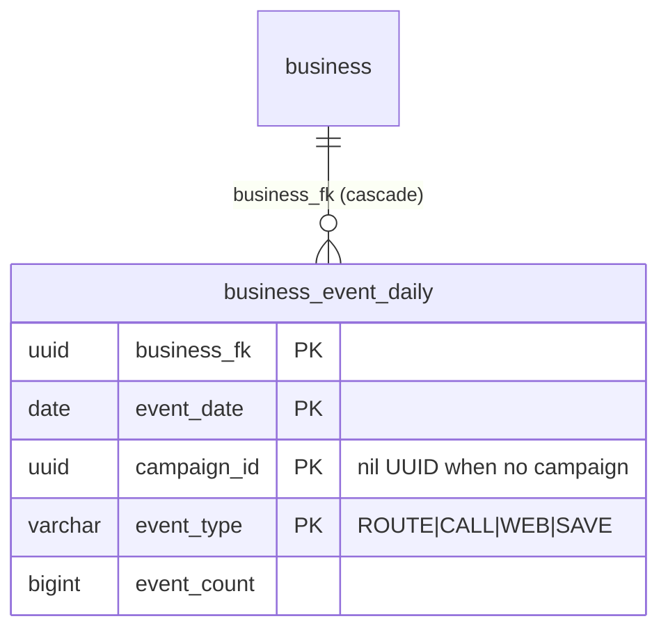
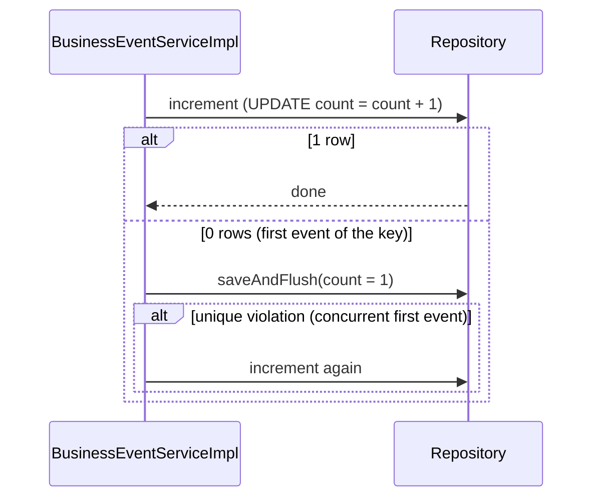

# F2-D RF-10 Aggregated click events

Technical guide. Code: `BusinessEventApi` / `BusinessEventController` / `BusinessEventServiceImpl` (package `com.umdc.directory.api.v1`), `BusinessEventDailyEntity` + `BusinessEventDailyId`, `BusinessEventDailyRepository`, `BusinessEventType`, and the event bucket in `RateLimitFilter`. Modelled on the view counters (`BusinessViewDailyEntity`, `BusinessStatsServiceImpl`).

## Data model (`V11__create_business_event_daily.sql`)



- One row per business, UTC day, campaign and type. No IP, user id or per-click rows.
- `campaign_id` is part of the primary key, so it cannot be null: events without campaign use the nil UUID (`BusinessEventDailyId.NO_CAMPAIGN`), exposed as `campaign_id: null` in the summary. It is not a foreign key; the service checks `CampaignRepository.existsByIdAndBusinessFk_Id`.
- Script is idempotent (`IF NOT EXISTS`), schema `directory_site`, applied by hand (Flyway is off). Tests create the table on H2 with `ddl-auto`.

## Atomic increment



Each step runs in its own transaction (the service method is not `@Transactional`), so a duplicate-key error cannot poison later steps. The counter arithmetic is done by the database, never read-modify-write in Java (`BusinessEventDailyRepositoryTest` proves a stale entity does not lose updates).

## Rate limiting

Besides the global IP and user buckets, `RateLimitFilter` takes a token from `ev:<ip>:<request uri>` for `POST {api}/businesses/{id}/events` only, `umdc.ratelimit.events-per-minute` (env-less property, default 20, `RateLimitConfig` `@Value`; 0 disables). So one client is limited per business; the general IP quota still applies first. A rejected request answers `429` with `Retry-After` and `X-RateLimit-Limit` and never reaches the service, so a burst cannot inflate a counter beyond the quota. Limitation: buckets are per instance (see `f0-platform.md`).

## Endpoints (to merge into `api/index.yaml`)

Both need the `session-token` header (`400` if absent from the header, `401` from the session filter if invalid). Base `/api/v1`.

### POST `/businesses/{businessId}/events`
Request (`BusinessEventRequestTO`): `{"type": "ROUTE|CALL|WEB|SAVE" (case-insensitive), "campaign_id": uuid | omitted}`. Unknown JSON fields are ignored.
Responses: `204` counted or owner ignored; `400` missing body or invalid type (`message-error` header); `404` business not found or campaign not of the business; `429`.

### GET `/businesses/{businessId}/events/summary?from=yyyy-MM-dd&to=yyyy-MM-dd`
Owner only (`uid` of the token equals `BusinessRepository.findOwnerId`). `to` defaults to today (UTC), `from` to `to - 29 days`; `from > to` or more than 365 days is `400`. Responses: `200`, `400`, `401`, `403`, `404`.

Response (`BusinessEventSummaryTO`):

```json
{
  "businessId": "uuid", "from": "2026-11-01", "to": "2026-11-23", "total": 9,
  "totalsByType": {"CALL": 5, "ROUTE": 0, "SAVE": 0, "WEB": 4},
  "campaigns": [{"campaign_id": null, "total": 2, "byType": {"CALL": 2, "ROUTE": 0, "SAVE": 0, "WEB": 0}}],
  "daily": [{"date": "2026-11-01", "total": 0, "byType": {"CALL": 0, "ROUTE": 0, "SAVE": 0, "WEB": 0}}]
}
```

`daily` has one entry per day with zeros; `campaigns` only the campaigns with events.

## Decisions

- Owner events are not counted (same rule as views). The 401 for an invalid session on POST comes from the session interceptor, as for views.
- Unique users cannot be told apart by design; counts are clicks, bounded by the rate limit.

## Tests

`BusinessEventServiceImplTest` (every branch, fixed clock), `BusinessEventRoutesTest`, `BusinessEventDailyRepositoryTest` (H2), `BusinessEventTypeTest`, `RateLimitFilterTest` (event bucket cases).
