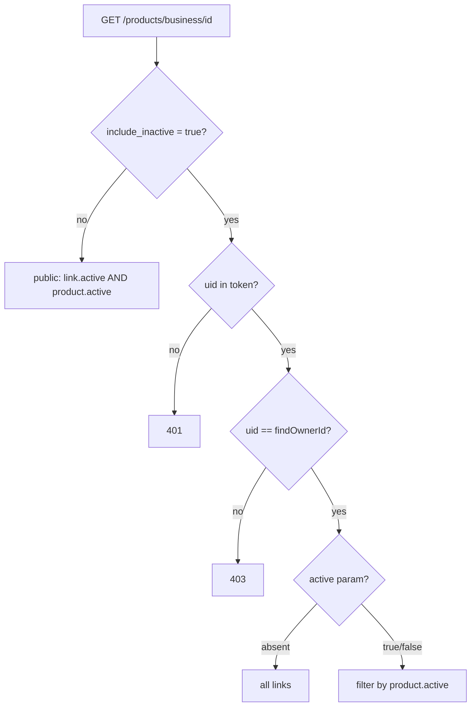
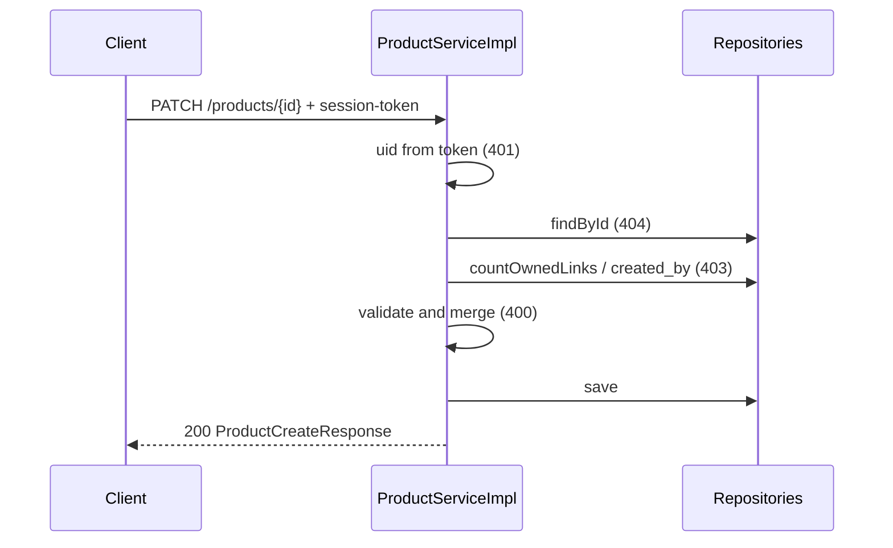

# Products RF-02: edit, deactivate, price and image (technical guide)

Implements RF-02 of the MVP requirements (the analysis is kept outside the repository). Follows the owner-check convention of [F0 product and campaign owner checks](f0-product-campaign-owner-checks.md): `session-token` header, `JwtUtil.getUidFromToken`, `401/403/404` as `ResponseEntity`.

## Endpoints

Base path `/api/v1/products`. Write endpoints require `session-token`.

| Method and path | Request | Success | Errors |
| --- | --- | --- | --- |
| `POST /` | `ProductCreateRequest` | `201` `ProductCreateResponse` | `400`, `401`, `403`, `404` (businessId) |
| `POST /link` | unchanged | `201` | unchanged |
| `GET /business/{businessId}?page&per_page&active&include_inactive` + optional `session-token` | - | `200` `ProductListResponse` | `400`, `401`, `403`, `404` |
| `PATCH /{productId}` | `ProductUpdateRequest` | `200` `ProductCreateResponse` | `400`, `401`, `403`, `404` |
| `PUT /{productId}` | `ProductUpdateRequest` | `200` `ProductCreateResponse` | `400`, `401`, `403`, `404` |
| `DELETE /{productId}` | - | `204` (idempotent) | `401`, `403`, `404` |

Shapes (JSON, camelCase as the existing product DTOs; `BigDecimal` serialised as a number):

```text
ProductCreateRequest  { name*, description*, categoryId*, price?, currency?, imageRef?, businessId? }
ProductUpdateRequest  { name?, description?, categoryId?, price?, currency?, imageRef?, active? }
ProductCreateResponse { id, name, description, createdDate, lastUpdate, categoryId, price, currency, imageRef, active }
ProductListItemTO     { id, name, description, categoryParentId, lastUpdate, createdDate, active, price, currency, imageRef }
ProductListResponse   { total_count, page, per_page, total_pages, data[] }   (unchanged)
```

The older constructors of `ProductCreateRequest`, `ProductCreateResponse` and `ProductListItemTO` (without the new fields) are kept, so existing callers compile.

## Decisions

### POST /products business id semantics (pending point from F0)
In F0 the create payload had no business, so the only check possible was "the user owns at least one business", and the product stayed unlinked until `POST /products/link`. Chosen behaviour, backward compatible:

- `businessId` **absent**: as before (`countByUserId > 0`, else `403`), no link is created.
- `businessId` **present**: `findOwnerId` gives `404` if the business does not exist and `403` if it belongs to another user; then the product is saved and linked as active in the same request. This is the recommended call for the BFF/front.
- The new column `product.created_by` stores the creator, so an unlinked product can still be edited by its creator.

### Ownership of a product
`ProductServiceImpl.authorize`: token (`401`), `ProductRepository.findById` (`404`), then allowed if `created_by == uid` or `BusinessProductRepository.countOwnedLinks(productId, uid) > 0` (the user owns a business that carries the product); otherwise `403`. Legacy products have `created_by = NULL`, so they are editable through the link rule.

### Active status
- `product.active` is the status managed by this feature. New products are created `active = true` (`ProductMapper.toProductEntity` constant). Before this change the entity default was `false` and nothing set it, so every product was inactive; `V9` activates those legacy rows once.
- `DELETE` is a soft delete: sets `active = false`, refreshes `lastUpdate`, does not touch `business_product`. `PATCH {"active": true}` reactivates.
- The link `business_product.active` keeps its meaning (set to `true` when linking).

### Listing


The business is checked with `existsById` first (`404`). Public mode ignores the `active` parameter: before this change `active=false` returned inactive products to anyone, which RF-02 forbids. This is the only behavioural change to an existing contract, and it is the requirement. Queries: `findByBusinessAndActiveAndProductActive`, `findByBusinessAndProductActive`, `findByBusiness`.

### Price and image validation (`ProductValidator`)
| Rule | Error |
| --- | --- |
| price and currency both null or both present | `400` |
| `price >= 0` and at most 2 decimals (`stripTrailingZeros().scale() <= 2`) | `400` |
| currency: 3 letters A-Z after trim and upper-casing and accepted by `java.util.Currency` | `400` |
| `imageRef` at most 512 characters | `400` |
| PATCH: name or description sent blank, name > 255, description > 1500 | `400` |
| PUT: name, description or categoryId missing | `400` |

PATCH validates the merged result (a sent price with the stored currency, and the reverse). PUT replaces price, currency and image (absent = cleared). A `DataIntegrityViolationException` on save (for example an unknown `categoryId`) answers `400`. Messages are in `DirectoryAppConstants` (`PRODUCT_*`); the HTTP answers carry no body, as in the other product operations.



## Data: migration V9
`src/main/resources/db/migration/V9__product_price_status_image.sql` (applied by hand, idempotent): adds `price NUMERIC(12,2)`, `currency CHAR(3)`, `image_ref VARCHAR(512)`, `created_by UUID` (all nullable), the check `ck_product_price` (both null or price >= 0 with currency) and `idx_product_active`. The one-time `UPDATE product SET active = TRUE WHERE active = FALSE` runs only when the `price` column does not exist yet, so re-running the script never reactivates products that owners deactivated. Entity: `ProductEntity` (`price`, `currency`, `imageRef`, `createdBy`).

## Changes to existing code
- `ProductApi/ProductController`: the list method gained `include_inactive` and the optional `session-token` (the 4-argument `ProductService.findByBusinessId` remains and delegates to the public mode); `patchProduct`, `putProduct`, `deleteProduct` added.
- `ProductService`: `update(id, request, token, replace)`, `deactivate(id, token)` and the 6-argument list, all `501` by default.
- `ProductMapper`: `active = true` on create, price/image in the response.
- `ProductServiceImplTest`: the two listing tests now expect the public query.

## OpenAPI
`src/main/resources/api/index.yaml` is not changed here; it is updated separately from the table above.

## Tests
`ProductManagementTest` (every branch of create with business, PATCH, PUT, DELETE, owner listing), `ProductValidatorTest`, `ProductManagementControllerTest`, `ProductRepositoryTest` (H2: public and owner queries, `countOwnedLinks`, price persisted), plus the updated `ProductServiceImplTest`.
