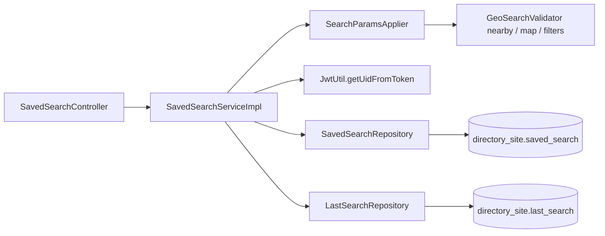
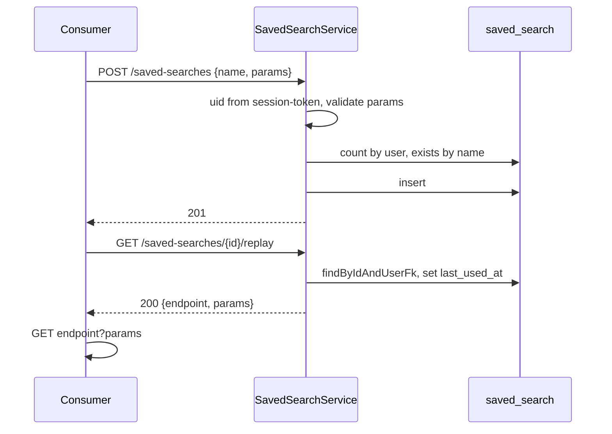

# Saved searches and last search (technical guide)

RF-08. New, self-contained feature. The only change to an existing class is an additive `GeoSearchValidator.filters(...)` (plus the `Filters` record) so that searches with no point or bbox are validated with the same rules.

## Components
| Class | Role |
|---|---|
| `SavedSearchApi` / `SavedSearchController` | Routes under `/api/v1/users/me`. The `session-token` header is `required = false` so that the service answers `401` (not `400`) |
| `SavedSearchService` / `SavedSearchServiceImpl` | Ownership, limit, duplicate names, replay mapping |
| `SearchParamsApplier` | Validates a `SearchParamsTO` (reusing `GeoSearchValidator`), normalises it into the entity, maps entity to TO |
| `SearchParamsBase` | `@MappedSuperclass` with the parameter columns |
| `SavedSearchEntity`, `LastSearchEntity` | Tables `saved_search` and `last_search` (the id of the last search is the user id) |
| `SavedSearchRepository`, `LastSearchRepository` | Every saved-search lookup includes `user_fk` |
| `SavedSearchConstants` | `MAX_PER_USER = 20`, `MAX_NAME_LENGTH = 80`, endpoints, `message-error` reasons |
| `V7__create_saved_search.sql` | Both tables (idempotent, `general."user"` FK with `ON DELETE CASCADE`). Flyway is off: apply by hand |

Parameters are plain columns instead of JSON, so they are validated, indexed and replayed without parsing. `favorite_list` is not part of this change.

## Endpoints
Base `/api/v1/users/me`. All need `session-token` (`401` otherwise, `message-error: Unauthorized`).

| Method and path | Body | Answers |
|---|---|---|
| `POST /saved-searches` | `{name, params}` | 201 `SavedSearchTO`; 400; 401; 409 duplicate name or limit |
| `GET /saved-searches` | | 200 `{items[], max}` newest first; 401 |
| `PATCH /saved-searches/{id}` | `{name}` | 200 `SavedSearchTO`; 400; 401; 404; 409 |
| `DELETE /saved-searches/{id}` | | 204 (physical delete); 401; 404 |
| `GET /saved-searches/{id}/replay` | | 200 `{endpoint, params{string:string}}`; 401; 404 |
| `GET /last-search` | | 200 `{params, updated_at}`; 401; 404 `No last search` |
| `PUT /last-search` | `SearchParamsTO` | 200 `{params, updated_at}` (upsert); 400; 401 |

Shapes (snake_case):
- `SearchParamsTO`: `q`, `category_id`, `city_id`, `city`, `lat`, `lng`, `radius_m`, `bbox`, `sort` (null fields omitted).
- `SavedSearchTO`: `id`, `name`, `params`, `created_at`, `updated_at`, `last_used_at`.
- `SearchReplayTO`: `endpoint` (`/api/v1/businesses/search|nearby|map`), `params` with the query names that endpoint expects (`search` also gets `city`; `nearby` gets `lat`, `lng`, `radius_m`, `sort`; `map` gets `bbox`).

## Rules
- Ownership: the user is the `uid` of the token. A row of another user is `404`, never `403`, so ids do not leak.
- Validation order in `POST`: 401, 400 body, 400 name, 400 params (`SearchParamsApplier`), 409 limit, 409 duplicate name. In `PATCH`: 401, 404, 400 name, 409.
- `SearchParamsApplier`: `lat`/`lng` together (400), not with `bbox`, `radius_m` and `sort` need a point; with a point it calls `GeoSearchValidator.nearby`, with a bbox `map`, otherwise `filters`; an empty search is `400`. Text is trimmed, `sort` is normalised to `distance`/`name`, the bbox is trimmed.
- Names are unique per user ignoring case (`existsByUserFkAndNameIgnoreCase`; the SQL has a unique index on `lower(name)`).
- Replay stamps `last_used_at`. It does not touch the last search: the client sends it with `PUT /last-search`.
- Privacy: coordinates are only stored on the user's own rows, deleted physically with the saved search or when the user is deleted (cascade). Not logged.

## OpenAPI
`src/main/resources/api/index.yaml` is not changed by this task; the endpoint list above is the input for that update.

## Tests
`SavedSearchServiceImplTest` (every branch), `SavedSearchRoutesTest` (MockMvc, snake_case, fallbacks), `SavedSearchRepositoryTest` (derived queries on H2) and the new `filters` cases in `GeoSearchValidatorTest`.
