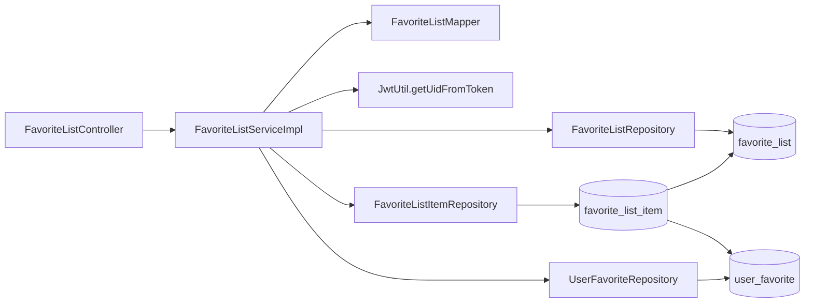
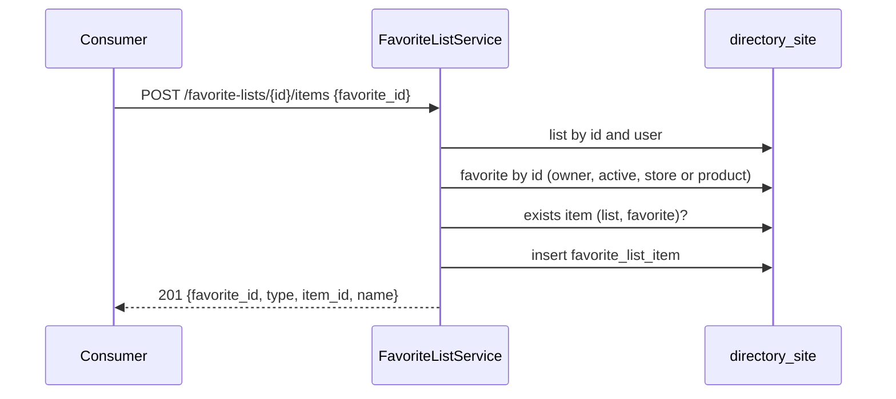

# Favorite lists and unique favorites index (technical guide)

RF-11. New, self-contained feature plus a database hardening of `user_favorite`. The existing `/api/v1/favorites` endpoints and classes are not modified.

## Components
| Class | Role |
|---|---|
| `FavoriteListApi` / `FavoriteListController` | Routes under `/api/v1/users/me`; `session-token` is `required = false` so the service answers `401` |
| `FavoriteListService` / `FavoriteListServiceImpl` | Ownership, limit, unique names, item rules |
| `FavoriteListMapper` | Entity to TO mapping (package private) |
| `FavoriteListEntity`, `FavoriteListItemEntity` | Tables `favorite_list` and `favorite_list_item`; `user_fk` is a plain UUID, no access to other schemas |
| `FavoriteListRepository`, `FavoriteListItemRepository` | Every list lookup includes `user_fk`; item page, counts (active favorites only) and delete by list |
| `FavoriteListConstants` | `MAX_PER_USER = 20`, `MAX_NAME_LENGTH = 80`, default page size 20, max 100, `message-error` reasons |

## Endpoints
Base `/api/v1/users/me`. All need `session-token` (`401`, `message-error: Unauthorized`). Errors carry their reason in `message-error`. JSON is snake_case.

| Method and path | Body | Answers |
|---|---|---|
| `POST /favorite-lists` | `{name}` | 201 `FavoriteListTO`; 400; 401; 409 duplicate name or limit |
| `GET /favorite-lists` | | 200 `{items: FavoriteListTO[], max}` newest first; 401 |
| `GET /favorite-lists/{id}?page=0&size=20` | | 200 `FavoriteListDetailTO`; 400 (`page < 0`, `size < 1`); 401; 404 |
| `PATCH /favorite-lists/{id}` | `{name}` | 200 `FavoriteListTO`; 400; 401; 404; 409 |
| `DELETE /favorite-lists/{id}` | | 204 (items removed, favorites kept); 401; 404 |
| `POST /favorite-lists/{id}/items` | `{favorite_id}` | 201 `FavoriteListItemTO`; 400 missing id or offer; 401; 404 list or favorite; 409 inactive or already in list |
| `DELETE /favorite-lists/{id}/items/{favoriteId}` | | 204; 401; 404 list or not in it |

Shapes:
- `FavoriteListTO`: `id`, `name`, `item_count`, `created_at`, `updated_at`.
- `FavoriteListDetailTO`: `id`, `name`, `created_at`, `updated_at`, `items` = `PaginatedResponse<FavoriteListItemTO>` (`total_count`, `page` 0-based, `per_page` capped at 100, `total_pages`, `items`).
- `FavoriteListItemTO`: `favorite_id`, `type` (`STORE` | `PRODUCT`), `item_id` (store or product id), `name`, `added_at`.

## Rules
- Ownership: the user is the `uid` of the token. A list of another user is `404`, never `403`. A favorite that is unknown or belongs to another user is `404`.
- Validation order in `POST /items`: 401, 404 list, 400 body, 404 favorite, 409 inactive, 400 offer, 409 already in list.
- Deleting a favorite (soft delete) leaves its items; they are hidden from pages and counts because queries filter `f.active = true`. Reactivating the favorite brings them back.
- `create`, `rename` and `addItem` are not `@Transactional` and use `saveAndFlush`: a unique-index violation from a concurrent request becomes `409`, like in `FavoriteServiceImpl`.

## Migrations (apply by hand, Flyway is off, idempotent)
- `V13__create_favorite_list.sql`: `favorite_list` with unique `(user_fk, lower(name))`; `favorite_list_item` with FKs to `favorite_list` and `user_favorite` (`ON DELETE CASCADE`) and unique `(list_fk, favorite_fk)`. No foreign key to any other schema.
- `V14__favorites_unique_index.sql` on `user_favorite` (real columns: `user_fk`, `business_fk`, `product_fk`, `campaign_fk`, `active`):
  1. Comments with the `SELECT` that reports duplicate active favorites and rows without exactly one target. Run them first.
  2. Older duplicate active rows are marked `active = false` (`deleted_at` set); nothing is deleted. The newest row of each user and target stays.
  3. Partial unique indexes `uq_fav_user_business`, `uq_fav_user_product`, `uq_fav_user_campaign` over active rows.
  4. `ck_fav_one_target`: `num_nonnulls(business_fk, product_fk, campaign_fk) = 1`, added `NOT VALID` (new and updated rows are checked, existing rows are not). The `VALIDATE CONSTRAINT` statement is left commented until the report 0b is empty.

The code already handled these constraints (`FavoriteServiceImpl.persist` maps `DataIntegrityViolationException` to `409`), so the indexes only close the race. See `docs/technical/f0-favorites.md`.

## OpenAPI note
`api/index.yaml` is not changed here; the table above is the contract to document.
