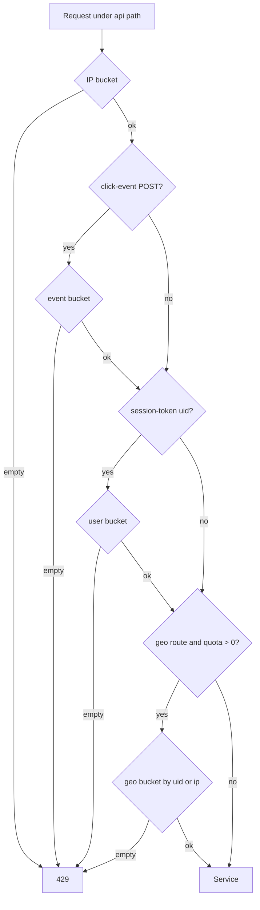

# F3-C Dedicated quotas for geo routes

Technical guide. Code: `RateLimitFilter`, `RateLimitConfig`, `InMemoryRateLimitStore` (package `com.umdc.directory.config.ratelimit`). Builds on the global buckets and the click-event bucket described in `f0-platform.md` and `f2-click-events.md`.

## Quotas

| Route | Bucket key | Property | Env var | Default |
|---|---|---|---|---|
| `POST {api}/geocode` | `geo:geocode:uid:<uid>` or `geo:geocode:ip:<ip>` | `umdc.ratelimit.geocode-per-minute` | `UMDC_RATELIMIT_GEOCODE_PER_MINUTE` | 10 |
| `GET {api}/businesses/map` | `geo:map:uid:<uid>` or `geo:map:ip:<ip>` | `umdc.ratelimit.map-per-minute` | `UMDC_RATELIMIT_MAP_PER_MINUTE` | 60 |
| `GET {api}/businesses/nearby` | `geo:nearby:uid:<uid>` or `geo:nearby:ip:<ip>` | `umdc.ratelimit.nearby-per-minute` | `UMDC_RATELIMIT_NEARBY_PER_MINUTE` | 60 |

- Read in `RateLimitConfig` with `@Value` and defaults; `application*.yml` is not edited. Spring relaxed binding maps the env vars to the properties above. A value of 0 or less disables that bucket.
- The key uses the `uid` (or `sub`) of the `session-token` payload when present (unverified, same caveat as the user bucket: forging it only creates more buckets, and the IP bucket always applies first), otherwise the client IP.
- Only the exact method and path match; other methods or sub-paths are untouched.

## Filter flow

The rejection happens in the filter, ahead of Spring Security, so the controller, the service and the geocoding provider (`FeignGeocodingClient`) are never called (`GeoQuotaRateLimitTest` verifies the services receive no call on 429).

## Rejection response

`429`, headers `Retry-After` (seconds, at least 1), `X-RateLimit-Limit` (the bucket that rejected), `message` (`DirectoryAppConstants.MESSAGE_HEADER`: `Too many requests, retry in N seconds`), body `{"error":"too_many_requests","retryAfterSeconds":N}`. The `message` header is now also sent for the global buckets (additive).

## Constructors

`RateLimitFilter(store, api, ip, user, trust)` and the 6-argument one (events) are kept and leave the geo buckets off; the new 9-argument one adds `geocode`, `map`, `nearby`.

## Bounded store

`InMemoryRateLimitStore` gets a hard cap (`maxBuckets`, default 100000, constructor `(LongSupplier, int)`). Besides the periodic idle eviction, when a new key arrives and the map is full, idle buckets are removed and, if still full, entries are trimmed until there is room. A trimmed active bucket only gets a fresh quota, so a flood of distinct keys cannot exhaust memory. Limitation: buckets are per instance (see `f0-platform.md`).

## Endpoints affected (contract unchanged, new 429 behaviour)

`POST /api/v1/geocode`, `GET /api/v1/businesses/map`, `GET /api/v1/businesses/nearby`: additional response `429` with the headers above. No request or response shapes change; `api/index.yaml` is updated separately.
