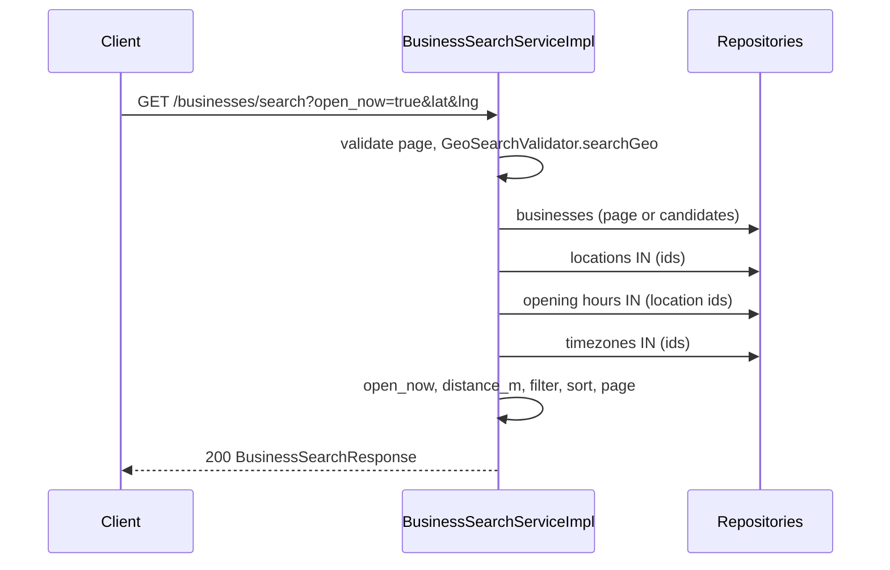

# Technical guide: search with open_now and distance_m (F3-B)

No migration. `/api/v1/businesses/search` stays public (no `session-token`, no owner check). Additive change: old clients ignore the new fields.

## Endpoint

`GET /api/v1/businesses/search` — existing params (`city_id`, `city`, `category_id`, `q`, `page`, `per_page`) plus:

| Param | Type | Notes |
|---|---|---|
| `open_now` | boolean | `true` filters; `false`/absent no filter |
| `lat`, `lng` | text | both or none; validated by `GeoSearchValidator.searchGeo` (|lat|<=90, |lng|<=180) |
| `sort` | `name` (default) \| `distance` | `distance` requires `lat`/`lng` |

Response `BusinessSearchResponse { total_count, page, per_page, total_pages, data[] }`. Each item of `data` is the previous shape plus:

```json
{ "open_now": true, "distance_m": 1250 }
```

`open_now`: `Boolean`, null when no location of the business has opening-hour rows. `distance_m`: `Long`, rounded metres, null without a point or without coordinates. `400` + `message-error` for invalid page/size (`SEARCH_INVALID_PAGINATION`) or geo params (`GeoSearchException` message).

## Logic (`BusinessSearchServiceImpl`)

- `open_now`: per location, `OpeningHoursEvaluator.isOpenNow(slots, zone, now)`; the business is open if any location is; the zone comes from `business.timezone_fk` through `OpeningHoursServiceImpl.zoneOf(TimezoneEntity)` (IANA name, else UTC offset, else default zone). `now` comes from an injectable `Clock`.
- `distance_m`: minimum haversine over the locations with coordinates, earth radius 6 371 000 m, the same formula as `LocationGeoRepository` (`nearby`).
- Fast path (no `open_now` filter, order by name): SQL page by `name, id` as before.
- In-memory path (`open_now=true` or `sort=distance`): the first `MAX_CANDIDATES` = 1000 matches (by name) are enriched, filtered/sorted (stable, nulls last) and paged; `total_count` is the number kept.

## No N+1

Per request, regardless of page size: `findAll(spec, pageable)` + `LocationRepository.findByBusinessIdIn` + `LocationOpeningHoursRepository.findByLocationIdIn` + `TimezoneRepository.findAllById`. A unit test verifies each is called exactly once for a 10-business page and that the per-location/per-business queries are never used.



## Files

`BusinessSearchApi`/`BusinessSearchService` (new 10-arg `search`; the 6-arg one delegates), `BusinessSearchServiceImpl`, `BusinessSearchItemTO` (+`openNow`, `distanceM`, 8-arg convenience constructor), `GeoSearchValidator.searchGeo`, `LocationOpeningHoursRepository.findByLocationIdIn`, `OpeningHoursServiceImpl.zoneOf(TimezoneEntity)`.

OpenAPI (`api/index.yaml`) is updated separately: add the four query params and the two item fields above.
