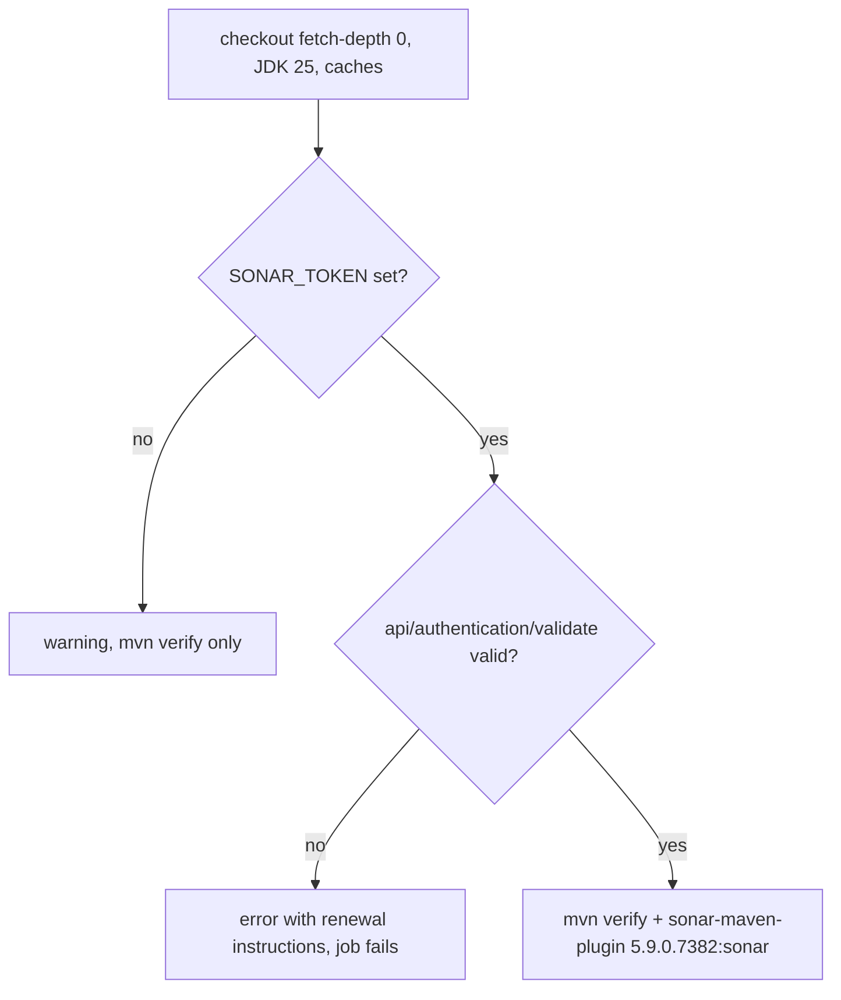

# SonarQube CI workflow (technical guide)

File: `.github/workflows/build.yml` (workflow "SonarQube", job "Build and analyze").

## Root cause

The failing run log ended with `Failed to query JRE metadata: GET https://api.sonarcloud.io/analysis/jres ... HTTP 403 Forbidden. Please check the property sonar.token or the environment variable SONAR_TOKEN`. The secret `SONAR_TOKEN` exists in the repository, so SonarCloud rejects its value (expired, revoked, or no access to organization `umdevc`). This cannot be fixed in the repository.

## Changes

- Plugin version pinned; `-Dsonar.organization`, `-Dsonar.host.url` and `-Dsonar.coverage.jacoco.xmlReportPaths=target/site/jacoco/jacoco.xml` passed on the command line.
- `pom.xml` is untouched. Its property `sonar.coverage.jacoco.xmlReportPaths` is `/site/jacoco/jacoco.xml` (missing the build directory); the command-line value overrides it.
- The token is only read from the environment and never printed.
