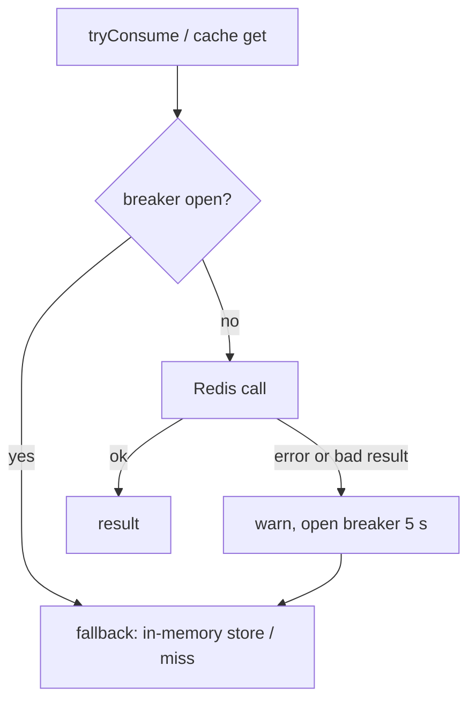

# F4-C Redis rate limit store and geo cache

Technical guide. No migration, no API contract change. Code: `config/ratelimit/RedisRateLimitStore`, `RedisRateLimitConfig`, `RedisFailOpenGuard`; `api/v1/service/GeoResponseCache`, `BusinessGeoServiceImpl`.

## Configuration

| Property | Env var | Default |
|---|---|---|
| `umdc.ratelimit.store` | `UMDC_RATELIMIT_STORE` | `memory` (`redis` declares `RedisRateLimitStore`) |
| `umdc.geo.cache-enabled` | `UMDC_GEO_CACHE_ENABLED` | `false` |
| `umdc.geo.cache-ttl-seconds` | `UMDC_GEO_CACHE_TTL_SECONDS` | `60` |

Redis connection: `RedisConfig` builds the Lettuce factory from `spring.data.redis.*` (`REDIS_URL`, `REDIS_PORT`, `REDIS_PASSWORD`, `REDIS_TIMEOUT`, `REDIS_SSL_ENABLED`); `StringRedisTemplate` is the Spring Boot auto-configured one. `application*.yml` and `pom.xml` are not edited (relaxed binding maps the env vars; `RateLimitConfig` already takes any `RateLimitStore` bean, so `RateLimitFilter` is unchanged).

## Rate limit store

`RedisRateLimitStore.tryConsume(key, permits)` runs one Lua script on the key `umdc:directory:rl:<key>` (hash `tokens`, `ts`, `PEXPIRE` 120 s). It uses Redis `TIME` (no clock skew between instances) and the arithmetic of `InMemoryRateLimitStore`: refill `elapsed_ms * permits / 60000` capped at `permits`, consume 1 if at least 1, else `retryAfter = max(1, ceil((1 - tokens) * 60 / permits))`. The decision carries `limit = permits`, so `X-RateLimit-Limit` is unchanged. `RateLimitStoreContractTest` runs the same cases on both stores (the Redis one through `FakeScriptRedisTemplate`, a Java transcription of the script with a controllable clock; no Docker).

## Geo cache

Keys (no user data, bounded size, filters hashed with SHA-256, 32 hex chars):

- `umdc:directory:geo:nearby:v1:<lat,lng grid 0.001>:<radius>:<d|n>:<page>:<perPage>:<hash(category|city|text)>`
- `umdc:directory:geo:map:v1:<zoom>:<minLng,minLat,maxLng,maxLat as grid indexes>:<limit>:<hash>`

Map grid step is `max(0.0005, 90 / 2^zoom / 4)` degrees. When the cache is enabled the service queries the snapped centre (nearby) or the bbox widened outwards to the grid (map, clamped to the world), so the cached body is exactly the answer for its key. Values are JSON (`BusinessMapResponse`, `BusinessNearbyResponse`), written with TTL; bigger than 512 KB are not stored. There is no explicit invalidation: TTL only. Validation errors (`400`) happen before any cache access.

## Fail open

`RedisFailOpenGuard` opens for 5 s after any failure; afterwards the next call probes Redis (a failure re-opens it). The warning logs only the exception class. The limiter falls back to a per-instance `InMemoryRateLimitStore`; the cache returns a miss and skips the write.

## Tests

`RedisRateLimitStoreContractTest` / `InMemoryRateLimitStoreContractTest` (shared contract), `RedisRateLimitStoreTest` (fail-open, breaker, bad result, config), `GeoResponseCacheTest`, `BusinessGeoServiceCacheTest` (hit, miss, snapping, keys).
