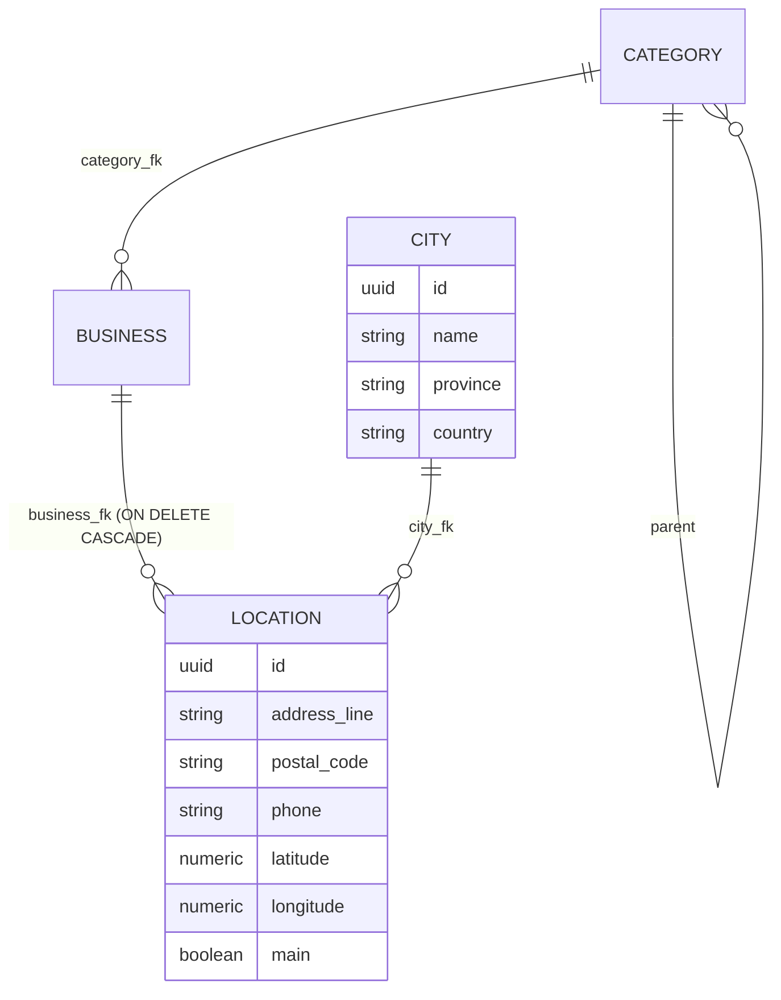
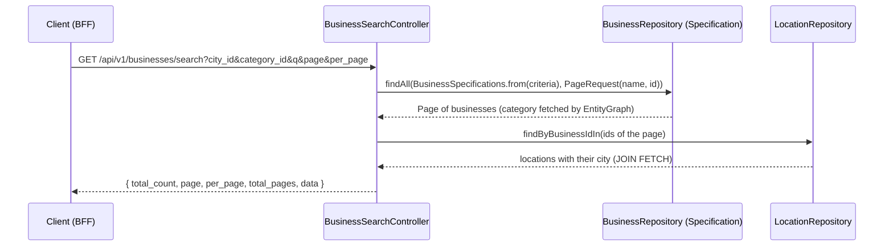

# Locations (sedes) and search by city (technical guide)

## Schema (`V4__create_city_and_location.sql`)
- `city(name, province, country)` unique; index on `lower(name)`; seeded with Toronto and eight Ontario cities (`ON CONFLICT DO NOTHING`).
- `location`: `business_fk` (cascade) and `city_fk`, both indexed; checks on latitude, longitude and that they come as a pair; **partial unique index** `(business_fk) WHERE main` = one main per business.
- Applied by hand (Flyway is not configured), like `V2` and `V3`. Entities: `CityEntity`, `LocationEntity`.

## Code
| Piece | Role |
| --- | --- |
| `BusinessSpecifications` | `inCity` (`EXISTS` sub-query on location+city, one row per business), `inCategory` (category or its parent, left join), `matchesText` (lower-case `LIKE` with `ESCAPE`); absent filters are `Specification.unrestricted()` (Spring Data JPA 4 rejects `null`) |
| `CitySpecifications` | Country and name filter of the catalogue |
| `BusinessSearchServiceImpl` | Validates `page`/`per_page` (1-based, max `MAX_PER_PAGE`), stable order `name, id`, one query for the locations of the page (no N+1) |
| `LocationServiceImpl` | Owner check as `deleteBusiness`: `JwtUtil.getUidFromToken` vs the business owner (401/404/403); `LocationValidator` holds the field rules; the old main is demoted and flushed **before** the new one is saved because of the unique index |
| Controllers | `CityController` `/api/v1/cities`, `LocationController` `/api/v1/businesses/{businessId}/locations`, `BusinessSearchController` `/api/v1/businesses/search` (a literal path wins over `/businesses/{id}`; covered by `LocationAndSearchRoutesTest`) |

Errors carry the reason in the `message-error` header. Contract: `src/main/resources/api/index.yaml`.

Tests: `BusinessSearchRepositoryTest` (`@DataJpaTest`, H2 in PostgreSQL mode with `NON_KEYWORDS=USER` and aliases for `uuid_generate_v4`), `LocationServiceImplTest`, `CityServiceImplTest`, `BusinessSearchServiceImplTest`, `LocationAndSearchRoutesTest`. Not covered: real PostgreSQL, query plans on a large data set.
