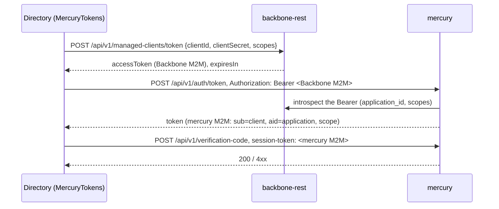

# Authentication towards mercury (technical guide)

Directory exchanges the Backbone M2M token of its managed client for mercury's own M2M token.

| Piece | Role |
| --- | --- |
| `client/mercury/MercuryTokens` | Gets and caches both tokens (until one minute before `expiresIn` / the JWT `exp`; 5 minutes when `exp` cannot be read). `withToken(call)` runs a mercury call and, on a 401, drops both caches and repeats it once. Thread-safe (one lock). |
| `client/backbone/BackboneManagedClient` | Feign client of `POST /api/v1/managed-clients/token`. **No `configuration`:** the endpoint is public, so the OAuth Bearer of `BackboneFeignConfigurer` must not be sent. |
| `client/mercury/MercuryAuthClient` | Feign client of mercury's `POST /api/v1/auth/token`. **No `configuration`** either: its `Authorization` is the Backbone M2M token and `MercuryFeignConfigurer` would add a second one. |
| `client/mercury/MercuryClient` | Calls that carry mercury's token in `session-token` (`confirmCode`, `isVerificationCodeDone`). |

Properties (`bootstrap.yml`, `prx.clients.mercury.m2m`): `client-id` (`MERCURY_M2M_CLIENT_ID`), `client-secret` (`MERCURY_M2M_CLIENT_SECRET`),
`scopes` (`MERCURY_M2M_SCOPES`, default `mercury:message:read,mercury:message:write`). An empty id or secret makes `MercuryTokens.token()` throw
`IllegalStateException`; the context still starts. Tokens and the secret are never logged (the records override `toString`). mercury lets a client act
only on the application Backbone ties it to (403 otherwise). The Feign base URLs are still the ones hard-coded in the `@FeignClient` annotations.

Tests: `MercuryTokensTest` (exchange, cache expiry, fallback, retry on 401, not configured), `UserRegisterServiceImplTest`, `AuthServiceImplTest`.
