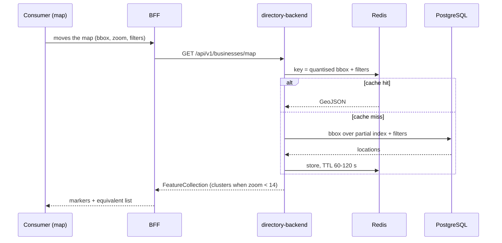
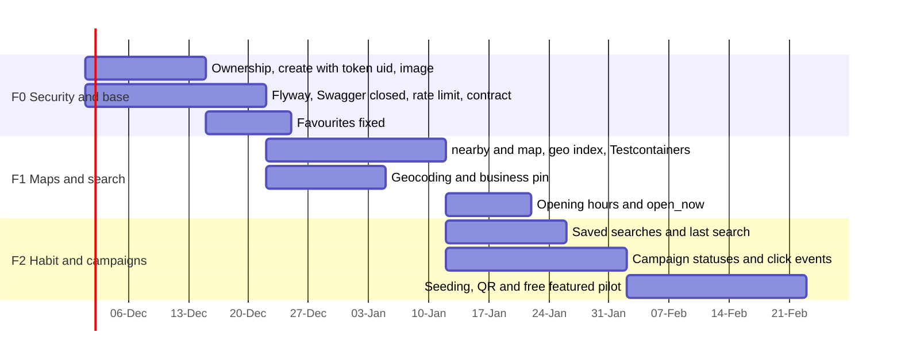

# MVP product and architecture analysis (technical guide)

Date: 2026-11-23. Scope: first phase (MVP), Toronto / GTA. This is an analysis document: **no code, API, schema or configuration was changed**. Everything below comes from reading the code and the documentation; no test or build was run. Items marked *unverified* were reported by a reviewer and not confirmed by a second read.

Goal: make directory the place where a business publishes its locations, products and campaigns, and where a consumer finds businesses on a map, keeps favourites and resumes earlier searches.

## 1. Current state (verified in the code)

| Area | Exists | Missing or partial |
| --- | --- | --- |
| Business | create, read, PATCH, delete (owner only), by user | owner check on `update` (*unverified*), `create` takes `userId` from the body |
| Location | CRUD (owner only), `latitude`/`longitude` optional and paired, one main per business | no opening hours, no geo index, no coordinate sanity check (a pin at 0,0 passes) |
| Search | `GET /api/v1/businesses/search` by city, category (with sub-categories), text; ordered by `name, id` | no nearby, no bbox, no distance, `LIKE '%x%'` without index |
| Campaign | create, read, list, PATCH (optimistic `lastUpdate`, `202`) | no delete, no explicit status, `type` is free text, no owner check, no filter by business |
| Product | create, link, list by business | no update/delete, no price, no image, no owner check |
| Favorite | CRUD for business, product and offer | `sort` answers `501` (`FavoriteServiceImpl.java:100`), pagination in memory, `updateFavorite` always looks up a product, no unique index per user and target |
| Statistics | daily views per business, owner only | no clicks (route, call, web), no saves, nothing per campaign |
| Stubs | | `ProfileImageService`, `BusinessProfileImageService`, `DigitalContactService`, Kafka email producer, part of `UserService` |
| Operations | | no rate limiting (TASK-009), Flyway not configured (V2 to V5 applied by hand) |

Stale documents found: `issues/created/TASK-002` says campaign update is not implemented (it is, as PATCH, `CampaignServiceImpl.java:172`); `TEST_COVERAGE_SUMMARY.md` cites `com/prx/...` paths that no longer exist.

## 2. Security blockers before a public launch

| Finding | Evidence | Status |
| --- | --- | --- |
| Campaign and product writes do not check the owner | `CampaignServiceImpl`, `ProductServiceImpl` read no token or uid | verified |
| Business `create` uses the `userId` of the body | `BusinessServiceImpl.java:89` and `:164` | verified; whether the `security-oauth` interceptor compares it with the token is unknown |
| Swagger and api-docs are `permitAll` | `SessionTokenSecurityConfig.java:43-44` | verified |
| `BusinessServiceImpl.update` has no owner check | line 225 | unverified |
| Image upload has no owner check and accepts a client `objectKey` | `BusinessProfileImageServiceImpl.java:40-57` | unverified |
| `AuthServiceImpl.token(AuthRequest)` signs a JWT from an alias only | `AuthServiceImpl.java:59-68`; no controller exposing it was found | to confirm |
| `JwtUtil.getUidFromToken` decodes without verifying the signature | `JwtUtil.java:32` | fragile: relies on the interceptor always running first |

Tests run on H2 with a schema generated from the entities, so they do not exercise the migrations or the PostgreSQL partial indexes (for example `uq_location_one_main_per_business` in V4).

## 3. Decisions taken where the reviewers disagreed

| Topic | Positions | Decision |
| --- | --- | --- |
| Geocoding | client side vs server side | **Server**, behind a `GeocodingClient` interface (Feign, like Backbone and Mercury), authenticated and rate limited. The business confirms the pin by moving it before it is stored. |
| Saved searches | localStorage vs server table | **Hybrid**: the client keeps recent searches; with a session the server keeps `saved_search` and the last search. |
| Geo engine | B-tree + Haversine vs PostGIS | **Partial B-tree, bbox and Haversine** for the MVP. The API contract does not depend on the engine, so PostGIS can replace it later. Geo tests use Testcontainers (H2 gives false greens). |
| Monetisation | out of MVP vs paid pilots on day 61 | **Free "featured" pilot**; no charging in phase 1. |
| Map and tiles | Google, Mapbox, MapLibre | **MapLibre GL with Maptiler** (no lock-in). Check current pricing before contracting. |

## 4. Functional requirements

| ID | Priority | Requirement | Acceptance | Layer |
| --- | --- | --- | --- | --- |
| RF-01 | Must | Owner authorisation on business, product, campaign and image; `create` with the uid of the token | A non-owner gets `403` on create, edit or delete | backend |
| RF-02 | Must | Products: edit, deactivate, price, image | Public list shows only active products | backend, BFF, front |
| RF-03 | Must | Campaigns: type enum, statuses, deactivate, list by `business_id` | An inactive or expired campaign is hidden from consumers | backend, BFF, front |
| RF-04 | Must | Location picker for sites | Pin saved through the existing locations API | front, BFF |
| RF-05 | Must | Geo search `nearby` and `map` | Businesses of the area, ordered by distance, with city, category and text filters | backend, BFF, front |
| RF-06 | Must | Consumer map with markers, filters and detail | Markers come from RF-05 | front, BFF |
| RF-07 | Must | Favourites with `sort`, database pagination, no duplicates | `sort=created_at,desc` answers `200` | backend |
| RF-08 | Must | Saved searches and last search | Save, list, delete and replay | backend, BFF, front |
| RF-09 | Must | Opening hours per location and `open_now` | Card shows "open until 21:00" in the business time zone | backend, front |
| RF-10 | Should | Aggregated click events (route, call, web) and saves | Owner sees counters per campaign, no IP, no user | backend, BFF |
| RF-11 | Should | Business and product images, digital contacts POST/PATCH, favourite lists | Today `501` or absent | backend, front |
| RF-12 | Should | Business panel, promotion summary on the card, preferences, city favourite | Panel reuses existing statistics | front, BFF |

Out of the MVP: reviews, payments or bookings, push notifications, alerts on saved searches, AI recommendations, multi-country, native app, loyalty.

## 5. Geo search design



Proposed endpoints (a literal path wins over `/businesses/{id}`, as `search` already does):

| Route | Parameters | Response |
| --- | --- | --- |
| `GET /api/v1/businesses/nearby` | `lat`, `lng`, `radius_m` (default 5000, max 50000), `category_id`, `q`, `sort=distance\|name`, `cursor` | `BusinessSearchResponse` plus `distance_m`; keyset pagination, tie-break `distance, location_id` |
| `GET /api/v1/businesses/map` | `bbox=minLng,minLat,maxLng,maxLat`, `zoom`, filters, `limit` (max 500) | GeoJSON `FeatureCollection`; clusters when `zoom < 14`; `truncated` instead of an exact total |
| `POST /api/v1/geocode` | address | coordinate candidates; authenticated, rate limited |
| `/api/v1/me/saved-searches` | GET, POST, PUT, DELETE, `/last` | versioned filters `{"v":1}`, max 2 KB, 50 per user |

A `Specification` is not enough for distance: add a `LocationGeoRepository` with a native query and extend `BusinessSearchCriteria`, reusing the filters of `BusinessSpecifications`.

### Proposed migration V6 (apply after Flyway baseline)

```sql
CREATE TABLE directory_site.favorite_list (
  id UUID PRIMARY KEY DEFAULT directory_site.uuid_generate_v4(),
  user_fk UUID NOT NULL REFERENCES directory_site."user"(id) ON DELETE CASCADE,
  name VARCHAR(80) NOT NULL, is_default BOOLEAN NOT NULL DEFAULT FALSE,
  UNIQUE (user_fk, name));
ALTER TABLE directory_site.user_favorite
  ADD COLUMN list_fk UUID REFERENCES directory_site.favorite_list(id) ON DELETE SET NULL,
  ADD COLUMN city_fk UUID REFERENCES directory_site.city(id);
ALTER TABLE directory_site.user_favorite ADD CONSTRAINT ck_fav_one_target
  CHECK (num_nonnulls(business_fk, product_fk, campaign_fk, city_fk) = 1) NOT VALID;
CREATE UNIQUE INDEX uq_fav_user_business ON directory_site.user_favorite(user_fk, business_fk)
  WHERE business_fk IS NOT NULL AND active;
CREATE TABLE directory_site.saved_search (
  id UUID PRIMARY KEY DEFAULT directory_site.uuid_generate_v4(),
  user_fk UUID NOT NULL REFERENCES directory_site."user"(id) ON DELETE CASCADE,
  name VARCHAR(80), filters JSONB NOT NULL, notify BOOLEAN NOT NULL DEFAULT FALSE,
  last_used_at TIMESTAMP, deleted_at TIMESTAMP);
CREATE INDEX idx_location_geo ON directory_site.location (latitude, longitude)
  WHERE latitude IS NOT NULL;
```

This is a proposal, not an applied script. Add the same unique index for `product_fk`, `campaign_fk` and `city_fk`.

### Map provider

| Option | Cost and licence | Risk |
| --- | --- | --- |
| MapLibre GL + Maptiler (recommended) | free tier, low plans; OSM data needs attribution | geocoding is separate |
| Google Maps | pay per use | geocoding results cannot be cached beyond place_id or lat/lng for 30 days; lock-in |
| Mapbox | free tier then per use | storing results costs more; proprietary licence |
| Public Nominatim | free | 1 request per second, no autocomplete: not for production |

## 6. Non-functional requirements

- **Performance:** `map` and `nearby` p95 below 300 ms on the server, payload below 100 KB. Redis cache keyed by quantised bbox, TTL 60 to 120 s (Redis is in `pom.xml` but there is no active `@Cacheable`). Partial index on `(latitude, longitude)` and `pg_trgm` for text.
- **Privacy (PIPEDA):** the consumer position lives only in the request, never in logs, metrics or cache keys (round to 2 decimals if needed). Sanitise the `logger.info` of `BusinessSearchServiceImpl`, which prints the filters. Saved searches need consent, physical deletion and a retention period. Click metrics stay aggregated, with no IP and no user, like the existing views.
- **Anti-scraping:** Bucket4j with Redis, different quotas for `map`, `nearby` and `geocode`; maximum radius and page size; validate and escape `q`; approximate location for home-based services.
- **Operations:** Flyway with baseline at V5 and `ddl-auto=validate`; Swagger closed in production; explicit CORS allow-list; Micrometer metrics (latency, size, cache hit ratio, geocoder errors).
- **Quality:** JaCoCo at 85% per method (the `pom.xml` enforces 80% of lines today). Clean `api/index.yaml`: fixed UUID paths, empty responses, `GET /favorites` with a `requestBody`.
- **Accessibility and i18n:** WCAG 2.2 AA; the list is always the accessible equivalent of the map; ES, EN, fr-CA; multilingual category names.

### Test strategy

| Level | What |
| --- | --- |
| Unit (Mockito) | owner matrix (owner, other user, no uid, missing business) on business, product, campaign and image; coordinate and bbox validation |
| PostgreSQL (Testcontainers) | bbox, radius, distance order, one `main` per business, migrations with Flyway |
| Contract | OpenAPI against controllers; `401`, `403`, `429` cases |
| Load (k6) | map-drag profile over about 100 thousand businesses, with and without cache |
| End to end | register, business, location with pin, map search, favourite; user B tries to edit user A; image with a false type |

## 7. Marketing capabilities and gaps

| Capability | Today | Missing |
| --- | --- | --- |
| Types | `type` free text | enum (offer, coupon, event, featured), coupon and event fields, image and CTA |
| Scheduling | start and end dates | statuses draft, scheduled, active, paused, expired; activation and expiry job; DELETE |
| Segmentation | category, business, dates | city through locations, nearby, "has this business as favourite", consent |
| Email | Kafka producer with `template_defined_id`; no Feign client for Mercury campaigns | templates, audience job, frequency limits, unsubscribe; decide whether campaigns live in Mercury |
| Metrics | daily views per business | impressions, clicks to route, call and web, saves, per campaign (first technical priority) |

## 8. Plan



Dates fix the order, not the calendar. Phase 0: RF-01, RF-07, Flyway, Swagger, rate limiting, contract clean-up. Phase 1: RF-04, RF-05, RF-06, RF-09. Phase 2: RF-02, RF-03, RF-08, RF-10 and the seeding.

## 9. Risk register

| Risk | Prob. | Impact | Mitigation |
| --- | --- | --- | --- |
| Editing other users' businesses, products and campaigns | high | high | common owner authorisation, matrix tests before launch |
| Impersonation by client `userId` or `objectKey` | high | high | user from the token, server-generated key, magic-byte check |
| Tokens issued without credentials | medium | critical | confirm exposure, restrict or remove |
| Mass scraping of coordinates | high | medium | rate limiting, radius and page caps, monitoring |
| Manual migrations drift between environments | high | high | Flyway, tests on real PostgreSQL |
| Fake or abusive businesses | medium | high | PENDING/APPROVED/REJECTED, Mercury code verification, reports |
| Consumer location leaking to logs or caches | medium | high | consent, rounding, no persistence, log review |
| False confidence from stale coverage and docs | high | medium | JaCoCo 85% per method, Testcontainers, update docs |

## 10. Limits and open items

- Not run: tests, build, any query. Source is code and documentation reading.
- To confirm in `security-oauth` (outside this repo): whether the interceptor compares `userId` with the token, and what exposes `token(AuthRequest)`.
- Spring configuration (CORS, `ddl-auto`) comes from the config server, outside this repo.
- Frontend and BFF live in other repositories; map, onboarding and SEO depend on them.
- Map provider prices and market data are not verified.

See also: [locations and search](locations-and-search.md), [database migrations](database-migrations.md), [business statistics](business-statistics.md), [TLS and session security](tls-and-session-security.md).
