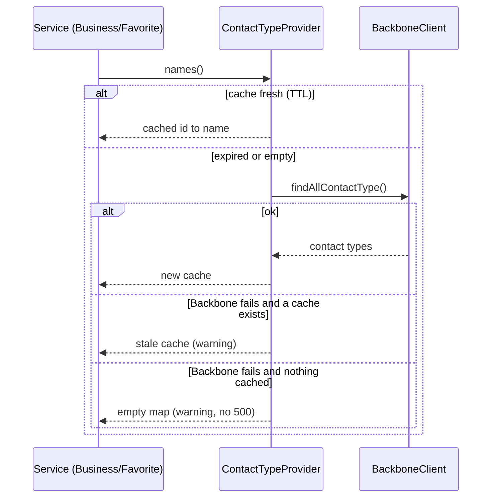

# directory-backend never accesses schema `general` (technical guide)

## Rule
directory-backend accesses exactly one DB schema: `directory_site`. Schema `general` belongs to Backbone; anything from it is obtained through `BackboneClient` (Feign). The directory DB user has grants only on `directory_site`.

## Changes
| Before | After |
|---|---|
| `UserEntity` (`general."user"`), `@ManyToOne` from `BusinessEntity.userEntityFk` and `UserFavoriteEntity.user` | removed; plain `UUID userFk` columns (`business.user_fk`, `user_favorite.user_fk`). `BusinessEntity.getUserFk()` and `UserFavoriteEntity.getUserFk()` now return the `UUID` |
| `ContactTypeEntity` (`general.contact_type`), `@ManyToOne` from `DigitalContactEntity` | removed; `DigitalContactEntity.contactTypeFk` (UUID) only. `DigitalContactMapper` maps `contactTypeId` from it |
| JPQL `bu.userEntityFk.id`, `uf.user.id`, `JOIN FETCH dc.contactTypeEntity` | `bu.userFk`, `uf.userFk`, no join. Method names (`findByUserEntityFk`, `findOwnerId`, `findByUserId`...) and results are unchanged |
| `BusinessMapper` read `contactType.name` from the entity | `toBusinessTO(entity, Map<UUID,String> contactTypeNames)` (MapStruct `@Context`); `toBusinessTO(entity)` maps without names |
| `V7` FKs to the general user table | removed in place (the script was never applied); indexes kept |

Public API, DTOs and `api/index.yaml` are unchanged.

## ContactTypeProvider
`com.umdc.directory.api.v1.service.ContactTypeProvider` (`@Service`).



- TTL: `@Value("${umdc.directory.contact-types.cache-ttl-seconds:600}")`, default 10 minutes; no yml change needed. `0` disables caching.
- Thread-safe (double-checked refresh under a lock, snapshot in an `AtomicReference`). `invalidate()` clears it.
- `BusinessServiceImpl` uses `contactTypes()` to resolve the ids of EML/WBH/SCE/MEC on writes (still `400 Contact type not found` / "Contact types are not available." when Backbone gives nothing) and `names()` for reads. `FavoriteServiceImpl` uses `names()` so favorite stores keep email and website.

## User existence decision
The foreign key used to guarantee that `user_fk` pointed to an existing user. It no longer does. The user id now always comes from the signed session token (`JwtUtil.getUidFromToken`), which Backbone issued for an existing user, and ownership checks compare it with the stored UUID. On business creation the service already calls `backboneClient.findUserById`. No Backbone call is added per request: it would add latency and a hard dependency to every read for no gain, since a forged id cannot get past the token signature. Orphans (data of a user deleted in Backbone) are possible and harmless; cleaning them is a separate job.

## Migrations
- `V7__create_saved_search.sql`: edited in place, no `REFERENCES` to another schema.
- `V12__drop_cross_schema_foreign_keys.sql`: idempotent `DO $$` block. It loops over `pg_constraint` (`contype = 'f'`, constraint in `directory_site`, referenced table in a different schema) and runs `ALTER TABLE ... DROP CONSTRAINT IF EXISTS`; then drops column defaults that call a function of `general` (`directory_site.uuid_generate_v4` is left alone). No data is deleted. In QA it finds exactly: `business.fk_business_user_1`, `digital_contact.fk_contact_business_contact_type_1`, `user_favorite.user_favorite_user_fk_fkey`. Names are not hard-coded.

Check before and after:
```sql
SELECT conrelid::regclass, conname, confrelid::regclass FROM pg_constraint
WHERE contype = 'f' AND connamespace = 'directory_site'::regnamespace
  AND confrelid::regclass::text NOT LIKE 'directory_site.%';
-- after V12: 0 rows
```

## Guard test
`NoGeneralSchemaAccessTest` fails when: an `@Entity`/`@Table` in `jpa/entity` has a schema other than `directory_site`; a file in `db/migration` mentions the general schema; a query in `jpa/repository` mentions it; a source (main or test) imports `UserEntity`/`ContactTypeEntity` or maps `schema = "general"`; or V12 stops finding the keys through `pg_constraint`.

## Database role (documentation script, placeholders only)
Run as the schema owner / superuser. Never commit real passwords.

```sql
-- 1. Role (password from your secret store; it is read by the service from Vault)
CREATE ROLE directory_app LOGIN PASSWORD '<PASSWORD>';

-- 2. No access to Backbone's schema
REVOKE ALL ON SCHEMA general FROM directory_app;
REVOKE ALL ON ALL TABLES IN SCHEMA general FROM directory_app;
REVOKE ALL ON ALL SEQUENCES IN SCHEMA general FROM directory_app;
REVOKE ALL ON ALL FUNCTIONS IN SCHEMA general FROM directory_app;
-- Only if general was ever granted to PUBLIC (check first, it may affect other roles):
-- REVOKE ALL ON SCHEMA general FROM PUBLIC;

-- 3. directory_site: use, never create
GRANT USAGE ON SCHEMA directory_site TO directory_app;
GRANT SELECT, INSERT, UPDATE, DELETE ON ALL TABLES IN SCHEMA directory_site TO directory_app;
GRANT USAGE, SELECT ON ALL SEQUENCES IN SCHEMA directory_site TO directory_app;
GRANT EXECUTE ON ALL FUNCTIONS IN SCHEMA directory_site TO directory_app;  -- uuid_generate_v4 lives here

-- 4. Future objects created by the DDL/owner role (replace directory_owner)
ALTER DEFAULT PRIVILEGES FOR ROLE directory_owner IN SCHEMA directory_site
    GRANT SELECT, INSERT, UPDATE, DELETE ON TABLES TO directory_app;
ALTER DEFAULT PRIVILEGES FOR ROLE directory_owner IN SCHEMA directory_site
    GRANT USAGE, SELECT ON SEQUENCES TO directory_app;
ALTER DEFAULT PRIVILEGES FOR ROLE directory_owner IN SCHEMA directory_site
    GRANT EXECUTE ON FUNCTIONS TO directory_app;

-- 5. Resolve unqualified names only in directory_site
ALTER ROLE directory_app SET search_path = directory_site;
```

Verification (run as `directory_app`; both must fail with `permission denied`, the last one must work):
```sql
SELECT has_schema_privilege('directory_app', 'general', 'USAGE');          -- false
SELECT 1 FROM general."user" LIMIT 1;                                      -- ERROR: permission denied for schema general
SELECT count(*) FROM directory_site.business;                              -- works
```

Notes:
- The datasource username and password of the service come from Vault (bootstrap config); use the `directory_app` credentials there.
- Migrations V6..V12 are applied by hand and need a separate DDL/owner role (create tables, drop constraints). `directory_app` must not be used for them.
