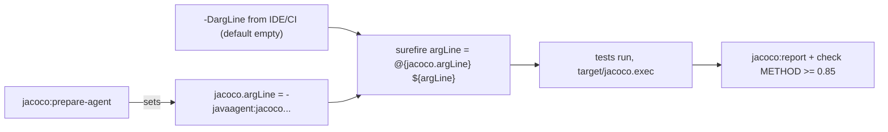
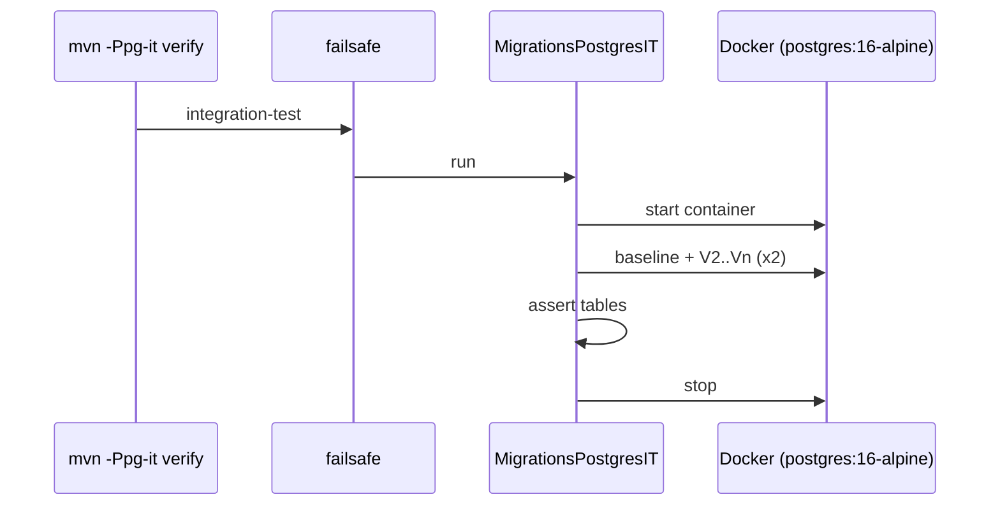

# Build hygiene (technical guide)

## Q2: springdoc `Connection refused`

`springdoc-openapi-maven-plugin:1.5:generate` is bound to `integration-test` and does an HTTP GET to `springdoc.apiDocsUrl` (default `http://localhost:8080/v3/api-docs`). The build has no `spring-boot:start`/`stop` execution and the test profile does not start a server (H2, Vault, Kafka, security disabled), so the request always hit a closed port; `failOnError` is `false`, hence the logged stack trace with `BUILD SUCCESS`.

Fix (pom.xml): property `springdoc.skip` default `true`, wired to the plugin `<skip>`. No quality gate is lowered; running it needs a live app: `-Dspringdoc.skip=false`.

Before (`mvn -o -B clean verify`):
```
[INFO] --- springdoc-openapi:1.5:generate (default) @ directory-backend ---
[ERROR] An error has occurred
java.net.ConnectException: Connection refused
```
After:
```
[INFO] --- springdoc-openapi:1.5:generate (default) @ directory-backend ---
[INFO] Skip execution as per configuration
```

## Q3: JaCoCo agent and `argLine`



`jacoco.argLine` is the only property the agent writes (it composes with a pre-existing value); the user-facing `argLine` property (empty default) is appended, so another injected agent coexists with JaCoCo. Verified with `-DargLine="-Dfoo=bar"`: tests pass and `target/jacoco.exec` is written. Use `-Djacoco.skip=true` only to run without coverage (the check is skipped too; never in CI).

## Q1 leftover

`sonar.coverage.jacoco.xmlReportPaths` = `target/site/jacoco/jacoco.xml` (was `/site/jacoco/jacoco.xml`). `.github/tools/sonar-analysis.tool.md` still documents the old value (outside the allowed documentation scope of this task; follow-up).

## Q4: PostgreSQL integration tests (plan and first step)

Docker was available in the build environment (OrbStack, server 29.8), so the first step is implemented:

- Profile `pg-it` (off by default) adds `org.testcontainers:testcontainers-postgresql` (version managed by the Spring Boot BOM, 2.0.5) with `test` scope, Failsafe for `**/*PostgresIT.java`, and `jacoco.skip=true`.
- The class `MigrationsPostgresIT` is excluded from test compilation unless the profile is active (`pg-it.testExclude` property), so the default build neither needs the dependency nor Docker.
- The test starts `postgres:16-alpine`, creates a minimal baseline (schema `directory_site`, `uuid_generate_v4`, `business`, `product`, `campaign`, `user_favorite`; the pre-V2 tables are not versioned), applies every `V<n>__*.sql` in numeric order twice (idempotency) and asserts the V6, V7, V11 and V13 tables. Newer scripts (V15 onwards) are picked up automatically.
- Result here: 1 test, 0 failures, about 19 s.



Next steps (not done): run the profile in CI as a separate job; replace the minimal baseline with a schema dump of QA; add repository tests (`@DataJpaTest` against the container) for the partial unique indexes of V14 and the geo index of V8; add a PostgreSQL-only check that the code never touches schema `general`.

## Hardening: open critical/high Dependabot alerts (read-only review, no version changed)

Source: `gh api repos/um-dev-creative/directory-backend/dependabot/alerts?state=open&severity=critical,high --paginate` (2026-11-23), 55 alerts, grouped by package. The alert manifest reports Spring Boot 3.5 / Spring 6.2 ranges while the pom is on Spring Boot 4.1.2 (postgresql 42.7.14), so many alerts may be stale or already resolved by the BOM; they must be re-checked after Dependabot rescans the default branch. Decision on upgrades is separate.

| Severity | Package | Relationship | Vulnerable range | Fixed in |
| --- | --- | --- | --- | --- |
| critical | org.apache.tomcat.embed:tomcat-embed-core | transitive | 10.1.0-M1 to < 10.1.58 (7 critical) | 10.1.58 |
| critical | org.bouncycastle:bcprov-jdk18on | transitive | < 1.85; 1.59 to 1.80.1 | 1.85 |
| critical | org.springframework.security:spring-security-web | transitive | 6.5.0 to < 6.5.9 | 6.5.9 |
| critical | org.springframework:spring-webmvc | transitive | 6.2.0 to 6.2.19 (2 alerts) | none yet |
| high | org.apache.tomcat.embed:tomcat-embed-core | transitive | < 10.1.52 to < 10.1.56 (8) | 10.1.56 |
| high | com.fasterxml.jackson.core:jackson-databind | direct | 2.19.0 to 2.21.6 (5) | 2.21.7 |
| high | com.fasterxml.jackson.core:jackson-core | transitive | 2.19.0 to 2.21.6 (3) | 2.21.7 |
| high | org.lz4:lz4-java | transitive | <= 1.8.1 (3) | 1.8.1 / none |
| high | org.postgresql:postgresql | direct | < 42.7.12 (2) | 42.7.12 |
| high | org.springframework.boot:spring-boot-starter-actuator | direct | 3.5.0 to < 3.5.12 (2) | 3.5.12 |
| high | org.springframework.kafka:spring-kafka | direct | 3.3.0 to 3.3.15 | 3.3.16 |
| high | org.springframework:spring-webmvc / spring-expression | transitive | 6.2.0 to 6.2.18 | 6.2.19 |
| high | io.micrometer:micrometer-core | transitive | 1.15.0 to 1.15.11 (2) | 1.15.12 |
| high | org.xerial.snappy:snappy-java | transitive | <= 1.1.10.8 (2) | 1.1.10.9 |
| high | org.apache.kafka:kafka-clients | transitive | 2.8.0 to < 3.9.2 | 3.9.2 |
| high | org.apache.httpcomponents.core5:httpcore5 / httpcore5-h2 | transitive | < 5.4.3 | 5.4.3 |
| high | commons-fileupload, commons-io, assertj-core, plexus-utils (direct), spring-data-commons, spring-boot | mixed | various | 1.6.0, 2.14.0, 3.27.7, 4.0.3, 3.5.12, 3.5.14 |

Suggested order for the separate decision: confirm the resolved versions with `mvn dependency:tree`, then Tomcat, Spring Security/MVC, Jackson, BouncyCastle, PostgreSQL driver.
