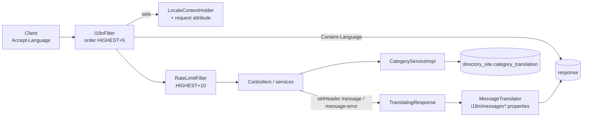
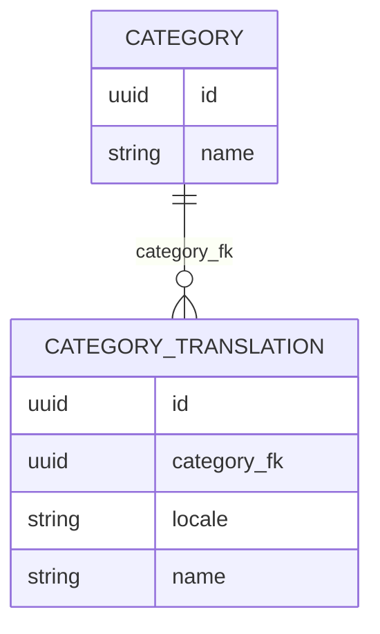

# Internationalisation (es, en, fr-CA): technical guide

## Overview

## Components (`com.umdc.directory.i18n`)

| Class | Role |
|---|---|
| `SupportedLocales` | `resolve(Accept-Language)`, `normalize(Locale)`, `tag(Locale)`. Supported: `en` (default), `es`, `fr-CA`. `fr`/`fr-*` map to `fr-CA`; `q=0`, unknown or malformed values are skipped; nothing usable gives `en`. |
| `I18nFilter` | `OncePerRequestFilter`: resolves the locale, stores it in `LocaleContextHolder` (restored afterwards) and in the request attribute `SupportedLocales.REQUEST_ATTRIBUTE`, sets `Content-Language`, wraps the response. |
| `I18nFilter.TranslatingResponse` | `HttpServletResponseWrapper`: `setHeader`/`addHeader` of `message-error` and `message` (case-insensitive) go through the translator. Other headers are untouched. |
| `MessageTranslator` | Bundle lookup, no JVM-locale fallback (`Control.getNoFallbackControl`). |
| `I18nConfig` | `FilterRegistrationBean`, order `HIGHEST_PRECEDENCE + 5` (before `RateLimitFilter`, so the `429` text is translated). |

No service that sets the header was changed: translation happens when the header is written.

## Message bundles

Files: `src/main/resources/i18n/messages.properties` (English source), `messages_es.properties`, `messages_fr_CA.properties` (UTF-8).

Key of a text: `msg.` + normalised text, where normalised means lower case, every number replaced by `n`, every other run of non-alphanumerics replaced by `_`. Example: `Business not found.` -> `msg.business_not_found`; `days must be between 1 and 365` -> `msg.days_must_be_between_n_and_n`.

- The numbers found in the text are available to the translation as `{0}`, `{1}`, ... in order of appearance.
- Parameter messages: when `<parameter> <rest>` has no entry, `param <rest>` is tried and `{name}` becomes the parameter (`lat is required`, `radius_m must be a number`, `x must be a UUID`).
- Messages without entry (or with a `null`/blank value) are sent unchanged. English is never translated.
- Adding a message: add the three lines (same key, same placeholders) to the three files.

### Completeness tests (`MessageTranslatorTest`)

- Fails: an English key without a non-blank es and fr-CA entry, with different placeholders, or key sets that differ.
- Fails: a constant message known at the time (`DirectoryAppConstants`, `FavoriteListConstants`, `OpeningHoursMessages`, `SavedSearchConstants`) without entry.
- Warns only (prints `WARNING i18n: ...`): literals passed to `MESSAGE_HEADER`/`MESSAGE_ERROR_HEADER` in `src/main/java` without entry, so new messages never break the build. Currently the only one is the prefix `Too many requests, retry in ` of `RateLimitFilter`, which is concatenated with a number and is translated as a whole (`msg.too_many_requests_retry_in_n_seconds`).

## Category names

Migration `V16__category_translation.sql` (idempotent, `directory_site` only, applied by hand):

`UNIQUE (category_fk, locale)`; the JPA entity `CategoryTranslationEntity` holds `category_fk` as a plain UUID (the database FK is inside `directory_site`).

`CategoryServiceImpl.find`, `findByParentId` and `findAll` call `localize(...)`: the locale comes from `LocaleContextHolder`, one query `findByCategoryFkInAndLocale(ids, tag)` per response (no N+1), and each item gets the translated name or, without a row, its base name, plus `locale` (the request locale tag, always `en`, `es` or `fr-CA`). Duplicate rows (impossible with the constraint) keep the first.

Response change (`CategoryGetResponse`): additive component `locale` (omitted from JSON when null, e.g. the create flow does not use it). The 7-argument constructor remains. Existing fields are unchanged. `create` is unchanged; admin writes of translations are out of scope.

Seed: not included. The category names live in the database, not in this repository, so Spanish and fr-CA names cannot be derived safely; the migration contains a commented example.

## Endpoint list (for the OpenAPI follow-up)

No endpoint was added. Changes to document in `api/index.yaml`:

- Every response: header `Content-Language` (`en` | `es` | `fr-CA`); request header `Accept-Language`.
- `message` / `message-error` headers are localised.
- `CategoryGetResponse`: new optional string `locale` (`en` | `es` | `fr-CA`); `name` is localised with fallback to the base name.

## Tests

`SupportedLocalesTest`, `MessageTranslatorTest`, `I18nFilterTest` (translation, Content-Language, context restore, config order), `CategoryTranslationRepositoryTest` (H2, unique constraint), `CategoryServiceImplTest` (translated, fallback, default locale, null ids, duplicates), `CategoryGetResponseTest`.
