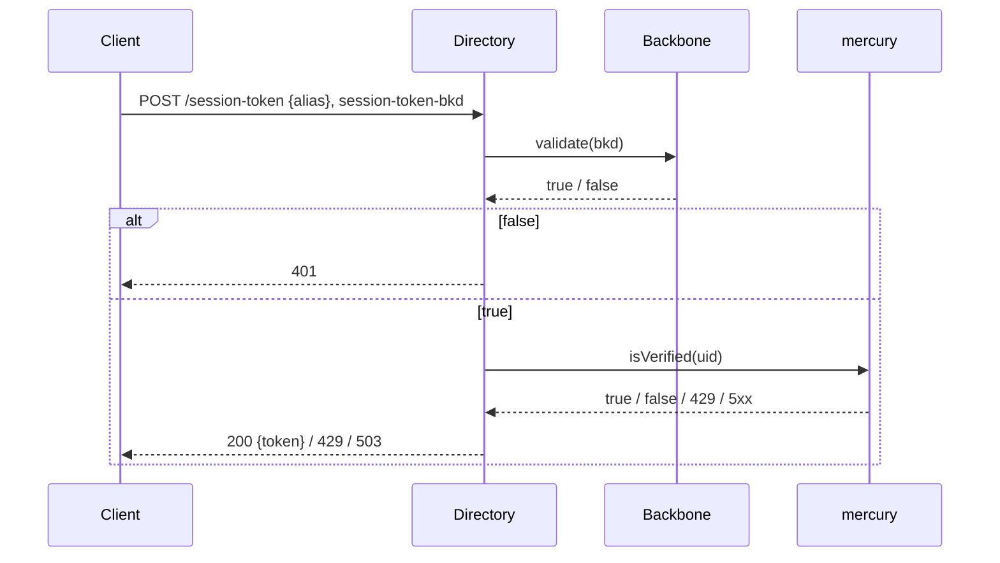
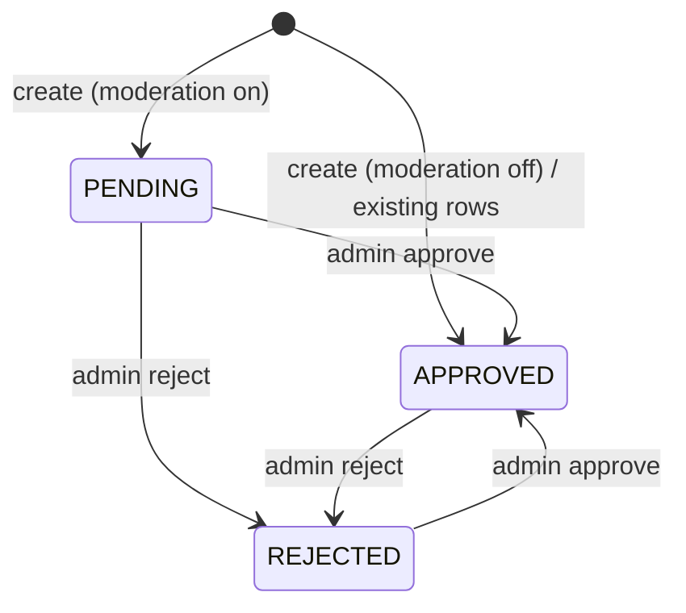

# Mercury alignment (MER-11), business moderation (S8), S1 and S4 (technical guide)

## 1. Mercury (MER-11)
See `docs/technical/mercury-m2m-auth.md`. Summary: `MercuryAuthClient.token(AuthRequest)` replaces the Backbone-token exchange; no retry loop on 401,
`Retry-After` honoured on 429 (surfaced to the caller as 429/503 with `message-error`), timeouts 3 s / 5 s, `MercuryVerificationService` over the
Feign client and the Kafka producer.

## 2. S4: review of the login endpoints
`security-oauth` publishes (both `@SkipSessionValidation`, so without a session token) `POST /token` and `POST /session-token`.

| Endpoint | Finding | Action |
| --- | --- | --- |
| `POST /token` (`AuthService.token(AuthRequest)`) | The library validates the Backbone token (`session-token-bkd`) and then Directory signs a session JWT for **any alias the caller names**, with no `uid`. It cannot own anything, but it is a valid session token for the interceptor. | Alias limited to 1..128 characters without control characters; a WARN is logged per use; switchable with `umdc.auth.alias-token.enabled` (**default `true`**: contract unchanged until the decision is taken; `false` answers 403 + `message-error`). |
| `POST /session-token` (`AuthService.token(AuthRequest, bkd)`) | **High.** The library does not validate `bkd`; Directory read the `uid` from its (unverified) payload, so a forged JWT with any `uid` produced a Directory session token for that user. | Fixed: `bkd` is validated with `BackboneClient.validate` first; 401 when invalid, missing, without `uid`, or Backbone fails. `uid` is now always in the token (before it was missing when mercury answered 404). |

With moderation on, the roles of the user (Backbone) are added to the session token in the claim `umdc.moderation.role-claim` (best effort: if Backbone
fails the claim is simply missing and nobody is a moderator).

## 3. S1: `PATCH /businesses/{id}`
A `request.id()` (field `id` of `BusinessUpdateRequest`) different from the uid of the token answers **403** `message: The business cannot be reassigned to another user.`
before anything changes. The owner's own id is accepted and ignored (no Backbone lookup). Previously the owner could set `user_fk` to any existing user. The 404 "User not found" of this field disappears.

## 4. S8: moderation
Configuration (all optional; defaults change nothing):

| Property | Default | Meaning |
| --- | --- | --- |
| `umdc.moderation.enabled` | `false` | New businesses start `PENDING`; public reads return only `APPROVED` |
| `umdc.moderation.admin-role` | `LH_ADMIN` | Role that may approve and reject (case-insensitive) |
| `umdc.moderation.role-claim` | `roles` | Claim of the session token with the roles (JSON array, or comma/space separated string) |
| `umdc.auth.alias-token.enabled` | `true` | See S4 |

`ModerationSettings` loads them into static fields because `BusinessSpecifications` and the native geo SQL are built without a Spring context in reach.

Migration `V15__business_moderation.sql` (idempotent, `directory_site` only): `moderation_status VARCHAR(16) NOT NULL DEFAULT 'APPROVED'` (existing rows stay public),
`CHECK (PENDING|APPROVED|REJECTED)`, index `idx_business_moderation_status`, and `verification_code_hash`, `verification_expires_at`, `verification_attempts`.

Visibility with moderation on:

| Surface | Rule |
| --- | --- |
| `GET /businesses/search` | `BusinessSpecifications.from` adds `moderationStatus = APPROVED` (also used for the open-now candidates). `BusinessSearchServiceImpl` is untouched |
| `GET /businesses/map`, `/nearby` | `LocationGeoRepository` adds `b.moderation_status = 'APPROVED'` to every query (nearby, count, bbox, clusters) |
| `GET /businesses/{id}` | New optional `session-token` header; 404 unless approved or the caller is the owner |
| `GET /businesses/user/{userId}` | New optional `session-token` header; only approved ones unless the caller is that user |
| Everything else (favorites, events, campaigns by id) | Not filtered; follow-up if the product wants it |

### Endpoints (base `/api/v1/businesses/{id}`, header `session-token`)
| Method and path | Who | Request | Success | Errors |
| --- | --- | --- | --- | --- |
| `POST /verification/request` | owner | none | `202` (the code goes by e-mail through Mercury, never in the answer) | 401, 403, 404, 409 owner without e-mail, 429 (cooldown 60 s, or Mercury throttled; `Retry-After`), 503 |
| `POST /verification/confirm` | owner | `{"code":"123456789"}` | `204`, business `verified = true`, code cleared | 400 malformed or wrong, 401, 403, 404, 409 no pending code, 410 expired, 429 five wrong tries |
| `GET /moderation` | owner | none | `200 {"businessId":"...","status":"PENDING","verified":false}` | 401, 403, 404 |
| `POST /moderation/approve` | role `umdc.moderation.admin-role` | none | `200` same shape, `status: APPROVED` | 401, 403 (not a moderator), 404 |
| `POST /moderation/reject` | role `umdc.moderation.admin-role` | none | `200` same shape, `status: REJECTED` | 401, 403, 404 |

Errors carry `message-error`. These endpoints work whether moderation is on or off (the status of an old business is `APPROVED`).

### Verification code
`BusinessModerationServiceImpl`: 9 digits from `SecureRandom`, valid 15 minutes, one e-mail per minute, 5 wrong tries. Only `SHA-256(businessId:code)` is stored
(compared in constant time); the code is never logged and not in any answer. The e-mail goes through `MercuryVerificationService.sendCode` (Kafka topic
`umdc.producer.mercury.topic`, template `umdc.verification.code.template.id`, parameters `vc` and `user_name`) to the Backbone e-mail of the owner.
Confirmation is checked locally against the stored hash. `MercuryVerificationService.verifyCode` (mercury's `POST /verification-code`) exists for
mercury-held codes (user registration) but is not used here, because Mercury does not know a code Directory generated. **Open point for the user:** if mercury should
hold business codes too, mercury needs an endpoint to register a code; until then the flow above is complete and self-contained.

### OpenAPI follow-up
`src/main/resources/api/index.yaml` is updated by another task: add the five endpoints above, the optional `session-token` header on `GET /businesses/{id}` and
`GET /businesses/user/{userId}`, the 403 of `PATCH /businesses/{id}`, and `BusinessModerationTO`.

### Tests
`BusinessModerationServiceImplTest` (every branch), `BusinessModerationVisibilityTest`, `BusinessModerationRoutesTest`, `BusinessSearchRepositoryTest` and
`LocationGeoRepositoryTest` (moderation on/off against H2), `ModerationSettingsTest`, `MercuryVerificationServiceTest`, `MercuryErrorsTest`,
`AuthServiceImplTest` (S4), `BusinessServiceImplTest` (S1).
