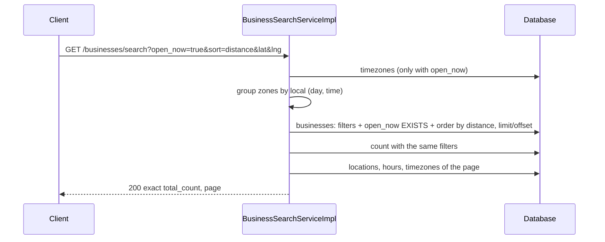

# Technical guide: search evaluated in SQL (F4-E)

Replaces the in-memory path of F3-B (`MAX_CANDIDATES = 1000`). No new endpoint and no contract change: `GET /api/v1/businesses/search` has the same parameters and response. Only the way `open_now=true` and `sort=distance` are computed changes. Migration `V17__location_coordinate_checks.sql`.

## Design

Both features are `Specification<BusinessEntity>`s (`jpa/spec/SearchRankingSpecifications`) composed with `BusinessSpecifications.from(...)`, so one `businessRepository.findAll(spec, pageable)` gives the page (limit/offset in the database) and the exact total (count query with the same predicates). Nothing is cut and there is no `truncated` flag nor `umdc.search.max-scan`: the hybrid fallback was not needed because `open_now` is exact in SQL.

### open_now

`OpeningHoursEvaluator.isOpenNow` is equivalent to: some slot of the **current local day** that is not closed with `opens <= time < closes` (`23:59` as closing time means until midnight). A slot never reaches the next day (a night opening is a slot to 23:59 plus a slot from 00:00), so the previous day does not matter.

The local day and time depend on the zone of each business, which SQL cannot resolve (IANA name, else UTC offset, else default). So the service resolves the zones in Java:

1. `TimezoneRepository.findAll()` (small table) and `OpeningHoursServiceImpl.zoneOf` give each zone its local ISO day and time (seconds) at `clock.instant()`.
2. Zones with the same (day, time) form an `OpenGroup`; the default zone group also covers businesses with no `timezone_fk` or an id that is not in the table.
3. The specification is `OR` over groups of `business.timezone_fk IN (group ids)` AND `EXISTS (location, location_opening_hours ...)` with the day/time predicate. Standard SQL, same on PostgreSQL and H2.

### sort=distance

`orderByDistance(lat, lng)` sets the query order (only for the data query, not the count): `coalesce(floor(min haversine over the locations with coordinates + 0.5), 1e18)`, `name`, `id`. Same earth radius (6 371 000 m) and formula as `LocationGeoRepository`; whole metres like `distance_m`. The pageable is unsorted so Spring Data keeps the order of the specification. A bounding-box prefilter is not used: the sort ranks all matching businesses and there is no radius to prefilter by (`/businesses/nearby` has the radius and the bbox).

## Query count

Per request: 1 (timezones, only `open_now`) + 1 page + 1 count (skipped by Spring Data on a short first page) + locations + hours + timezones of the page. Independent of page size and of the number of businesses (`BusinessSearchSqlTest.aSearchRunsAFixedNumberOfQueriesWhateverThePage`).

## Logs (Q5)

`BusinessSearchServiceImpl` logs `page`, `perPage`, `hasCity`, `hasCategory`, `hasText`, `openNow`, `byDistance`. Never the text, the city, the ids nor `lat`/`lng` (test: `theSearchLogNeverHoldsTheTextNorTheCoordinates`).

## D4: coordinate checks

`V17` adds `ck_location_latitude` (-90..90) and `ck_location_longitude` (-180..180) as `NOT VALID` (no table scan; new and updated rows are checked), guarded by `pg_constraint` so it can run twice. The comment in the script gives the query that finds bad rows and the `VALIDATE CONSTRAINT` statements for a quiet moment. A NULL coordinate passes. The Canada bounding box stays in the application (`LocationValidator`, `umdc.location.bounds.enforced`). H2 tests build the schema from the entities, so the constraints are not created there.

## Tests

`BusinessSearchSqlTest` (H2, PostgreSQL mode): the SQL answer equals `OpeningHoursEvaluator` for 7 zone kinds (IANA, offset-only, unparseable, unknown id, null) at every 37 minutes of 8 days; more than 1000 open businesses with exact total and last page; distance order with and without coordinates; both combined; query count; log content; no-timezone-table and empty-group branches. `BusinessSearchServiceImplTest` covers the delegation and validation.
