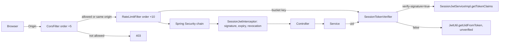

# Session token and CORS security (technical guide)

## Key and signing (checked)

The `session-token` is issued by this service (`AuthServiceImpl.token` -> `SessionJwtServiceImpl.generateSessionToken`, HS256, key = Base64 `APP_TOKEN_SECRET`) and validated by the library interceptor through the same `SessionJwtServiceImpl` bean. The directory therefore already holds the key, so `SessionTokenVerifier` verifies with `SessionJwtService.getTokenClaims` and the default is `verify-signature=true`. The token passed to `AuthServiceImpl.token(AuthRequest, sessionTokenBkd)` is the Backbone token (not signed with this key) and keeps using `JwtUtil.getUidFromToken`; that is why `JwtUtil` is untouched. If a deployment ever receives session tokens signed by another key, set `umdc.security.jwt.verify-signature=false` (legacy unverified read, all authorisation then depends on the interceptor) and plan a pluggable verifier; this is not the current case.

## S6 SessionJwtServiceImpl

- Caller parameters are copied first (null names/values and the reserved claims `jti`, `type`, `iat`, `exp`, `nbf`, `sub`, `iss`, `aud` are skipped); `jti`, `type` and `iat` are then set by the service, `subject`, `issuedAt` and `expiration` by the builder.
- Constructor `SessionJwtServiceImpl(JwtConfigProperties, int minKeyBytes)` (`umdc.security.jwt.min-key-bytes`, default 32). A non-Base64 secret or fewer decoded bytes throws `IllegalStateException` naming the property. The one-argument constructor uses 32.

## S3 SessionTokenVerifier

`uid(token)` returns the `uid` claim, `bucketKey(token)` the `uid` else `sub` (rate limit only), both `null` when the token is blank, malformed, unsigned, forged or expired (callers already map a null uid to 401). With verification off, `uid` delegates to `JwtUtil.getUidFromToken` and `bucketKey` returns null (the filter then uses its legacy payload read). `SessionTokenVerifier.unverified()` is the legacy instance used by the old constructors so existing tests and callers keep working.

Call sites switched (authorisation decisions): `FavoriteServiceImpl` (4), `FavoriteListServiceImpl` (7), `SavedSearchServiceImpl` (7), `BusinessEventServiceImpl` (2, owner clicks), and `RateLimitFilter` (user bucket, wired in `RateLimitConfig` through `withVerifier`). Not switched, follow-up once the verified path has run in QA: the owner checks in `BusinessServiceImpl` (owned by F4-B), `ProductServiceImpl`, `CampaignServiceImpl`, `BusinessStatsServiceImpl`, `BusinessProfileImageServiceImpl`, `OpeningHoursServiceImpl`, `LocationServiceImpl`, `GeocodeServiceImpl`, `BusinessProfileImageController`, `AuthServiceImpl`. They sit behind the same interceptor, which already verifies signature, expiry and revocation. The change per class is to inject `SessionTokenVerifier` and call `uid(token)`.

Click events stay anonymous-friendly: an invalid token is treated as no token (the click is counted).

## S7 CorsConfig

`CorsFilter` registered at `HIGHEST_PRECEDENCE + 5` for `umdc.api.endpoint/**`. Empty origins: a cross-origin request gets `403` (Spring `CorsFilter`), same-origin and requests without `Origin` pass. Exposed headers: `message`, `message-error`, `Retry-After`, `X-RateLimit-Limit`. Credentials disabled. `*` in the origins throws at startup. The 429 answers of the rate limiter carry the CORS headers because the filter runs first.

Environment variable per environment: `UMDC_CORS_ALLOWED_ORIGINS` (config server/Vault or deployment env). `bootstrap.yml` is not edited by this change; the properties have in-code defaults.

## Tests

`SessionJwtServiceImplTest` (reserved claims, nulls, short key, configurable minimum, non-Base64), `SessionTokenVerifierTest` (valid, no uid, bad uid, forged, unsigned, expired, garbage, legacy mode, no service), `VerifiedTokenServicesTest` (401 on a forged token in favorites, lists, saved searches; owner click), `RateLimitFilterTest` (verified and legacy bucket), `CorsConfigTest` (empty, listed, preflight, configurable, wildcard, outside the API path).
