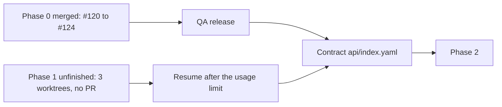
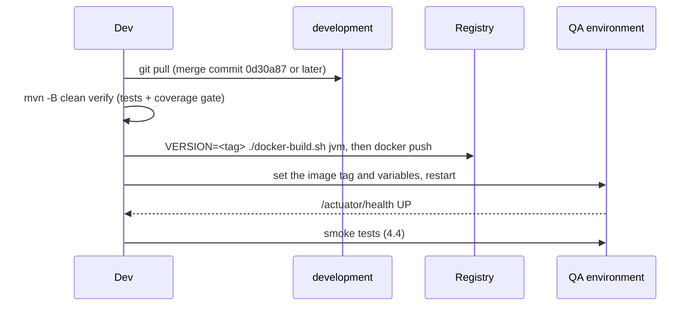

# Pending work after Phase 0 and QA release runbook (technical guide)

Date: 2026-11-23. Source: the reports of the Phase 0 flows (PR #121 to #124), the analysis in [`mvp-product-analysis.md`](mvp-product-analysis.md) (PR #120) and the state of the Phase 1 work. This document changes no code.

## 1. State

| Item | State |
| --- | --- |
| #120 analysis docs | merged |
| #123 platform (Swagger closed, rate limit, Flyway off, coverage) | merged |
| #122 business and image owner checks | merged |
| #121 product and campaign owner checks | merged |
| #124 favourites | merged |
| Phase 1 A (`nearby`, `map`), B (opening hours), C (geocoding, pin validation) | **not finished**: the agents stopped on a usage limit; uncommitted files remain in `.claude/worktrees/agent-a3131106fd8c5af8c`, `agent-afbddaf091e5dc337`, `agent-a1bc1315b731a88e4`; no PR, no tests run, no coverage |
| `api/index.yaml` | **not updated** for any change |

CI note: the check "Build and analyze (25)" (SonarQube) fails on `development` itself ("The scanner bootstrapping has failed") and on every PR, including the docs-only one. It is not caused by these changes; it needs its own fix (Sonar token, host or network of the runner).

## 2. Pending items

### 2.1 Security and correctness (from Phase 0)

| # | Item | Why it matters |
| --- | --- | --- |
| S1 | `PATCH /businesses/{id}` lets the owner reassign the business to another user through `request.id()` | an owner can hand a business to any user id; decide whether to forbid it |
| S2 | `POST /products` has no business id in the body; the check is "owns at least one business" | a user with several businesses can create a product with no link to a specific one; alternative: add `businessId` to the payload |
| S3 | `JwtUtil.getUidFromToken` decodes the payload without verifying the signature | all authorisation depends on the security interceptor running first; the rate limiter also reads the unverified `uid` to pick a bucket |
| S4 | Not confirmed: does the interceptor of `security-oauth` (outside this repo) compare `userId` with the token, and what exposes `AuthServiceImpl.token(AuthRequest)` | it signs a JWT from an alias only (`AuthServiceImpl.java:59-68`) |
| S5 | Rate limit buckets are per instance | with N replicas the effective quota is N times higher; add a Redis `RateLimitStore` |
| S6 | `SessionJwtServiceImpl`: `claims.putAll(parameters)` runs after `jti` and `type` | parameters can overwrite them; reverse the order. HMAC key from `APP_TOKEN_SECRET` has no minimum length check |
| S7 | CORS lives in the config server, not in the repo | needs an explicit allow-list per environment |
| S8 | Business moderation and ownership verification (PENDING/APPROVED/REJECTED, code through Mercury) | anyone can register a business at any address |

### 2.2 Data and migrations

| # | Item |
| --- | --- |
| D1 | Favourites unique indexes and `CHECK num_nonnulls` are **proposed, not applied** (script in `f0-favorites.md`). The code already turns a unique violation into 409, but without the index a race can still create duplicates. Needs a migration number (V6 to V8 are reserved: hours, saved search, geo index; use V9) and a clean-up of existing duplicates first |
| D2 | Flyway is off (`SPRING_FLYWAY_ENABLED=false`). Decide when to turn it on per environment (section 4) |
| D3 | `V6` opening hours, `V7` `saved_search` / `favorite_list`, `V8` geo index are reserved and not yet written (Phase 1 and 2) |
| D4 | Coordinates: only the range is checked in the database; the Canada box and the (0,0) rejection belong to Phase 1 C |

### 2.3 Contract and documentation

| # | Item |
| --- | --- |
| C1 | `src/main/resources/api/index.yaml` needs: header `session-token` and 401/403/404 on business, image, product and campaign writes; `POST /campaigns` unknown business is now 404 (was 400); favourites `sort` (`created_at`, `name`, `,asc`/`,desc`), new 400 for invalid `type`, `sort` or `size < 1`, `size` capped at 100; `POST /favorites` reactivation answers 201 |
| C2 | Existing defects of the contract: fixed UUID paths (`/businesses/1a24da99-...`, `/campaigns/64d0648d-...`, `/favorites/016870b0-...`), empty `responses: {}`, `GET /products/business/{id}` missing, `GET /favorites` declared with a `requestBody` |
| C3 | Stale documents: `issues/created/TASK-002` (update exists, as PATCH), `TEST_COVERAGE_SUMMARY.md` and `ISSUE-business-patch-contacttype-transient.md` (`com/prx` paths) |

### 2.4 Quality and build

| # | Item |
| --- | --- |
| Q1 | SonarQube workflow fails to bootstrap the scanner (see section 1) |
| Q2 | `mvn verify` prints `[ERROR] An error has occurred` from `springdoc-openapi:generate` ("Connection refused"); it does not fail the build and was not investigated |
| Q3 | The JaCoCo agent is now always on; an IDE or CI that injects its own agent could duplicate it |
| Q4 | Tests run on H2; no PostgreSQL-specific behaviour (partial indexes, CHECKs, migrations) is exercised. Add Testcontainers when Docker is available in CI |
| Q5 | Existing logs: `BusinessSearchServiceImpl` prints the search filters; sanitise before coordinates reach it |

### 2.5 Stubs still returning 501 or throwing

`ProfileImageService`, `BusinessProfileImageService` (parts), `DigitalContactService` (3 methods), `TimezoneApi` (2 methods), `EmailMessageProducerService` (Kafka), several methods of `UserService`.

## 3. What each phase still has to cover

| Phase | Work |
| --- | --- |
| Phase 1 (resume) | F1-A `GET /businesses/nearby` and `/map` with `V8` index; F1-B opening hours (`V6`, `PUT`/`GET`, status, evaluator); F1-C `POST /geocode`, pin validation. Then integrate `open_now` and `distance_m` into the search responses. Front and BFF: location picker (RF-04), consumer map (RF-06) |
| Contract | One agent documents Phase 0 and Phase 1 in `api/index.yaml` after the Phase 1 PRs are merged (C1, C2) |
| Phase 2 | RF-02 products (update, delete, price, image); RF-03 campaigns (type enum, statuses, delete, `GET /campaigns?business_id=`, expiry job); RF-08 saved searches and last search (`V7`); RF-10 click and save events (aggregated, no IP or user); favourite lists; Mercury campaign client and email templates; Redis cache for `map` and a Redis rate limit store; `pg_trgm` index for text search; i18n (ES, EN, fr-CA); business moderation and verification; PostGIS only if the p95 target is missed |

## 4. QA release runbook

### 4.1 Components affected

| Component | Affected by | Needs a release |
| --- | --- | --- |
| `directory-backend` (JVM image) | #121 to #124 | yes |
| PostgreSQL (`directory_site`) | none required by the merged code; optional D1 | no DDL required; verify V2 to V5 exist |
| Config Server / Vault | new properties with safe defaults | only if you override defaults |
| Ingress, gateway, reverse proxy | rate limit by client IP | check `X-Forwarded-For` handling |
| BFF and frontend (other repositories) | `session-token` now required; 401/403; favourites `sort`; product create semantics; image upload without `objectKey` | yes, in the same window |
| Backbone, Mercury, Kafka, Redis | not changed | no |

### 4.2 Before the deploy

1. Confirm V2 to V5 are applied in QA: `\d directory_site.user_favorite` shows `deleted_at`, `deleted_by`; `\d directory_site.business` shows `profile_image_ref`; tables `city`, `location` and `business_view_daily` exist. If not, apply the scripts of `src/main/resources/db/migration/` by hand, in order.
2. Keep `SPRING_FLYWAY_ENABLED=false` for this release. Turn it on in a later release, after a database backup (section 4.5).
3. Decide the QA values of the new properties (all have defaults):

| Variable | Default | QA recommendation |
| --- | --- | --- |
| `UMDC_DOCS_ENABLED` | `false` | `true` only if QA testers need Swagger; keep `false` otherwise |
| `UMDC_RATELIMIT_ENABLED` | `true` | `true` |
| `UMDC_RATELIMIT_IP_PER_MINUTE` | `120` | raise (for example 600) for load tests |
| `UMDC_RATELIMIT_USER_PER_MINUTE` | `300` | keep |
| `UMDC_RATELIMIT_TRUST_FORWARDED` | `false` | **`true` when the service runs behind a proxy or ingress**, otherwise every user shares the proxy IP bucket and the whole QA hits 429 together. Only enable it if the proxy overwrites `X-Forwarded-For` |

4. Tell the BFF and frontend owners: all write calls to businesses, products, campaigns and images must send `session-token`; the business owner comes from the token (a different body `userId` is 403); the client can no longer choose the image `objectKey`; `POST /products` needs an owned business.

### 4.3 Build and deploy `directory-backend`

1. `git checkout development && git pull --ff-only`.
2. `mvn -B clean verify` must end with BUILD SUCCESS (the coverage gate now enforces METHOD >= 85 %).
3. `VERSION=<release tag> ./docker-build.sh jvm` builds `lamata/directory-backend:<tag>` (needs `~/.m2/settings.xml` and, optionally, the internal CA). Use the JVM image: the native one is not verified.
4. Push the image to the registry that QA pulls from and update the tag in the QA deployment.
5. Apply the variables of 4.2 in the QA environment (Config Server, Vault or the deployment manifest). Never put secrets in the repository.
6. Roll out and wait for `GET /actuator/health` to answer `UP`.

### 4.4 Smoke tests in QA

| # | Call | Expected |
| --- | --- | --- |
| 1 | `GET /actuator/health` | 200 `UP` |
| 2 | `GET /v3/api-docs` with docs closed | 403 |
| 3 | `PATCH /api/v1/businesses/{id}` without `session-token` | 401 |
| 4 | same, with the token of another user | 403 |
| 5 | same, with the owner token | success, as before |
| 6 | `POST /api/v1/businesses` with a body `userId` different from the token | 403 |
| 7 | `POST /api/v1/products` and `POST /api/v1/campaigns` with a stranger token | 403; with the owner token, success |
| 8 | `POST /api/v1/campaigns` with an unknown business | 404 |
| 9 | `GET /api/v1/favorites?sort=created_at,desc` | 200 ordered; `sort=foo` is 400 |
| 10 | create, delete and create the same favourite again | 201, 204, then 201 (reactivation); an active duplicate is 409 |
| 11 | burst of more than the IP limit in one minute | 429 with `Retry-After` |
| 12 | `GET /api/v1/businesses/search?city_id=...` and the public campaign and product reads | unchanged |

If smoke test 11 fails for normal traffic, review `UMDC_RATELIMIT_TRUST_FORWARDED` first.

### 4.5 Rollback

- Image: redeploy the previous tag. No DDL was applied by this release, so there is nothing to undo in the database.
- If Flyway is enabled in a later release, take a backup first; the baseline at V5 marks V2 to V5 as applied without running them.
- BFF and frontend: deploy their previous versions together with the previous backend tag; the new backend rejects calls that miss `session-token`.

### 4.6 Per-PR deployment impact

| PR | Backend change | Needs BFF/front change | Needs config |
| --- | --- | --- | --- |
| #123 platform | Swagger closed, rate limit, Flyway (off), coverage gate | no | optional properties, proxy header |
| #122 business and image | owner from the token; `session-token` required; server-made `objectKey` | yes: send the header, stop sending `objectKey` | none |
| #121 product and campaign | owner checks; header required; 404 for unknown business on campaign create | yes: send the header | none |
| #124 favourites | `sort`, database paging, per-type update, reactivation, 409 on duplicates | optional: use `sort`; handle 201 on reactivation | none; D1 index is optional |
| #120 docs | none | no | none |

## 5. Verification of the merged state

`development` at the merge of #124 (`0d30a87`) was verified with `mvn -B clean verify`: 745 tests, 0 failures, BUILD SUCCESS, `jacoco-check` met, JaCoCo METHOD coverage 93.4 % (778 of 833), LINE 89.73 %. The branches had only been tested one by one before; this run covers the four of them together.
