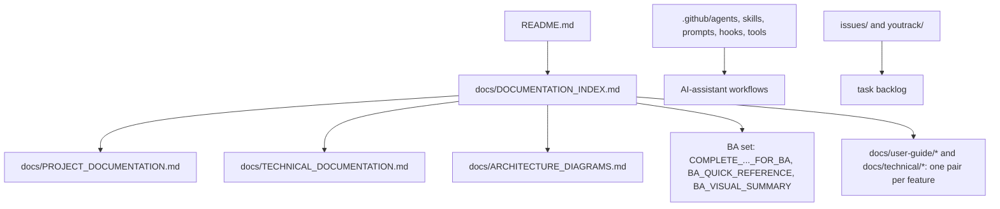

# Project documentation layout (technical guide)

Conventions: guides are Markdown, diagrams are Mermaid, the CHANGELOG is in English, and no secret, key or token is ever committed
(`default.env`, `config/local.env`, keystores and `.env` files stay out of the repository).
The `.github` agent files are prompts for AI assistants; they do not affect the build or the runtime.
