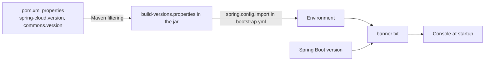

# Startup banner — technical guide

Same mechanism as `backbone-rest`.

## Pieces

| File | Role |
|------|------|
| `src/main/resources/banner.txt` | Spring Boot banner. Uses `${umdc.app.title}`, `${umdc.app.version}` (from `bootstrap.yml`), `${spring-boot.version}` (built in) and `${umdc.build.spring-cloud-version:n/a}` / `${umdc.build.umdc-libs-version:n/a}`. |
| `src/main/resources/build-versions.properties` | Holds `@spring-cloud.version@` and `@com.umdc.commons.version@`. Maven filters **only this file**. It carries no secrets; add nothing else to it. |
| `pom.xml` (`<resources>`) | The normal resource block excludes `build-versions.properties`; a second block includes only that file with `<filtering>true</filtering>`. |
| `bootstrap.yml` | `spring.config.import: "optional:classpath:build-versions.properties"` loads the filtered file into the environment. |
| `BannerVersionsTest` | Fails if the file is unfiltered (`@`), if the banner or `bootstrap.yml` lose their references, or if the banner renders with an unresolved `${...}` or `n/a`. |

## UMDC libraries version

`umdc.build.umdc-libs-version` prints `com.umdc.commons.version`. `commons-services` and `security-oauth` are versioned separately in the `pom.xml`; the banner shows the `commons` one, as backbone does.

## Verification

- `mvn -B clean verify`: 664 tests, 0 failures; method coverage 93.25 % (JaCoCo).
- A real Spring startup (`SpringApplicationBuilder`, `spring.config.name=bootstrap`, bootstrap context off, Vault and Config Server off) printed `Powered by Spring Boot 4.0.6 | Spring Cloud 2025.1.1 | UMDC libraries 0.0.1`, and the two properties resolved from the environment. That temporary test was not committed.
- Not verified: the deployed run with `spring.cloud.bootstrap.enabled=true` (the bootstrap context). If the properties were not visible there, the banner would show `n/a`, not fail.
