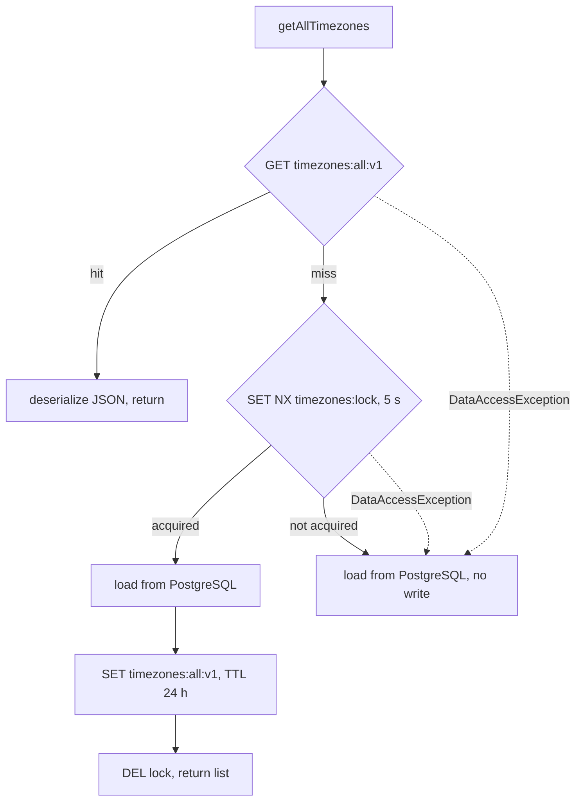

# Timezone list cache (technical guide)

`TimezoneServiceImpl.findAll()` delegates to `TimezoneCacheService.getAllTimezones()`, a read-through cache on Redis (`StringRedisTemplate`, JSON).

| Piece | Role |
| --- | --- |
| `TimezoneCacheService` | Interface: `getAllTimezones()`, `refreshTimezones()`, `invalidateTimezones()` |
| `TimezoneCacheServiceImpl` | Implementation. Lock avoids a stampede; a failed cache write is logged (`timezone.cache.write-error`) and ignored; a corrupt JSON value returns an empty list (`timezone.cache.deserialize-error`) |
| `DirectoryAppConstants` | `TIMEZONE_CACHE_KEY`, `TIMEZONE_CACHE_LOCK_KEY`, `TIMEZONE_CACHE_DEFAULT_TTL_SECONDS` (86 400), `TIMEZONE_CACHE_LOCK_TTL_MS` |
| `TimezoneServiceImpl` | Gets the cache service by constructor injection. `getTimezonesPageable` still uses the repository |

Redis connection comes from Spring Boot auto-configuration (`spring-boot-starter-data-redis`). The TTL is a constant, not a property.
Any `DataAccessException` while reading (Redis down, timeout) degrades to a direct database read, so Redis is not a hard dependency of the endpoint.

Tests: `TimezoneCacheServiceImplTest` (hit, miss with and without lock, Redis down, bad JSON, refresh, invalidate), `TimezoneServiceImplTest`.
