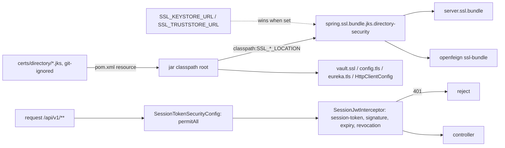

# TLS bundle and session-token security (technical guide)

| Piece | Role |
| --- | --- |
| `pom.xml` `<resource>certs/directory</resource>` | Copies only `*.jks` to the classpath root (the PEM key and certificates stay out of the jar); a missing folder is skipped by Maven |
| `bootstrap.yml` `${SSL_*_URL:classpath:${SSL_*_LOCATION}}` | One expression for the bundle, Vault, Config Server, Eureka and `umdc.security.truststore.location` |
| `HttpClientConfig` | Inter-service `RestTemplate`; loads the truststore through `DefaultResourceLoader` (accepts `classpath:`, `file:` or a bare name) |
| `DirectoryBackendApplication` | `@ComponentScan` excludes `com.umdc.security.config.SecurityConfig` (Keycloak-style resource server) |
| `SessionTokenSecurityConfig` | Stateless chain: `umdc.api.endpoint/**`, health probes and Swagger `permitAll`; `anyRequest().denyAll()`. The interceptor covers the same property, so the two cannot drift |
| `spring.autoconfigure.exclude` | `OAuth2ResourceServerAutoConfiguration` and its web variant |
| `Dockerfile` / `docker-entrypoint.sh` (JVM) and `Dockerfile.native` / `docker-entrypoint.native.sh` (native, see [docker-images](docker-images.md)) | Layered image; CA imported into `cacerts` from the optional BuildKit secret `prx_internal_ca`; `HEALTHCHECK` on `/actuator/health/liveness` (port 8197) |
| `config/local.env`, `secrets/local.env.example` | Non-secret names (versioned) vs passwords and `VAULT_TOKEN` (git-ignored) |

Tests: `SessionTokenSecurityConfigTest` (API open to the chain, probes and docs open, everything else `403`), `SslLocationPropertiesTest` (classpath default, URL override, `umdc.api.endpoint`). Not covered by automated tests: a real TLS handshake and the interceptor with live Backbone tokens.
