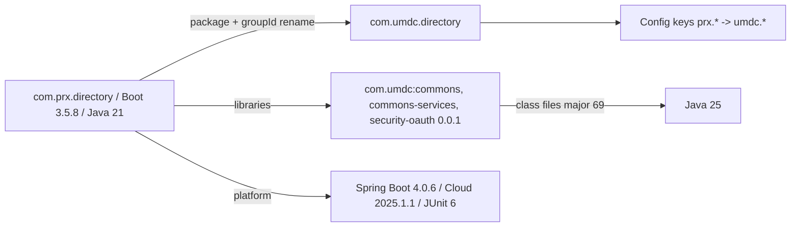

# `com.umdc` migration (technical guide)

| Area | Change |
| --- | --- |
| Packages | `com.prx.directory` → `com.umdc.directory` in `src/main` and `src/test`; `pom.xml` `groupId` `com.umdc`; benchmark main class `com.umdc.directory.benchmark.BenchmarkRunner` |
| Libraries | `com.umdc:commons` (was `prx-commons`), `commons-services`, `security-oauth`; imports `com.umdc.commons.*`, `com.umdc.security.*` |
| Java | 25. Required because `security-oauth` is compiled for class-file version 69. Dockerfile and workflows updated |
| Spring Boot 4 | `RestTemplateBuilder` is `org.springframework.boot.restclient`; `DataRedisProperties` is `org.springframework.boot.data.redis.autoconfigure`; `@EntityScan` removed from `DataSourceSslConfig` |
| Redis | `config/RedisConfig` builds a `LettuceConnectionFactory` (URL or host mode, SSL, 10 s default timeouts, lazy init, connection validation). The timezone cache ([docs](timezone-redis-cache.md)) keeps its DB fallback if Redis is down |
| Feign | `BackendFeignConfigurer(SslBundles, ClientProperties)` fetches tokens through `RestTemplateBuilder().sslBundle(directory-security)` |
| Config | `bootstrap.yml` top-level `prx:` → `umdc:`; `@Value` keys updated (`UserServiceImpl`, `DataSourceSslConfig`, `HttpClientConfig`, `BackendFeignConfigurer`, `MercuryTokens`) |
| Tests | `application-test.yml` / `bootstrap-test.yml` use `umdc:`; `MockitoExtension` replaces `SpringExtension` + `openMocks`; `RedisConfigTest` added |

Not touched: certificates and keystores under `src/main/resources` (`*.crt`, `*.jks`) and the Flyway scripts.
