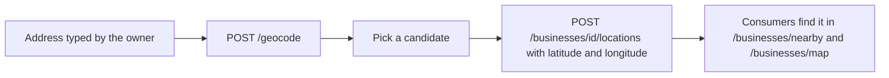

# API contract for Phase 0 and Phase 1: user guide

The file `src/main/resources/api/index.yaml` is the OpenAPI contract of the directory backend. Import it in Postman or any OpenAPI viewer to see every route.

## What you need to know as an API client

| Topic | Rule |
|---|---|
| Authentication | Send the `session-token` header on every write. Without a valid token the answer is `401`. Reads marked public do not need it. |
| Ownership | Creating or changing businesses, products, campaigns, locations and opening hours needs the token user to own the business: `403` otherwise, `404` when it does not exist. |
| Too many requests | `429` with `Retry-After` (seconds to wait) and `X-RateLimit-Limit`. Wait and retry. |
| Error reason | Many `400` answers explain the cause in the `message-error` response header. |
| Swagger UI | Only available in development and test environments. |

## New in Phase 1

- Find businesses near a point: `GET /api/v1/businesses/nearby?lat=43.65&lng=-79.38&radius_m=3000`. No login needed.
- Businesses for a map: `GET /api/v1/businesses/map?bbox=minLng,minLat,maxLng,maxLat&zoom=12`. Returns GeoJSON; zoom below 14 returns clusters.
- Opening hours of a location: `GET`, `PUT` (owner) on `/api/v1/businesses/{businessId}/locations/{locationId}/hours`, and "open now" on `.../hours/status`.
- Address to coordinates: `POST /api/v1/geocode` with `{"address": "...", "city": "...", "country": "ca"}`. Needs login.

## Favourites

`GET /api/v1/favorites` takes `type`, `page` (starts at 0), `size` (1 to 100) and `sort` (`created_at` or `name`, with `,asc` or `,desc`). Adding a favourite you had removed brings it back (`201`); adding one that is already active is `409`.

## Note

The Phase 1 routes are in the contract before their pull requests are merged; they answer only after those are released.
