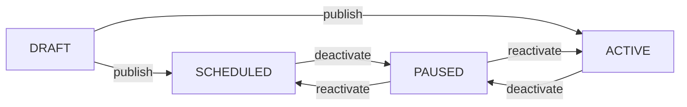

# API contract, Phase 2 (user guide)

`src/main/resources/api/index.yaml` describes every endpoint of the directory API. This update adds Phase 2: products, campaigns, saved searches and click events. Everything is under `/api/v1`. Write calls need the `session-token` header.

## What you can do

| Area | Calls |
| --- | --- |
| Products | Edit (`PATCH`, `PUT`), deactivate (`DELETE`), price, currency and image; owners can list inactive products with `include_inactive=true` |
| Campaigns | Type (`PROMOTION`, `EVENT`, `ANNOUNCEMENT`), status (`DRAFT`, `SCHEDULED`, `ACTIVE`, `PAUSED`, `EXPIRED`), `deactivate`, `reactivate`, `publish`, filters `status` and `type` |
| Saved searches | Save, list, rename, delete and replay searches; store and read the last search (`/users/me/...`) |
| Click events | Count a click (route, call, web, save) and read the owner summary |

## Things to know
- Errors: when an endpoint explains a `400` or `409`, the reason is in the `message-error` response header.
- Campaign lists are public. If you send a `session-token`, you also see your own drafts and hidden campaigns.
- A product that is deactivated disappears from the public list but can be reactivated with `PATCH` and `active=true`.
- The example password in `/auth/session-token` and `/auth/token` is now the placeholder `<password>`.
- Every operation can answer `429` when the rate limit is exceeded.
