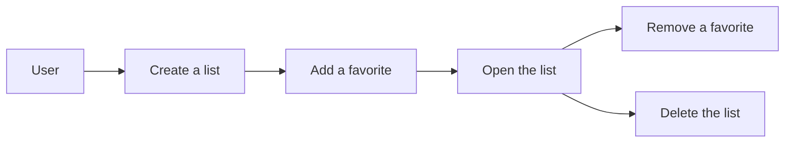

# API contract, Phase 3 (user guide)

`src/main/resources/api/index.yaml` now also describes the Phase 3 features. Everything is under `/api/v1`.

## What is new

| Area | Calls |
| --- | --- |
| Favorite lists | Create, list, open, rename and delete your own lists; add and remove favorites (stores or products) in them. Needs `session-token` |
| Search | `GET /businesses/search` accepts `open_now=true`, `lat` and `lng`, and `sort=distance`. Each result shows `open_now` and `distance_m` |
| Quotas | `POST /geocode`, `GET /businesses/map` and `GET /businesses/nearby` have their own per-minute limit |

## Things to know
- You can have at most 20 lists; names are unique per user, ignoring case (`409` otherwise). A list of another user answers `404`.
- Deleting a list keeps your favorites. Only active store or product favorites can be added.
- Search stays public: no `session-token` is needed. `open_now` is empty when a business has no opening hours; `distance_m` is empty when you did not send `lat` and `lng`. `sort=distance` needs both.
- Old search clients keep working: the new fields are extra.
- Quotas per minute and user (or IP): geocode 10, map 60, nearby 60. Over the limit you get `429` and must wait `Retry-After` seconds.
- When an endpoint explains a `400` or `409`, the reason is in the `message-error` header.
