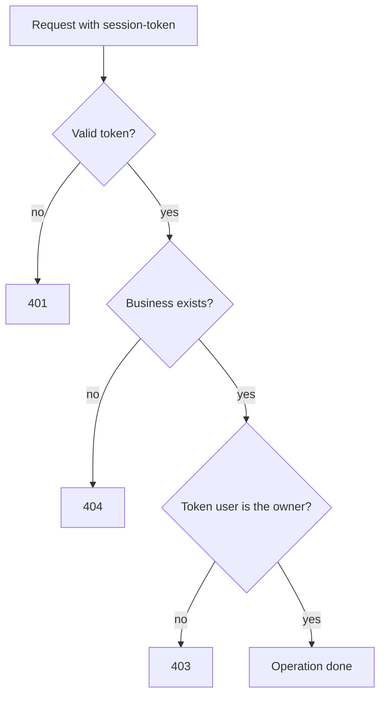

# Business and image owner checks (user guide)

Only the owner of a business can edit it or change its profile image. The owner is always the user of the session token you send in the `session-token` header.

## What you can do

| Action | Endpoint | Who can do it |
| --- | --- | --- |
| Create a business | `POST /api/v1/businesses` | Any signed-in user; the business is created for you |
| Edit a business | `PATCH /api/v1/businesses/{id}` | The owner only |
| Delete a business | `DELETE /api/v1/businesses/{id}` | The owner only |
| Upload the profile image | `POST /api/v1/businesses/images/{businessId}` | The owner only |
| Upload a generic image | `POST /api/v1/businesses/images` | Any signed-in user |

## Responses

| Code | Meaning |
| --- | --- |
| 401 | The `session-token` header is missing or invalid |
| 403 | You are not the owner (or the `userId` in the body is not you) |
| 404 | The business does not exist |

## Notes

- When creating a business you can omit `userId`; if you send it, it must be your own id, otherwise you get `403`.
- You cannot choose where an image is stored. Any `objectKey` you send is ignored; the server returns the generated key and the public URL in the response.

