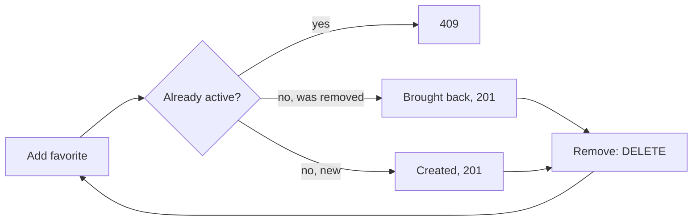

# Favorites: user guide

A signed-in user can save stores, products and offers as favorites. All calls need the `session-token` header.

## List favorites

`GET /api/v1/favorites?type=stores|products|offers&page=0&size=10&sort=created_at,desc`

| Parameter | Meaning |
| --- | --- |
| `type` | Optional. `stores`, `products` or `offers`. Anything else answers `400`. |
| `page` | Page number, **starting at 0**. A negative number is treated as 0. |
| `size` | Items per page, 1 to 100 (larger values are reduced to 100). `0` or less answers `400`. |
| `sort` | Optional. `created_at` or `name`, followed by `,asc` or `,desc`. Without a direction it is ascending. Default: `created_at,desc`. Any other value answers `400`. |

Without `type`, the page is taken over all favorites in this order: stores, then products, then offers. Inside each group the `sort` applies. `name` uses the name of the store or product and the title of the offer.

## Add a favorite

`POST /api/v1/favorites` with `{"type": "STORE|PRODUCT|OFFER", "itemId": "<uuid>"}`.

- `201`: created. If you had removed the same favorite before, it is **brought back** (also `201`).
- `404`: the store, product or offer does not exist.
- `409`: it is already one of your active favorites.

## Change or remove

- `PUT /api/v1/favorites/{id}` with `{"id": "<target uuid>", "active": true|false}`. The target must be of the same kind as the favorite (a store favorite is pointed at another store, and so on). `404` if the target does not exist, `403` if the favorite is not yours, `409` if you already have that target as an active favorite. `active=true` brings back a removed favorite.
- `DELETE /api/v1/favorites/{id}` removes it (soft delete). `204` on success.

