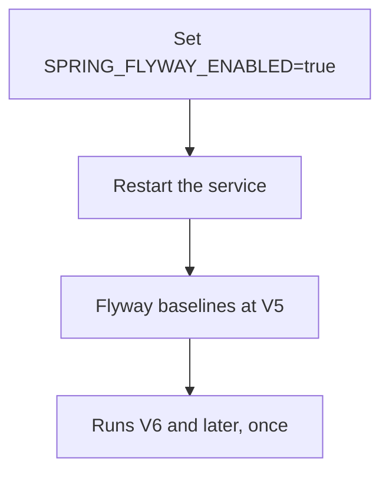

# Phase 0 platform changes: operator guide

For whoever deploys or operates the directory backend. Technical detail: `docs/technical/f0-platform.md`.

## API documentation (Swagger) is closed in production

Swagger UI and the OpenAPI JSON answer `403` unless the documentation is enabled. It is open by default only in the `dev` profile and in tests. To open it in another environment (for example QA) set:

```
UMDC_DOCS_ENABLED=true
```

Leave it unset in production.

## Rate limiting

The API (`/api/v1/**`) limits requests per client IP (120 per minute) and per logged-in user (300 per minute). When a client goes over, it receives `429 Too Many Requests` with a `Retry-After` header (seconds to wait). `/actuator/health` is never limited.

| Environment variable | Meaning | Default |
|---|---|---|
| `UMDC_RATELIMIT_ENABLED` | turn the limit on or off | `true` |
| `UMDC_RATELIMIT_IP_PER_MINUTE` | requests per minute per IP | `120` |
| `UMDC_RATELIMIT_USER_PER_MINUTE` | requests per minute per user | `300` |
| `UMDC_RATELIMIT_TRUST_FORWARDED` | take the client IP from `X-Forwarded-For` (only behind your own proxy) | `false` |

Behind a reverse proxy or load balancer, set `UMDC_RATELIMIT_TRUST_FORWARDED=true`; otherwise every client looks like the proxy's IP and shares one quota.

## Database migrations with Flyway (optional)

Flyway is installed but OFF. The scripts `V2` to `V5` were applied by hand, so enabling it is safe: it marks the database as already at version 5 and only runs newer scripts.



Rules for new scripts: never edit or rename an existing `V*.sql`; use the next number. `V6` (business hours of locations) and `V7` (saved searches and favourite lists) are reserved for Phase 1.

## Build and coverage

`mvn clean verify` now really measures coverage (report in `target/site/jacoco`) and fails the build if method coverage is below 85 %, line coverage below 80 % or branch coverage of a package below 50 %.
