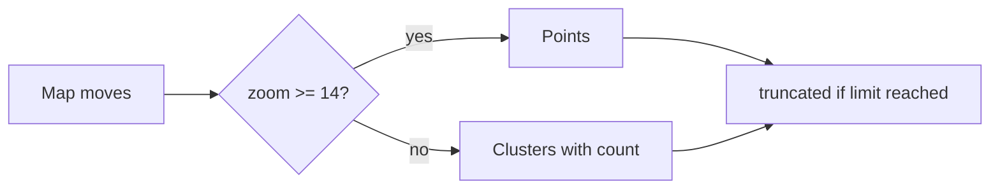

# Geographic search: nearby and map (user guide)

Two public endpoints (no token) to find businesses by place.

## Businesses near a point

`GET /api/v1/businesses/nearby?lat=43.6532&lng=-79.3832`

| Parameter | Meaning |
|---|---|
| `lat`, `lng` | Required. Latitude (-90 to 90) and longitude (-180 to 180). |
| `radius_m` | Radius in metres. Default 5000, maximum 50000. |
| `category_id` | A category; its sub-categories are included. |
| `city_id` | Only locations of this city. |
| `q` | Text in the business name or description (up to 100 characters). |
| `sort` | `distance` (default) or `name`. |
| `page`, `per_page` | Page (starts at 1) and size (default 10, maximum 100). |

Each result is one location (sede) with its business and `distance_m` in metres. The closest comes first; equal distances keep a fixed order.

## Businesses of a map area

`GET /api/v1/businesses/map?bbox=-79.5,43.6,-79.3,43.7&zoom=15`

| Parameter | Meaning |
|---|---|
| `bbox` | Required. `minLng,minLat,maxLng,maxLat`. Minimum values must be lower than the maximum ones, and at most 90 degrees per axis. |
| `zoom` | 0 to 22. Default 14. |
| `category_id`, `city_id`, `q` | Same filters as above. |
| `limit` | Maximum features. Default 200, maximum 500. |

The answer is a GeoJSON `FeatureCollection`. With zoom 14 or more each feature is a business location (`business_id`, `location_id`, `name`, `category_id`, `verified`, `main`). With a lower zoom the features are clusters with a `count`. If `truncated` is `true`, more results exist: zoom in or narrow the filters.

## Errors

A wrong parameter answers `400` and the reason is in the `message-error` header (for example `bbox is inverted`). Only businesses whose location has coordinates appear.

