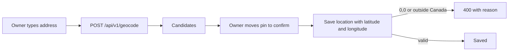

# Address search and pin validation (F1-C)

## What it does

When a business owner types the address of a location, the application can ask the server for **coordinate candidates**. The owner then confirms the right one by moving the pin on the map before saving the location. The server never saves the candidates.

The pin that is saved (through the existing locations API) is now checked too: a point at (0, 0) or outside Canada is rejected with `400` and a clear reason.

## Look up an address

`POST /api/v1/geocode` with the `session-token` header and a body:

```json
{ "address": "100 Queen St W", "city": "Toronto", "country": "ca" }
```

- `address` is required (1 to 200 characters). `city` and `country` are optional; `country` is a two-letter code and defaults to `ca`.
- The answer has up to 5 candidates, best first:

```json
{ "candidates": [ { "label": "100 Queen St W, Toronto", "latitude": 43.6526, "longitude": -79.3841, "confidence": 0.93 } ] }
```

An empty list means nothing was found: let the owner place the pin by hand.

## Answers

| Status | Meaning |
| --- | --- |
| 200 | Candidates (maybe none) |
| 400 | Empty or too long address, invalid country code |
| 401 | No valid `session-token` |
| 502 | The geocoding provider failed |
| 503 | Geocoding is switched off in this environment |
| 504 | The provider did not answer in time |

The reason of every error is in the `message-error` response header.

## Saving a pin

When a location is created or updated with `latitude` and `longitude`:

- Both must be sent together.
- (0, 0) is rejected.
- Outside Canada (latitude 41.6 to 83.2, longitude -141.1 to -52.5) is rejected, unless the environment turns the check off.


