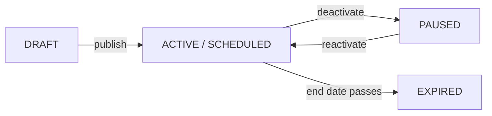

# Campaigns: types, status and visibility (user guide)

## What changed
Each campaign now has a **type** and a **status**, and the owner can pause, resume and publish campaigns.

| Type | Use |
|---|---|
| `PROMOTION` | Discount or offer (default) |
| `EVENT` | Something that happens on a date |
| `ANNOUNCEMENT` | News for customers |

| Status | Meaning |
|---|---|
| `DRAFT` | Saved but not published; only you see it |
| `SCHEDULED` | Published, starts in the future |
| `ACTIVE` | Running now |
| `PAUSED` | You deactivated it |
| `EXPIRED` | The end date has passed (final) |

The status is worked out from the dates and the active flag, you do not set it (except `DRAFT` when creating).

## Who sees what
- Customers (and anyone without a session) see only `SCHEDULED` and `ACTIVE` campaigns.
- You, as the owner of the business, also see your `DRAFT`, `PAUSED` and `EXPIRED` campaigns. Send your `session-token` when listing.

## What you can do
1. **Create** a campaign with `type` (optional) and, to keep it private, `status: DRAFT`.
2. **List** your campaigns: `GET /api/v1/campaigns?business_id=<id>` with your `session-token`; filter with `status=PAUSED` or `type=EVENT`.
3. **Pause**: `POST /api/v1/campaigns/{id}/deactivate`. Only running or scheduled campaigns can be paused.
4. **Resume**: `POST /api/v1/campaigns/{id}/reactivate`. Only paused campaigns.
5. **Publish a draft**: `POST /api/v1/campaigns/{id}/publish`.
6. **Edit** with `PATCH /api/v1/campaigns/{id}` as before (you can also change `type`).

## Errors you may see
| Code | Why |
|---|---|
| 400 | Unknown `type` or `status` |
| 401 | Missing or invalid session on owner actions |
| 403 | The business is not yours |
| 404 | Campaign not found, or hidden from you |
| 409 | The action is not allowed in the current status (for example reactivating an expired campaign), or someone else edited it first |

To run a finished campaign again, create a new one.
